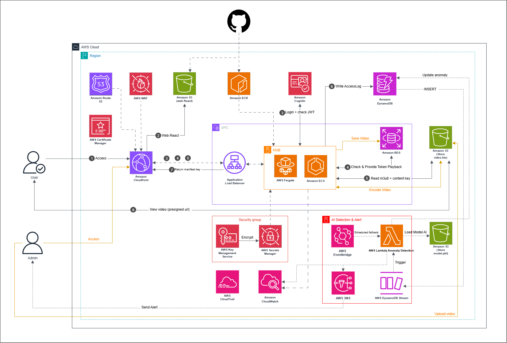

# SecureLearn: Digital Content Protection System for Educational Platforms — AWS Well-Architected Standards
## Digital Content Protection System for Educational Platforms — AWS Well-Architected Standards

### 1. Executive Summary
SecureLearn is a low-cost video content protection solution for small and medium-sized training centers (SMEs) that runs entirely on AWS.
* A Spring Boot backend on Amazon ECS Fargate handles authentication (Amazon Cognito), authorization, video processing and business logic.
* The ReactJS frontend is delivered through Amazon S3 + Amazon CloudFront and protected by AWS WAF.
* Videos are converted to HLS and encrypted with AES-128 by MediaConvert. Viewing rights are controlled by JWTs and short-lived playback tokens, and each segment can only be downloaded through a 60-second presigned URL.
* The system combines behavioral AI (Isolation Forest on AWS Lambda) with dynamic watermarking to protect intellectual property.

### 2. Problem Statement
### What’s the Problem?
In the era of digital education, small and medium-sized training centers (SMEs) and e-learning platforms face serious intellectual-property loss as lecture videos are downloaded, screen-recorded and redistributed without permission on social networks. Large-scale commercial DRM solutions (such as Google Widevine and Microsoft PlayReady) carry very high licensing costs and integration complexity, beyond the budget of most SMEs.

### The Solution
SecureLearn uses a serverless container architecture on AWS:
* **Video processing:** The Spring Boot backend on Amazon ECS Fargate generates an AES-128 key unique to the lesson and creates an AWS Elemental MediaConvert job. MediaConvert converts the video to HLS and encrypts every segment with AES-128 using the lesson's key, writing the output to S3.
* **Data:** course data lives in Amazon RDS for PostgreSQL, access logs in Amazon DynamoDB, and videos in private Amazon S3.
* **Delivery:** Amazon CloudFront, AWS WAF and an Application Load Balancer deliver the frontend and API securely.
* **Core features:** JWT authentication through Amazon Cognito, short-lived HMAC playback tokens, AI anomaly detection with Isolation Forest on Lambda and EventBridge, dynamic watermarking and automatic alerts through Amazon SNS.

**Comparative Table of Current Issues, Business Impacts, and AWS Solutions:**
| Current Issue | Business Impact | SecureLearn Solution (AWS / Cloudflare) |
| --- | --- | --- |
| Videos downloaded & illegally shared | Revenue loss, leakage of exclusive lecture IP | AES-128 encrypted HLS produced by MediaConvert; the decryption key is only returned to holders of a valid playback token; segments are only downloadable through 60-second S3 presigned URLs|
| Lack of proactive monitoring | Failure to detect account sharing or video crawling in real-time | Every playback request is logged to DynamoDB (IP, device fingerprint); an Isolation Forest Lambda scans logs every 5 minutes and alerts through SNS |
| Inability to trace leaks | Unable to identify culprits when videos are screen-recorded | A dynamic watermark shows the learner ID and time, moving continuously over the video player |
| High commercial DRM costs | SMEs cannot afford infrastructure upkeep | AWS managed services (ECS Fargate, RDS, S3, CloudFront), no server administration, no DRM licensing fees; AWS Free Tier credits cover the early phase |

### Benefits and Return on Investment
The solution needs no physical or virtual server administration and no commercial DRM licensing. It protects exclusive content, prevents unauthorized account sharing, monitors anomalies automatically and supports leak tracing. Estimated infrastructure cost is about $165 USD/month running 24/7 (about $60–75 USD/month when only running during working hours).

### 3. Solution Architecture
The system runs entirely on AWS, with no traditional server administration, and is organized into 4 functional layers:
1. **Media Pipeline (Upload & Processing):** Instructors request a presigned URL from the backend and upload the raw video straight to Amazon S3 (SSE-KMS encryption at rest).
The Spring Boot backend on ECS Fargate downloads the raw video and uses MediaConvert to transcode it to HLS (6-second segments, H.264/AAC), encrypting it with AES-128 using a per-lesson key.
The backend stores segment_XXX.ts, content.key and master.m3u8 in S3, writes the lesson to RDS PostgreSQL and deletes the raw video.
2. **Delivery & Access Control:** Learners sign in through Amazon Cognito and receive a JWT.
The backend validates the JWT, issues an HMAC-SHA256 playback token (2-hour lifetime) and rewrites the manifest so both the key and the segments must go through the backend.
The AES-128 key is only returned to the token holder. Each segment is redirected (302) to a 60-second S3 presigned URL.
The ReactJS frontend is served from S3 through CloudFront; /api/* goes through CloudFront → ALB → ECS.
3. **Security & Key Management:** AWS WAF filters requests at CloudFront: managed rules, rate limiting and an IP allow-list for admin APIs.
AWS KMS and AWS Secrets Manager protect the database password, the Cognito client secret and the token-signing key.
The backend uses an IAM role instead of access keys. Security groups only allow the CloudFront → ALB → ECS → RDS chain.
AWS CloudTrail records audit logs.
4. **AI & Tracing:** Offline training using Isolation Forest in Jupyter Notebooks (`.pkl` model stored in R2); AWS Lambda (triggered by EventBridge every 5 mins) reads access logs from DynamoDB/CloudWatch, runs anomaly inference, and publishes alerts via Amazon SNS; JavaScript-based dynamic watermarks display moving user IDs.

**Data Flow Diagrams:**
- Upload flow: Instructor → CloudFront → ALB → ECS (request presigned URL) → Browser PUTs the video to S3 videos/ → ECS ( create key + job)→ MediaConvert → S3 hls/ + RDS → Learner.
- Playback flow: Learner → Cognito JWT → CloudFront → ALB → ECS (validate JWT, issue playback token, write AccessLog to DynamoDB) → Manifest + AES-128 key → Segments downloaded from S3 via 60-second presigned URLs → HLS Player → Dynamic Watermark. 
- AI branch: DynamoDB AccessLog → EventBridge Scheduler (every 5 minutes) → Lambda Anomaly Detection → Isolation Forest → If an anomaly is detected → SNS → Admin email.

- General diagram:

### AWS Services Used
- **AWS Lambda:** Handle upload handling, license verification, JWT authorization, and AI anomaly detection logic.
- **Amazon DynamoDB:** On-demand NoSQL storage for sessions, DRM logs, and metadata.
- **Amazon CloudWatch & AWS CloudTrail:** Centralize audit trails and application logs.
- **AWS KMS & AWS Secrets Manager:** Secure cryptographic keys and API tokens.
- **Amazon SNS:** Broadcasts automated email alerts to administrators upon detecting anomalies.
- **AWS EventBridge:** Triggers the AI anomaly detection Lambda function every 5 minutes.
- **Amazon ECS Fargate, Amazon ECR & Application Load Balancer:** Run the Spring Boot backend (API, authentication, playback tokens, MeiaConvert transcoding) as a container without server administration.
- **Amazon RDS for PostgreSQL:** Stores course, chapter and lesson data.
- **Amazon S3:** Stores raw videos, encrypted HLS, the static frontend and the AI model.
- **Amazon CloudFront, AWS WAF, Amazon Route 53 & AWS Certificate Manager:** Deliver the frontend/API over HTTPS, protect the edge and manage the domain.
### Evaluation Against 6 AWS Well-Architected Pillars
| Pillar | Implementation Design | AWS / Cloudflare Services Used |
| --- | --- | --- |
| **Security** | Least-privilege IAM roles, no static access keys; encryption at rest (SSE-KMS) & in transit (TLS); AES-128 encrypted HLS content; secrets in Secrets Manager; edge protection with AWS WAF; security-group chain allowing only CloudFront → ALB → ECS → RDS; Cognito group authorization in Spring Security. |AWS IAM, KMS, Secrets Manager, WAF, Cognito, VPC |
| **Reliability** | ALB across 2 AZs with health checks; ECS restarts failed tasks; RDS automated backups for 7 days; S3 durability of 11 nines (99.999999999%). RDS can be upgraded to Multi-AZ and ECS to 2 tasks in production. | Amazon ECS, ALB, RDS, S3 |
| **Operational Excellence** | Centralized logs with CloudWatch Logs and CloudTrail; automatic anomaly alerts through Amazon SNS; backend packaged as a Docker image in ECR and redeployed with a single ECS service update. | Amazon CloudWatch, AWS CloudTrail, SNS, ECR |
| **Performance Efficiency** | Frontend cached at CloudFront edge locations; ECS Fargate scales by task count; video segments downloaded directly from S3 without passing through the backend; DynamoDB on-demand scales automatically. | Amazon CloudFront, ECS Fargate, S3, DynamoDB |
| **Cost Optimization** | Pay-as-you-go; no DRM licensing and no paid transcoding service; no NAT Gateway; AWS Free Tier credits and always-free services (Lambda, DynamoDB, SNS, EventBridge); ECS/RDS turned off outside working hours. | AWS Free Tier, ECS Fargate, Lambda, DynamoDB |
| **Sustainability** | Shared AWS managed infrastructure; Fargate provisions only the CPU/RAM needed; the AI Lambda runs only a few seconds every 5 minutes; lifecycle rules delete leftover raw videos. | AWS Fargate, Lambda, S3 Lifecycle |

### 4. Technical Implementation
**Implementation Scope:**
- **In-Scope:** Protection of AES-128 encrypted HLS video, JWT authentication through Cognito, short-lived playback tokens validated by the backend, segment delivery from private S3 via presigned URLs, access logging to DynamoDB, automatic AI log analysis with SNS alerts, dynamic watermarking.
- **Out-of-Scope:** Protection of PDF/Word documents, hardware DRM (HDCP) or commercial DRM (Widevine/PlayReady/FairPlay) integration, real-time livestream processing.

**Implementation Phases:**
- **Week 1-3:** Study Cognito, ECS Fargate, RDS, S3, KMS; design the AWS architecture; set up accounts, the VPC and the dev environment (Spring Boot, React, Docker).
- **Week 4-6:** Create the S3 bucket and the presigned-URL upload flow; write VideoProcessingService using MediaConvert for HLS transcoding + AES-128 encryption; build a basic React player with hls.js.
- **Week 7-8:** Build the playback-token API, manifest rewriting, key delivery and segment redirects; integrate Cognito (sign-up, OTP, sign-in, groups); package with Docker and deploy to ECS Fargate + ALB + RDS; configure CloudFront and AWS WAF.
- **Week 9-10:** Test the token lifecycle; write AccessLog to DynamoDB; train the Isolation Forest model (locally) and serialize it to a .pkl file on S3 (models/ prefix); write the Anomaly Detection Lambda; create a 5-minute EventBridge Scheduler; integrate CloudWatch + SNS; develop the dynamic watermark.
- **Week 11:** Integrate the dynamic watermark and device fingerprint into the video player; build the leak-tracing tool; internal security testing (pen-test, API authorization checks); cost optimization and AWS Budgets review.
- **Week 12:** Fix bugs, refine UI/UX, record demo video (5-7 mins), write technical blog, finalize workshop lab guide.

### 5. Timeline & Milestones
- **Week 1-3:** Architecture design, account setup, and theoretical research.
- **Week 4-6:** Media pipeline setup and automated video transcoding.
- **Week 7-8:** Access control, JWT authentication, and secure playback integration.
- **Week 9-10:** AI anomaly detection integration and token lifecycle testing.
- **Week 11:** Dynamic watermarking integration and security penetration testing.
- **Week 12:** Bug fixing, demo recording, documentation, and final presentation.

### 6. Budget Estimation
Estimated total infrastructure cost is about ~$165 USD/month running 24/7 in the Singapore region (scenario: 100 hours of stored video + 100 hours watched/month). Running ECS and RDS only during working hours (~8 hours/day) brings it down to about ~$60–75 USD/month.
*Note: Actual costs vary based on usage, region, pricing plans, and AWS Free Tier eligibility.*

**Infrastructure Cost Breakdown:**
- **Amazon ECS Fargate:** ~$93 (1 task 2 vCPU / 4 GB + 50 GB ephemeral storage)
- **Application Load Balancer:** ~$23 (1 ALB, low traffic)
- **Amazon RDS for PostgreSQL:** ~$21 (db.t4g.micro Single-AZ + 20 GB gp3)
- **Amazon Cognito:** $0.00 (User Pool authentication)
- **AWS WAF:** ~$12 (1 Web ACL + 7 rules)
- **AWS Route 53:** ~$0.50 (1 hosted zone, domain registration not included)
- **Amazon S3:** ~$2 (~70 GB of HLS + frontend + model)
- **AWS Secrets Manager:** ~$0.40 (API tokens and credentials)
- **Amazon CloudFront:** $0.00 (Always Free 1 TB/month)
- **AWS KMS:** ~$1.15 (Customer Managed Key for secrets encryption)
- **AWS Lambda:** $0.00 (Covered by Free Tier for 50k invocations)
- **Amazon API Gateway:** ~$0.10 (20k REST API calls)
- **Amazon DynamoDB:** $0.00 (On-Demand Free Tier)
- **Amazon CloudWatch & ECR:** ~$0.75 (Audit logs and alarms)
- **AWS EventBridge:** $0.00 (Triggering anomaly detection every 5 mins)

**Resource Clean-up Plan:**
- *AWS:* elete the remaining resources (CloudFront, WAF, S3, ECR, Lambda, DynamoDB, SNS, EventBridge, Cognito, KMS, Secrets Manager, VPC, CloudWatch Log Groups, Route 53 records).
- *Priority:* Delete the ECS service/cluster, the ALB and RDS right after recording the demo, since they are billed hourly.

### 7. Risk Assessment
**Risk Matrix & Mitigation Strategies:**
- **Long video transcoding exceeding timeouts (Medium impact, medium probability):** The /upload/process API runs synchronously while CloudFront waits at most 60 seconds. Demo with short videos; the improvement is background processing (return 202 and poll the status).
- **AWS  lacks full native DRM (High impact, low probability):** Clearly define scope around secure video access, anti-sharing, and traceability. Enable `requireSignedURLs`, short-lived tokens, and watermarks. MVP does not equal Widevine/PlayReady/FairPlay.
- **Signed Token leakage or incorrect expiration (Medium impact, medium probability):** Set short TTLs (1 hour), limit concurrent device sessions, and combine with AI anomaly detection.
- **AI model false-positive predictions (Medium impact, medium probability):** Start with Isolation Forest, tune contamination thresholds properly, and log false-positives for periodic retraining.
- **Short internship duration (6 weeks) (High impact, low probability):** Prioritize MVP first: Upload → Process → Authorization → Secure Playback, then integrate AI and watermarks.
- **Cost overruns (Medium impact, low probability):** Setup strict budget alerts on both AWS and Cloudflare.

### 8. Expected Outcomes
**Technical Improvements:** Build an automated secure media pipeline (AES-128 HLS transcoding + encryption), apply a serverless container architecture on AWS and integrate automatic AI anomaly detection. 
**Long-Term Value:** Provide a cost-effective, highly scalable digital content protection framework that helps SME education platforms comprehensively protect their intellectual property.