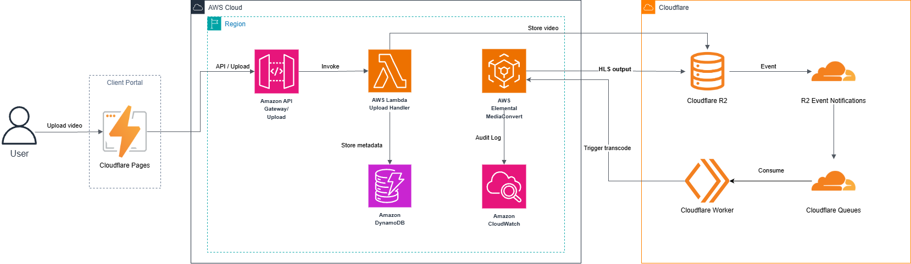
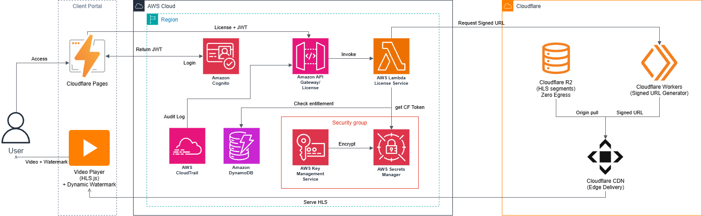
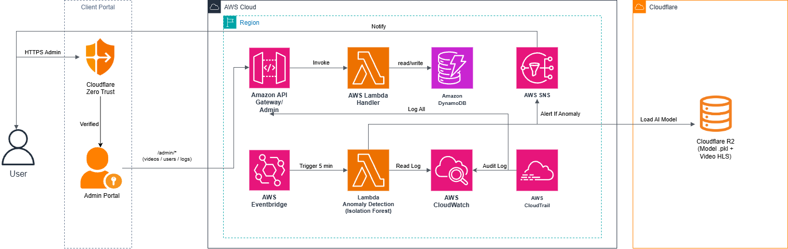
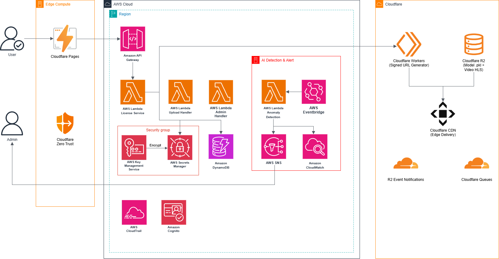

# SecureLearn: Digital Content Protection System for Educational Platforms — AWS Well-Architected Standards
## Digital Content Protection System for Educational Platforms — AWS Well-Architected Standards

### 1. Executive Summary
**Project Name:** SecureLearn (First Cloud Journey - FCAJ Internship Program)  
**Architecture Standards:** AWS Well-Architected Framework (6 Pillars) & AWS-Native Serverless  

SecureLearn is a low-cost video content protection solution designed for small and medium-sized educational centers (SMEs). The platform combines AWS for authentication, authorization, video processing, AI, and business logic with Cloudflare for frontend hosting, storage, and content distribution. It converts lecture videos into HLS, controls access using JWT and short-lived playback tokens, and integrates behavioral AI analysis with dynamic watermarking to protect and trace educational intellectual property.

### 2. Problem Statement
### What’s the Problem?
In the era of digital education, small and medium-sized educational centers (SMEs) and online learning platforms face severe intellectual property leakage risks as lecture videos are downloaded, screen-recorded, and redistributed illegally on social media. Large-scale commercial DRM solutions (such as Google Widevine and Microsoft PlayReady) involve high licensing costs and integration complexity, making them financially unfeasible for most SMEs.

### The Solution
SecureLearn utilizes an AWS-Cloudflare Hybrid Serverless Architecture. It automates video processing via AWS Elemental MediaConvert, manages access control using API Gateway, Lambda, and DynamoDB, and leverages Cloudflare R2, Workers, and CDN for secure distribution. Key features include JWT authentication, short-lived playback tokens, Isolation Forest AI anomaly detection via Lambda and EventBridge, dynamic watermarking, and automated alerts via Amazon SNS.

**Comparative Table of Current Issues, Business Impacts, and AWS Solutions:**
| Current Issue | Business Impact | SecureLearn Solution (AWS / Cloudflare) |
| --- | --- | --- |
| Videos downloaded & illegally shared | Revenue loss, leakage of exclusive lecture IP | HLS/DASH encryption via AWS Elemental MediaConvert combined with JWT authentication |
| Lack of proactive monitoring | Failure to detect account sharing or video crawling in real-time | Automated Lambda Isolation Forest AI model scanning logs with SNS alerts |
| Inability to trace leaks | Unable to identify culprits when videos are screen-recorded | Dynamic Watermark displaying User ID & IP directly on the video player |
| High commercial DRM costs | SMEs cannot afford infrastructure upkeep | Hybrid Serverless architecture using AWS for control plane and Cloudflare for media plane, reducing operational costs and avoiding traditional servers |

### Benefits and Return on Investment
The solution eliminates traditional server maintenance, drastically reducing operational expenses compared to commercial DRM platforms. It protects exclusive educational assets, prevents unauthorized sharing, provides active anomaly monitoring, and traces content leaks via dynamic watermarking, all while keeping estimated monthly infrastructure costs around $46 USD.

### 3. Solution Architecture
The system is built on an AWS-Cloudflare Hybrid Serverless Architecture, completely eliminating traditional servers and divided into 4 main functional layers:
1. **Media Pipeline (Upload & Processing):** Cloudflare R2 (Source Bucket) stores raw videos with AES-256 at-rest encryption; R2 Event Notifications trigger Cloudflare Queues; Consumer Workers coordinate video transfer to AWS Elemental MediaConvert; MediaConvert outputs HLS/DASH manifests (`.m3u8` / `.mpd`).
2. **Delivery & Access Control:** Students log in via Cognito and receive JWTs; Lambda License Service verifies entitlements in DynamoDB and requests short-lived signed tokens from Cloudflare; Cloudflare Workers validate tokens before serving private HLS/DASH segments from R2 via CDN.
3. **Security & Key Management:** AWS KMS protects credentials and secrets used by Lambda; MediaConvert requires signed URLs (`requireSignedURLs`); AWS CloudTrail records audit logs.
4. **AI & Tracing:** Offline training using Isolation Forest in Jupyter Notebooks (`.pkl` model stored in R2); AWS Lambda (triggered by EventBridge every 5 mins) reads access logs from DynamoDB/CloudWatch, runs anomaly inference, and publishes alerts via Amazon SNS; JavaScript-based dynamic watermarks display moving user IDs.

**Data Flow Diagrams:**
- Upload Flow: User → API Gateway → Upload Lambda → R2 (Private Source) → R2 Event Notification → Cloudflare Queue → Consumer Worker → AWS MediaConvert → HLS/DASH → Cloudflare CDN → Student.
  
- Playback Flow: User → JWT → API Gateway → Authorization Lambda → DynamoDB check → AWS Elemental MediaConvert + Cloudflare R2/Workers Signed Token → HLS/DASH Player → Dynamic Watermark.
  
- AI Branch Flow: Authorization/Application Logs → CloudWatch/DynamoDB → EventBridge (every 5 min) → Lambda Anomaly Detection → Isolation Forest → Anomaly detected → SNS → Admin Email.
  
General diagram architecture:
  

### AWS Services Used
- **AWS Elemental MediaConvert:** Transcodes raw videos into HLS/DASH streaming formats.
- **AWS Lambda & Amazon API Gateway:** Handle upload handling, license verification, JWT authorization, and AI anomaly detection logic.
- **Amazon DynamoDB:** On-demand NoSQL storage for sessions, DRM logs, and metadata.
- **Amazon CloudWatch & AWS CloudTrail:** Centralize audit trails and application logs.
- **AWS KMS & AWS Secrets Manager:** Secure cryptographic keys and API tokens.
- **Amazon SNS:** Broadcasts automated email alerts to administrators upon detecting anomalies.
- **AWS EventBridge:** Triggers the AI anomaly detection Lambda function every 5 minutes.
- **Cloudflare R2, Workers, Queues, & CDN:** Provide object storage, event routing, queue decoupling, edge security, and fast content delivery.

### Evaluation Against 6 AWS Well-Architected Pillars
| Pillar | Implementation Design | AWS / Cloudflare Services Used |
| --- | --- | --- |
| **Security** | Least privilege IAM roles; at-rest (AES-256) and in-transit (TLS 1.3) encryption; secrets managed via AWS Secrets Manager; perimeter defense via Cloudflare WAF and Zero Trust Access. | AWS IAM, KMS, Secrets Manager; Cloudflare WAF, Access |
| **Reliability** | Cloudflare Queues decouple upload events from processing; Lambda retry mechanisms; R2 data durability of 11 nines (99.999999999%); industrial-grade transcoding via MediaConvert. | Cloudflare R2, Queues, AWS Lambda, EventBridge |
| **Operational Excellence** | Centralized logging via CloudWatch Logs and CloudTrail; automated anomaly alerting via CloudWatch Alarms and Amazon SNS. | Amazon CloudWatch, AWS CloudTrail, SNS, Cloudflare Logpush |
| **Performance Efficiency** | Auto-scaling with Serverless Lambda & API Gateway; optimized video delivery via global Cloudflare CDN and Edge Caching; high-speed parallel MediaConvert transcode. | AWS Lambda, MediaConvert, API Gateway, Cloudflare CDN |
| **Cost Optimization** | Pay-as-you-go serverless model; leverage AWS Free Tier and Cloudflare Free Plan; R2 Zero Egress Fee to minimize data transfer costs. | AWS Free Tier, Cloudflare R2 (Zero Egress), Free Plan |
| **Sustainability** | Optimized energy consumption using shared AWS serverless infrastructure and Cloudflare edge networks, avoiding idle server waste. | AWS Serverless Stack, Cloudflare Edge Network |

### 4. Technical Implementation
**Implementation Scope:**
- **In-Scope:** HLS video protection, JWT user authentication, short-lived playback tokens validated by Cloudflare Workers, HLS/DASH distribution from private R2 buckets, automated DynamoDB/CloudWatch log analysis, and SNS alerts.
- **Out-of-Scope:** PDF/Word document protection, hardware DRM integration (HDCP), and real-time livestream video processing.

**Implementation Phases:**
- **Week 1:** Research MediaConvert, R2, KMS, Lambda; design AWS + Cloudflare hybrid architecture; setup AWS and Cloudflare accounts, and dev environments.
- **Week 2:** Setup Cloudflare R2 bucket and Workers; write upload Lambda triggers; configure MediaConvert HLS/DASH job templates; build basic React + HLS.js video player.
- **Week 3:** Implement Lambda License Service for JWT/entitlement verification and token issuance; integrate Cloudflare Signed URLs & Zero Trust Access; build Admin Portal and DynamoDB metadata APIs.
- **Week 4:** Test token lifecycles and expiration; train Isolation Forest model locally, serialize to `.pkl`, and upload to Cloudflare R2 (`models/` prefix); write anomaly detection Lambda; create 5-minute EventBridge rule; integrate CloudWatch + SNS; develop dynamic watermarking.
- **Week 5:** Integrate dynamic watermarking into video player; build watermark leakage tracing tools; perform internal security pen-testing (video downloading, account sharing tests); optimize costs and check AWS Budgets.
- **Week 6:** Fix bugs, refine UI/UX, record demo video (5-7 mins), write technical blog, finalize workshop lab guide, and prepare presentation slides.

### 5. Timeline & Milestones
- **Week 1:** Architecture design, account setup, and theoretical research.
- **Week 2:** Media pipeline setup and automated video transcoding.
- **Week 3:** Access control, JWT authentication, and secure playback integration.
- **Week 4:** AI anomaly detection integration and token lifecycle testing.
- **Week 5:** Dynamic watermarking integration and security penetration testing.
- **Week 6:** Bug fixing, demo recording, documentation, and final presentation.

### 6. Budget Estimation
Total estimated monthly infrastructure cost is **~$46 USD/month** (simulated with 100 storage hours + 100 viewed hours/month).  
*Note: Actual costs vary based on usage, region, pricing plans, and AWS Free Tier eligibility.*

**Infrastructure Cost Breakdown:**
- **Cloudflare R2:** ~$1.20 (100 GB storage, 50k requests, Zero Egress)
- **Cloudflare Pages:** $0.00 (React frontend hosting)
- **Cloudflare Workers & Queues:** $0.00 (Free Plan)
- **Amazon Cognito:** $0.00 (User Pool authentication)
- **Cloudflare Zero Trust (Access):** $0.00 (Admin portal protection, up to 50 users)
- **AWS MediaConvert:** ~$45+ (100 input hours / 6,000 transcode minutes at ~$0.0075/min Basic AVC tier)
- **AWS Secrets Manager:** ~$0.40 (API tokens and credentials)
- **AWS KMS:** ~$1.15 (Customer Managed Key for secrets encryption)
- **AWS Lambda:** $0.00 (Covered by Free Tier for 50k invocations)
- **Amazon API Gateway:** ~$0.10 (20k REST API calls)
- **Amazon DynamoDB:** $0.00 (On-Demand Free Tier)
- **Amazon CloudWatch:** ~$0.75 (Audit logs and alarms)
- **AWS EventBridge:** $0.00 (Triggering anomaly detection every 5 mins)

**Resource Clean-up Plan:**
- *AWS:* Delete Lambda functions, API Gateways, DynamoDB tables, SNS topics, EventBridge rules, KMS keys, Secrets Manager secrets, and CloudWatch Log Groups.
- *Cloudflare:* Manually delete all videos, R2 bucket objects, Workers, Queues, and Zero Trust configurations after recording the demo.

### 7. Risk Assessment
**Risk Matrix & Mitigation Strategies:**
- **R2 and AWS Lambda integration complexity (Medium impact, medium probability):** R2 is S3-API compatible, enabling AWS SDK usage. Use Cloudflare Workers or polling for triggers.
- **AWS MediaConvert lacks full native DRM (High impact, low probability):** Clearly define scope around secure video access, anti-sharing, and traceability. Enable `requireSignedURLs`, short-lived tokens, and watermarks. MVP does not equal Widevine/PlayReady/FairPlay.
- **Signed Token leakage or incorrect expiration (Medium impact, medium probability):** Set short TTLs (1 hour), limit concurrent device sessions, and combine with AI anomaly detection.
- **AI model false-positive predictions (Medium impact, medium probability):** Start with Isolation Forest, tune contamination thresholds properly, and log false-positives for periodic retraining.
- **Short internship duration (6 weeks) (High impact, low probability):** Prioritize MVP first: Upload → Process → Authorization → Secure Playback, then integrate AI and watermarks.
- **Cost overruns (Medium impact, low probability):** Setup strict budget alerts on both AWS and Cloudflare.

### 8. Expected Outcomes
**Technical Improvements:** Automated secure media processing pipeline, hybrid serverless architecture implementation, and automated AI anomaly detection.  
**Long-Term Value:** Provides a cost-effective, scalable digital content protection framework that empowers small and medium educational platforms to safeguard intellectual property without excessive commercial expenses.