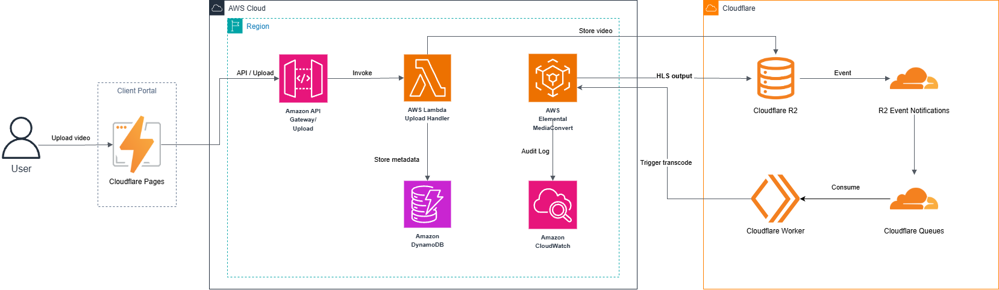
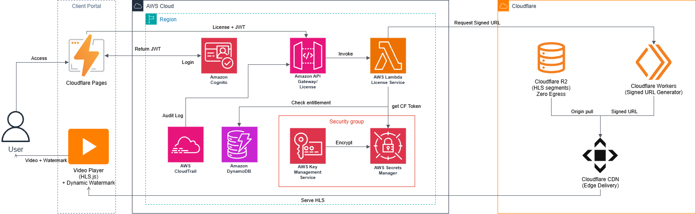
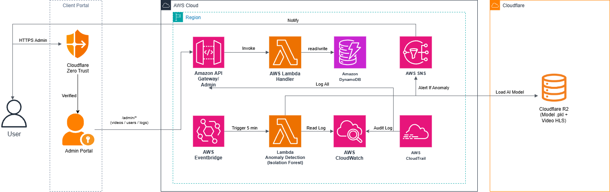
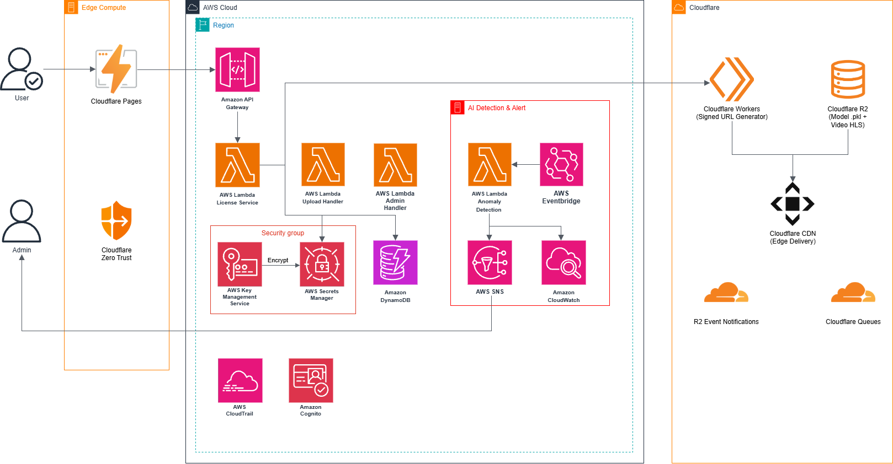

# SecureLearn: Hệ Thống Bảo Vệ Nội Dung Số Dành Cho Nền Tảng Giáo Dục Trên AWS
## Digital Content Protection System for Educational Platforms — AWS Well-Architected Standards

### 1. Tóm tắt dự án (Executive Summary)
SecureLearn là giải pháp bảo vệ nội dung video chi phí thấp dành cho các trung tâm đào tạo vừa và nhỏ (SMEs). Hệ thống kết hợp AWS cho các tác vụ xác thực, phân quyền, xử lý video, AI và logic nghiệp vụ với Cloudflare cho hosting frontend, lưu trữ và phân phối nội dung. Giải pháp thực hiện chuyển đổi video sang định dạng HLS, kiểm soát quyền truy cập bằng JWT và token phát lại ngắn hạn (short-lived playback tokens), đồng thời tích hợp AI phân tích hành vi cùng watermarking động để bảo vệ tài sản trí tuệ.

### 2. Vấn đề cần giải quyết (Problem Statement)
### Vấn đề hiện tại là gì?
Trong kỷ nguyên số hóa giáo dục, các trung tâm đào tạo vừa và nhỏ (SMEs) và nền tảng học trực tuyến đang đối mặt với nguy cơ thất thoát trí tuệ nghiêm trọng do video bài giảng bị tải xuống, quay màn hình và phát tán trái phép trên mạng xã hội. Các giải pháp DRM thương mại quy mô lớn (như Google Widevine, Microsoft PlayReady) có chi phí bản quyền và độ phức tạp tích hợp rất cao, nằm ngoài khả năng tài chính của đa số SMEs.

### Giải pháp
SecureLearn sử dụng Kiến trúc Lai (Hybrid) Serverless giữa AWS và Cloudflare. Hệ thống tự động hóa quá trình xử lý video qua AWS Elemental MediaConvert, quản lý phân quyền qua API Gateway, Lambda và DynamoDB, đồng thời tận dụng Cloudflare R2, Workers và CDN để phân phối an toàn. Các tính năng cốt lõi bao gồm xác thực JWT, token phát lại ngắn hạn, phát hiện bất thường bằng AI Isolation Forest qua Lambda và EventBridge, watermarking động và cảnh báo tự động qua Amazon SNS.

**Bảng đối chiếu vấn đề thực tế, tác động kinh doanh và giải pháp hạ tầng tương ứng:**
| Vấn đề hiện tại | Hậu quả kinh doanh | Giải pháp SecureLearn (AWS / Cloudflare) |
| --- | --- | --- |
| Video bị tải xuống & chia sẻ lậu | Mất doanh thu, thất thoát tài sản trí tuệ bài giảng độc quyền | Mã hóa HLS/DASH qua AWS Elemental MediaConvert kết hợp xác thực JWT |
| Thiếu cơ chế giám sát chủ động | Không phát hiện kịp thời hành vi dùng chung tài khoản hoặc crawl video | Mô hình AI Lambda Isolation Forest tự động quét log và báo động qua SNS |
| Không có khả năng truy vết rò rỉ | Không xác định được đối tượng phát tán khi video bị quay lén | Dynamic Watermark hiển thị User ID & IP trực tiếp trên video player |
| Chi phí DRM thương mại quá cao | SMEs không đủ kinh phí duy trì hạ tầng | Kiến trúc Serverless Hybrid sử dụng AWS cho control plane và Cloudflare cho media plane, giảm chi phí vận hành và tránh duy trì máy chủ truyền thống |

### Lợi ích và Hiệu quả đầu tư
Giải pháp loại bỏ hoàn toàn việc duy trì máy chủ truyền thống, tiết kiệm chi phí vận hành so với các nền tảng DRM thương mại đắt đỏ. Hệ thống bảo vệ nội dung độc quyền, ngăn chặn chia sẻ tài khoản trái phép, giám sát bất thường tự động và hỗ trợ truy vết rò rỉ với chi phí hạ tầng ước tính khoảng $46 USD/tháng.

### 3. Kiến trúc giải pháp (Solution Architecture)
Hệ thống được thiết kế thuần trên Kiến trúc Lai AWS - Cloudflare Serverless, loại bỏ hoàn toàn việc duy trì máy chủ truyền thống và chia thành 4 lớp chức năng chính:
1. **Lớp Upload & Xử lý (Media Pipeline):** Cloudflare R2 (Source Bucket) lưu trữ video gốc với mã hóa AES-256 at-rest; R2 Event Notifications gửi message tới Cloudflare Queues; Consumer Workers điều phối video sang AWS Elemental MediaConvert; MediaConvert chuyển mã thành HLS/DASH (`.m3u8` / `.mpd`).
2. **Lớp Phân phối & Kiểm soát truy cập (Delivery & Access Control):** Học viên đăng nhập qua Cognito nhận JWT; Lambda License Service kiểm tra quyền trong DynamoDB, yêu cầu Cloudflare tạo Signed Token; Cloudflare Workers xác thực token trước khi phục vụ HLS/DASH từ R2 private qua CDN.
3. **Lớp Bảo mật & Quản lý khóa (Security & Key Management):** AWS KMS bảo vệ secret/credential cho Lambda; MediaConvert cấu hình yêu cầu Signed URLs (`requireSignedURLs`); AWS CloudTrail ghi nhận log kiểm toán.
4. **Lớp AI & Truy vết (AI & Tracing):** Huấn luyện offline mô hình Isolation Forest (lưu file `.pkl` trên R2); AWS Lambda (trigger bởi EventBridge mỗi 5 phút) đọc log từ DynamoDB/CloudWatch, chạy dự đoán bất thường và gửi cảnh báo qua Amazon SNS; Watermark động bằng JavaScript hiển thị ID học viên di chuyển trên video.

**Sơ đồ luồng dữ liệu:**
- Luồng Upload: Giảng viên → API Gateway → Upload Lambda → R2 (Private Source) → R2 Event Notification → Cloudflare Queue → Consumer Worker → AWS MediaConvert → HLS/DASH → Cloudflare CDN → Học viên.
  
- Luồng Playback: Học viên → JWT → API Gateway → Authorization Lambda → DynamoDB check → AWS Elemental MediaConvert + Cloudflare R2/Workers Signed Token → HLS/DASH Player → Dynamic Watermark.
  
- Nhánh AI: Authorization/Application Logs → CloudWatch/DynamoDB → EventBridge (5 phút/lần) → Lambda Anomaly Detection → Isolation Forest → Nếu phát hiện bất thường → SNS → Email Admin.
  

-Sơ đồ tổng thể:
  

### Các dịch vụ AWS sử dụng
- **AWS Elemental MediaConvert:** Chuyển mã video gốc sang định dạng HLS/DASH.
- **AWS Lambda & Amazon API Gateway:** Xử lý upload, xác thực JWT, ủy quyền cấp phép và logic phát hiện bất thường bằng AI.
- **Amazon DynamoDB:** Lưu trữ NoSQL on-demand cho session, DRM log và metadata.
- **Amazon CloudWatch:** Thu thập tập trung nhật ký kiểm toán và log hệ thống.
- **AWS KMS & AWS Secrets Manager:** Mã hóa dữ liệu và bảo mật thông tin xác thực, API token.
- **Amazon SNS:** Gửi cảnh báo tự động qua email cho quản trị viên khi phát hiện bất thường.
- **AWS EventBridge:** Kích hoạt Lambda chạy mô hình AI phát hiện bất thường định kỳ mỗi 5 phút.
- **Cloudflare R2, Workers, Queues, & CDN:** Lưu trữ object, xử lý sự kiện, đệm hàng đợi, bảo mật biên và phân phối nội dung tốc độ cao.

### Đánh giá theo 6 Trụ cột AWS Well-Architected Framework
| Trụ cột (Pillar) | Thiết kế thực thi trong SecureLearn | Dịch vụ AWS / Cloudflare sử dụng |
| --- | --- | --- |
| **Security (Bảo mật)** | IAM Role quyền tối thiểu; Mã hóa at-rest (AES-256) & in-transit (TLS 1.3); Quản lý secret qua AWS Secrets Manager; Bảo vệ biên bằng Cloudflare WAF và Zero Trust Access. | AWS IAM, KMS, Secrets Manager; Cloudflare WAF, Access |
| **Reliability (Độ tin cậy)** | Cloudflare Queues làm lớp đệm giữa upload và xử lý; Cơ chế Retry cho Lambda; Độ bền dữ liệu R2 đạt 11 số 9 (99.999999999%); MediaConvert đảm bảo chất lượng transcode chuẩn công nghiệp. | Cloudflare R2, Queues, AWS Lambda, EventBridge |
| **Operational Excellence (Vận hành xuất sắc)** | Thu thập log tập trung với CloudWatch Logs và CloudTrail; Tự động hóa cảnh báo bất thường qua CloudWatch Alarms và Amazon SNS. | Amazon CloudWatch, AWS CloudTrail, SNS, Cloudflare Logpush |
| **Performance Efficiency (Hiệu năng)** | Tự động co giãn với Serverless Lambda & API Gateway; Tối ưu tốc độ qua Cloudflare CDN và Edge Caching toàn cầu; MediaConvert transcode song song tốc độ cao. | AWS Lambda, MediaConvert, API Gateway, Cloudflare CDN |
| **Cost Optimization (Tối ưu chi phí)** | Mô hình pay-as-you-go; Tận dụng AWS Free Tier và Cloudflare Free Plan; R2 Zero Egress Fee tối ưu chi phí truyền dữ liệu. | AWS Free Tier, Cloudflare R2 (Zero Egress), Free Plan |
| **Sustainability (Độ bền vững)** | Tối ưu năng lượng bằng hạ tầng serverless dùng chung của AWS và mạng lưới Edge Cloudflare, tránh lãng phí tài nguyên máy chủ rảnh rỗi. | AWS Serverless Stack, Cloudflare Edge Network |

### 4. Triển khai kỹ thuật (Technical Implementation)
**Phạm vi kỹ thuật:**
- **Trong phạm vi (In-Scope):** Bảo vệ định dạng video HLS, xác thực JWT, cấp playback token ngắn hạn được xác thực bởi Cloudflare Workers, phân phối HLS/DASH từ R2 private, phân tích log tự động qua DynamoDB/CloudWatch, cảnh báo qua SNS.
- **Ngoài phạm vi (Out-of-Scope):** Bảo vệ tài liệu PDF/Word, tích hợp DRM phần cứng (HDCP), xử lý video livestream thời gian thực.

**Các giai đoạn thực hiện:**
- **Tuần 1:** Nghiên cứu MediaConvert, R2, KMS, Lambda; thiết kế kiến trúc hybrid AWS + Cloudflare; thiết lập tài khoản và môi trường dev.
- **Tuần 2:** Thiết lập Cloudflare R2 bucket và Workers; viết Lambda trigger khi upload video; cấu hình MediaConvert job templates; xây dựng giao diện React player cơ bản.
- **Tuần 3:** Xây dựng Lambda License Service xác thực JWT và cấp token; tích hợp Cloudflare Signed URLs & Zero Trust Access; xây dựng Admin Portal và DynamoDB metadata APIs.
- **Tuần 4:** Kiểm thử vòng đời token; huấn luyện mô hình Isolation Forest (local), serialize thành file `.pkl` lưu lên R2 (`models/` prefix); viết Lambda Anomaly Detection; tạo EventBridge rule 5 phút/lần; tích hợp CloudWatch + SNS; phát triển watermark động.
- **Tuần 5:** Tích hợp watermark động vào video player; xây dựng công cụ truy vết rò rỉ; kiểm thử bảo mật nội bộ (pen-test); tối ưu chi phí và kiểm tra AWS Budgets.
- **Tuần 6:** Sửa lỗi, tinh chỉnh UI/UX, quay video demo (5-7 phút), viết blog kỹ thuật, hoàn thiện workshop lab guide và chuẩn bị slide thuyết trình.

### 5. Lịch trình & Mốc thời gian (Timeline & Milestones)
- **Tuần 1:** Thiết kế kiến trúc và chuẩn bị môi trường.
- **Tuần 2:** Xây dựng pipeline xử lý và mã hóa video.
- **Tuần 3:** Tích hợp kiểm soát truy cập và phân phối an toàn.
- **Tuần 4:** Triển khai AI phát hiện bất thường và kiểm thử token.
- **Tuần 5:** Tích hợp watermarking và kiểm thử bảo mật.
- **Tuần 6:** Hoàn thiện tài liệu, quay video demo và báo cáo cuối kỳ.

### 6. Dự toán ngân sách (Budget Estimation)
Tổng chi phí hạ tầng ước tính khoảng **~$46 USD/tháng** (với kịch bản 100 giờ video lưu trữ + 100 giờ xem/tháng).  
*Lưu ý: Chi phí thực tế thay đổi theo mức sử dụng, region, plan và free tier của tài khoản.*

**Chi tiết chi phí hạ tầng:**
- **Cloudflare R2:** ~$1.20 (100 GB storage, 50k requests, Zero Egress)
- **Cloudflare Pages:** $0.00 (Hosting React frontend)
- **Cloudflare Workers & Queues:** $0.00 (Free Plan)
- **Amazon Cognito:** $0.00 (User Pool authentication)
- **Cloudflare Zero Trust (Access):** $0.00 (Bảo vệ Admin portal, tối đa 50 users)
- **AWS MediaConvert:** ~$45+ (100 giờ input / 6,000 phút transcode ở tier Basic AVC)
- **AWS Secrets Manager:** ~$0.40 (Lưu Cloudflare API Token và secret)
- **AWS KMS:** ~$1.15 (Customer Managed Key bảo vệ secret)
- **AWS Lambda:** $0.00 (Miễn phí trong Free Tier cho 50k invocations)
- **Amazon API Gateway:** ~$0.10 (20k REST API calls)
- **Amazon DynamoDB:** $0.00 (On-Demand Free Tier)
- **Amazon CloudWatch:** ~$0.75 (Audit logs và alarms)
- **AWS EventBridge:** $0.00 (Trigger Lambda quét log mỗi 5 phút)

**Kế hoạch Dọn dẹp Tài nguyên:**
- *AWS:* Xóa các tài nguyên đã tạo (Lambda, API Gateway, DynamoDB, SNS, EventBridge, KMS, Secrets Manager, CloudWatch Log Groups).
- *Cloudflare:* Xóa thủ công toàn bộ video trên, object trong R2 bucket, Worker, Queue và cấu hình Zero Trust sau khi quay demo.

### 7. Đánh giá rủi ro (Risk Assessment)
**Ma trận rủi ro & Phương án giảm thiểu:**
- **Tích hợp R2 với Lambda phức tạp (Mức độ trung bình, xác suất trung bình):** R2 tương thích S3 API, dùng được AWS SDK. Sử dụng Cloudflare Workers hoặc polling để xử lý trigger.
- **AWS MediaConvert không hỗ trợ DRM đầy đủ (Mức độ cao, xác suất thấp):** Xác định đúng scope là secure video access + anti-sharing + traceability. Bật `requireSignedURLs`, token ngắn hạn và watermark. MVP không tương đương Widevine/PlayReady/FairPlay.
- **Signed Token bị lộ hoặc hết hạn sai cách (Mức độ trung bình, xác suất trung bình):** Thiết lập TTL ngắn (1 giờ), giới hạn thiết bị đồng thời, kết hợp AI phát hiện bất thường.
- **Mô hình AI dự đoán sai (False Positive) (Mức độ trung bình, xác suất trung bình):** Bắt đầu với Isolation Forest, điều chỉnh ngưỡng contamination phù hợp. Log các trường hợp false-positive để retrain định kỳ.
- **Thời gian thực tập ngắn (6 tuần) (Mức độ cao, xác suất thấp):** Ưu tiên MVP trước: Upload → Process → Authorization → Secure Playback, sau đó mới tích hợp AI và watermark.
- **Chi phí phát sinh (Mức độ trung bình, xác suất thấp):** Thiết lập cảnh báo ngân sách trên cả AWS và Cloudflare.

### 8. Kết quả dự kiến (Expected Outcomes)
**Cải tiến kỹ thuật:** Xây dựng quy trình xử lý media an toàn tự động, ứng dụng kiến trúc serverless lai và tích hợp AI phát hiện bất thường tự động.  
**Giá trị dài hạn:** Cung cấp framework bảo vệ nội dung số có chi phí hợp lý, khả năng mở rộng cao, giúp các nền tảng giáo dục SMEs bảo vệ tài sản trí tuệ toàn diện.