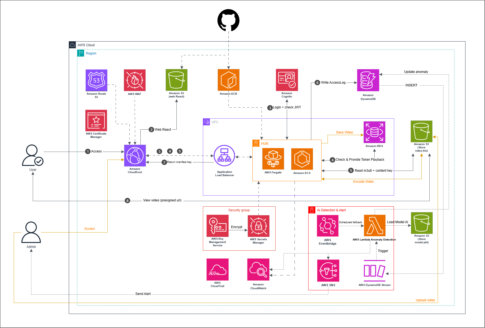

# SecureLearn: Hệ Thống Bảo Vệ Nội Dung Số Dành Cho Nền Tảng Giáo Dục Trên AWS
## Digital Content Protection System for Educational Platforms — AWS Well-Architected Standards

### 1. Tóm tắt dự án (Executive Summary)
SecureLearn là giải pháp bảo vệ nội dung video chi phí thấp dành cho các trung tâm đào tạo vừa và nhỏ (SMEs), chạy hoàn toàn trên AWS.
* Backend Spring Boot trên Amazon ECS Fargate đảm nhiệm xác thực (Amazon Cognito), phân quyền, xử lý video và logic nghiệp vụ.
* Frontend ReactJS được phân phối qua Amazon S3 + Amazon CloudFront, bảo vệ bởi AWS WAF.
* Video được chuyển sang HLS và mã hóa AES-128 bằng MediaConvert. Quyền xem được kiểm soát bằng JWT và playback token ngắn hạn, mỗi segment chỉ tải được qua presigned URL hạn 60 giây.
* Hệ thống tích hợp AI phân tích hành vi (Isolation Forest trên AWS Lambda) cùng watermarking động để bảo vệ tài sản trí tuệ.

### 2. Vấn đề cần giải quyết (Problem Statement)
### Vấn đề hiện tại là gì?
Trong kỷ nguyên số hóa giáo dục, các trung tâm đào tạo vừa và nhỏ (SMEs) và nền tảng học trực tuyến đang đối mặt với nguy cơ thất thoát trí tuệ nghiêm trọng do video bài giảng bị tải xuống, quay màn hình và phát tán trái phép trên mạng xã hội. Các giải pháp DRM thương mại quy mô lớn (như Google Widevine, Microsoft PlayReady) có chi phí bản quyền và độ phức tạp tích hợp rất cao, nằm ngoài khả năng tài chính của đa số SMEs.

### Giải pháp
SecureLearn sử dụng kiến trúc container serverless trên AWS:

* Xử lý video: backend Spring Boot chạy trên Amazon ECS Fargate sinh khóa AES-128 cho từng bài học và tạo job AWS Elemental MediaConvert để chuyển video sang HLS và mã hóa AES-128.
* Dữ liệu: nghiệp vụ khóa học lưu trên Amazon RDS for PostgreSQL, nhật ký truy cập trên Amazon DynamoDB, video trên Amazon S3 private.
* Phân phối: Amazon CloudFront, AWS WAF và Application Load Balancer phân phối frontend và API an toàn.
* Tính năng cốt lõi: xác thực JWT qua Amazon Cognito, playback token HMAC ngắn hạn, phát hiện bất thường bằng AI Isolation Forest qua Lambda và EventBridge, watermarking động và cảnh báo tự động qua Amazon SNS.

**Bảng đối chiếu vấn đề thực tế, tác động kinh doanh và giải pháp hạ tầng tương ứng:**
| Vấn đề hiện tại | Hậu quả kinh doanh | Giải pháp SecureLearn (AWS / Cloudflare) |
| --- | --- | --- |
| Video bị tải xuống & chia sẻ lậu | Mất doanh thu, thất thoát tài sản trí tuệ bài giảng độc quyền | HLS mã hóa AES-128 bằng MediaConvert; khóa giải mã chỉ trả cho người giữ playback token hợp lệ; segment chỉ tải được qua presigned URL S3 hạn 60 giây |
| Thiếu cơ chế giám sát chủ động | Không phát hiện kịp thời hành vi dùng chung tài khoản hoặc crawl video | Mọi request xem video được ghi vào DynamoDB (IP, device fingerprint); Lambda Isolation Forest quét log mỗi 5 phút và báo động qua SNS |
| Không có khả năng truy vết rò rỉ | Không xác định được đối tượng phát tán khi video bị quay lén | Dynamic Watermark hiển thị User ID & thời gian di chuyển liên tục trên video player |
| Chi phí DRM thương mại quá cao | SMEs không đủ kinh phí duy trì hạ tầng | Dịch vụ AWS managed (ECS Fargate, RDS, S3, CloudFront), không quản trị máy chủ, không phí bản quyền DRM |

### Lợi ích và Hiệu quả đầu tư
Giải pháp không cần quản trị máy chủ vật lý hay máy ảo, không mất phí bản quyền DRM thương mại. Hệ thống bảo vệ nội dung độc quyền, ngăn chặn chia sẻ tài khoản trái phép, giám sát bất thường tự động và hỗ trợ truy vết rò rỉ. Chi phí hạ tầng ước tính khoảng $165 USD/tháng khi chạy 24/7.

### 3. Kiến trúc giải pháp (Solution Architecture)
Hệ thống chạy hoàn toàn trên AWS, không quản trị máy chủ truyền thống, chia thành 4 lớp chức năng chính:
1. **Lớp Upload & Xử lý (Media Pipeline):** 
* Giảng viên xin presigned URL từ backend và upload video gốc thẳng lên Amazon S3 (mã hóa SSE-KMS at-rest).
* Backend Spring Boot trên ECS Fargate sinh khóa AES-128 riêng cho từng bài học, lưu content.key vào S3 rồi tạo job AWS Elemental MediaConvert.
* MediaConvert (dùng IAM role riêng) đọc video gốc từ videos/, chuyển mã sang HLS (H.264/AAC) và mã hóa AES-128 bằng khóa của bài học, ghi các segment .ts và master.m3u8 vào hls/.
* Backend theo dõi trạng thái job (GetJob); khi job hoàn tất thì ghi bài học vào RDS PostgreSQL và xóa video gốc.
2. **Lớp Phân phối & Kiểm soát truy cập (Delivery & Access Control):** 
* Học viên đăng nhập qua Amazon Cognito nhận JWT, backend kiểm tra JWT và cấp playback token HMAC-SHA256 (hạn 2 giờ), rồi viết lại manifest để khóa và segment đều phải đi qua backend.
* Khóa AES-128 chỉ trả cho đúng người giữ token. Mỗi segment được redirect 302 tới presigned URL S3 hạn 60 giây. Frontend ReactJS phục vụ từ S3 qua CloudFront; /api/* đi qua CloudFront → ALB → ECS.
3. **Lớp Bảo mật & Quản lý khóa (Security & Key Management):** AWS WAF lọc request tại CloudFront: managed rules, rate-limit, IP allowlist cho API quản trị. AWS KMS và AWS Secrets Manager bảo vệ mật khẩu database, Cognito client secret và khóa ký token. Backend dùng IAM role thay cho access key. Security group cho phép đi theo chuỗi CloudFront → ALB → ECS → RDS. AWS CloudTrail ghi nhận log kiểm toán.
4. **Lớp AI & Truy vết (AI & Tracing):** Huấn luyện offline mô hình Isolation Forest (lưu file `.pkl` trên S3); AWS Lambda (trigger bởi EventBridge mỗi 5 phút) đọc log từ DynamoDB/CloudWatch, chạy dự đoán bất thường và gửi cảnh báo qua Amazon SNS; Watermark động bằng JavaScript hiển thị ID học viên di chuyển trên video.

**Sơ đồ luồng dữ liệu:**
**Luồng Upload:** Giảng viên → CloudFront → ALB → ECS (xin presigned URL) → Trình duyệt PUT video lên S3 videos/ → ECS (sinh khóa, tạo job MediaConvert) → MediaConvert (chuyển mã + mã hóa AES-128) → S3 hls/ → ECS lưu bài học vào RDS → Học viên.
**Luồng Playback:** Học viên → Cognito JWT → CloudFront → ALB → ECS (kiểm tra JWT, cấp playback token, ghi AccessLog vào DynamoDB) → Manifest + khóa AES-128 → Segment tải từ S3 qua presigned URL 60 giây → HLS Player → Dynamic Watermark. Sơ đồ kiến trúc SecureLearn 2
Nhánh AI: DynamoDB AccessLog → EventBridge Scheduler (5 phút/lần) → Lambda Anomaly Detection → Isolation Forest → Nếu phát hiện bất thường → SNS → Email Admin. Sơ đồ kiến trúc SecureLearn 3
-Sơ đồ tổng thể:
  

### Các dịch vụ AWS sử dụng
- **Amazon ECS Fargate, Amazon ECR & Application Load Balancer:** Chạy backend Spring Boot (API, xác thực, cấp playback token) dạng container không cần quản trị máy chủ.
- **Amazon Cognito:** Quản lý người dùng, đăng ký/đăng nhập, phân nhóm STUDENT / INSTRUCTOR / ADMIN.
Amazon RDS for PostgreSQL: Lưu dữ liệu nghiệp vụ khóa học, chương, bài học.
- **Amazon DynamoDB:** Lưu nhật ký truy cập on-demand (AccessLog) phục vụ truy vết và AI.
- **Amazon S3:** Lưu video gốc, HLS đã mã hóa, frontend tĩnh và mô hình AI.
- **AWS Elemental MediaConvert:** Chuyển mã video gốc sang HLS và mã hóa AES-128, tính phí theo phút video đầu ra, không cần quản lý máy chủ chuyển mã. -Amazon Cognito: Quản lý người dùng, đăng ký/đăng nhập, phân nhóm STUDENT / INSTRUCTOR / ADMIN. Amazon RDS for PostgreSQL: Lưu dữ liệu nghiệp vụ khóa học, chương, bài học.
- **Amazon CloudFront, AWS WAF, Amazon Route 53 & AWS Certificate Manager:** Phân phối frontend/API qua HTTPS, bảo vệ biên và quản lý tên miền.
- **AWS Lambda & Amazon EventBridge:** Chạy mô hình AI phát hiện bất thường định kỳ mỗi 5 phút.
AWS KMS & AWS Secrets Manager: Mã hóa dữ liệu và bảo mật thông tin xác thực, khóa ký token.
- **Amazon SNS:** Gửi cảnh báo tự động qua email cho quản trị viên khi phát hiện bất thường.
- **Amazon CloudWatch & AWS CloudTrail:** Thu thập tập trung log ứng dụng và nhật ký kiểm toán.

### Đánh giá theo 6 Trụ cột AWS Well-Architected Framework
| Trụ cột (Pillar) | Thiết kế thực thi trong SecureLearn | Dịch vụ AWS / Cloudflare sử dụng |
| --- | --- | --- |
| **Security (Bảo mật)** | IAM Role quyền tối thiểu, không dùng access key tĩnh; Mã hóa at-rest (SSE-KMS) & in-transit (TLS); Nội dung HLS mã hóa AES-128; Quản lý secret qua Secrets Manager; Bảo vệ biên bằng AWS WAF; Chuỗi security group chỉ cho phép CloudFront → ALB → ECS → RDS; Phân quyền theo nhóm Cognito trong Spring Security. | AWS IAM, KMS, Secrets Manager, WAF, Cognito, VPC |
| **Reliability (Độ tin cậy)** | ALB trải trên 2 AZ và health check; ECS tự khởi động lại task lỗi; RDS automated backup 7 ngày; Độ bền dữ liệu S3 đạt 11 số 9 (99.999999999%). Có thể nâng RDS lên Multi-AZ và ECS lên 2 task khi chạy thật. | Amazon ECS, ALB, RDS, S3 |
| **Operational Excellence (Vận hành xuất sắc)** | Thu thập log tập trung với CloudWatch Logs và CloudTrail; Cảnh báo bất thường tự động qua Amazon SNS; Đóng gói backend bằng Docker image trên ECR, deploy lại bằng một lệnh cập nhật ECS service | Amazon CloudWatch, AWS CloudTrail, SNS, ECR |
| **Performance Efficiency (Hiệu năng)** | Frontend cache tại edge của CloudFront; chuyển mã chạy song song trên MediaConvert, không chiếm CPU/RAM của backend; ECS Fargate co giãn theo số task; segment video tải trực tiếp từ S3 không qua backend; DynamoDB on-demand tự co giãn. | Amazon CloudFront, ECS Fargate, S3, DynamoDB, MediaConvert |
| **Cost Optimization (Tối ưu chi phí)** | Mô hình pay-as-you-go; Không phí bản quyền DRM; MediaConvert tính phí theo phút video đầu ra nên chỉ tốn tiền khi có video mới, đổi lại task ECS không cần thêm ephemeral storage cho chuyển mã; Không dùng NAT Gateway; Tận dụng AWS Free Tier credits và các dịch vụ always-free (Lambda, DynamoDB, SNS, EventBridge); Tắt ECS/RDS ngoài giờ làm việc.| AWS Free Tier, ECS Fargate, Lambda, DynamoDB, MediaConvert |
| **Sustainability (Độ bền vững)** | Dùng hạ tầng managed dùng chung của AWS; Fargate chỉ cấp đúng lượng CPU/RAM cần; Lambda AI chỉ chạy vài giây mỗi 5 phút; Lifecycle rule xóa video gốc dư thừa | AWS Fargate, Lambda, S3 Lifecycle |

### 4. Triển khai kỹ thuật (Technical Implementation)
**Phạm vi kỹ thuật:**
- **Trong phạm vi (In-Scope):** Bảo vệ video định dạng HLS mã hóa AES-128, xác thực JWT qua Cognito, cấp playback token ngắn hạn do backend xác thực, phân phối segment từ S3 private qua presigned URL, ghi nhật ký truy cập vào DynamoDB, phân tích log tự động bằng AI và cảnh báo qua SNS, watermark động.
- **Ngoài phạm vi (Out-of-Scope):** Bảo vệ tài liệu PDF/Word, tích hợp DRM phần cứng (HDCP) hoặc DRM thương mại (Widevine/PlayReady/FairPlay), xử lý video livestream thời gian thực.

**Các giai đoạn thực hiện:**
- **Tuần 1-3:** Nghiên cứu Cognito, ECS Fargate, RDS, S3, KMS; thiết kế kiến trúc trên AWS; thiết lập tài khoản, VPC và môi trường dev (Spring Boot, React, Docker).
- **Tuần 4-6:** Tạo bucket S3 và luồng upload bằng presigned URL; viết VideoProcessingService dùng MediaConvert chuyển mã HLS + mã hóa AES-128; xây dựng giao diện React player cơ bản với hls.js.
- **Tuần 7-8:** Xây dựng API cấp playback token, viết lại manifest, trả khóa và redirect segment; tích hợp Cognito (đăng ký, OTP, đăng nhập, phân nhóm); đóng gói Docker, triển khai lên ECS Fargate + ALB + RDS; cấu hình CloudFront và AWS WAF.
- **Tuần 9-10:** Kiểm thử vòng đời token; ghi AccessLog vào DynamoDB; huấn luyện mô hình Isolation Forest (local), serialize thành file .pkl lưu lên S3 (models/ prefix); viết Lambda Anomaly Detection; tạo EventBridge Scheduler 5 phút/lần; tích hợp CloudWatch + SNS; phát triển watermark động.
- **Tuần 11:** Tích hợp watermark động và device fingerprint vào video player; xây dựng công cụ truy vết rò rỉ; kiểm thử bảo mật nội bộ (pen-test, kiểm tra phân quyền API); tối ưu chi phí và kiểm tra AWS Budgets.
- **Tuần 12:** Sửa lỗi, tinh chỉnh UI/UX, quay video demo (5-7 phút), viết blog kỹ thuật, hoàn thiện workshop lab guide.

### 5. Lịch trình & Mốc thời gian (Timeline & Milestones)
- **Tuần 1-3:** Thiết kế kiến trúc và chuẩn bị môi trường.
- **Tuần 4-6:** Xây dựng pipeline xử lý và mã hóa video.
- **Tuần 7-8:** Tích hợp kiểm soát truy cập và phân phối an toàn.
- **Tuần 9-10:** Triển khai AI phát hiện bất thường và kiểm thử token.
- **Tuần 11:** Tích hợp watermarking và kiểm thử bảo mật.
- **Tuần 12:** Hoàn thiện tài liệu, quay video demo và báo cáo cuối kỳ.

### 6. Dự toán ngân sách (Budget Estimation)
Tổng chi phí hạ tầng ước tính khoảng ~$165 USD/tháng khi chạy 24/7 (kịch bản 100 giờ video lưu trữ + 100 giờ xem/tháng). Nếu chỉ bật ECS và RDS trong giờ làm việc (~8 giờ/ngày) thì còn khoảng ~$60–75 USD/tháng.
*Lưu ý: Chi phí thực tế thay đổi theo mức sử dụng, region, plan và free tier của tài khoản.*

**Chi tiết chi phí hạ tầng:**
- **Amazon ECS Fargate:** ~$93 (1 task 2 vCPU / 4 GB + 50 GB ephemeral storage)
- **Application Load Balancer:** ~$23 (1 ALB, lưu lượng thấp)
- **Amazon RDS for PostgreSQL:** ~$21 (db.t4g.micro Single-AZ + 20 GB gp3)
- **Amazon Cognito:** $0.00 (User Pool authentication)
- **AWS WAF:** ~$12 (1 Web ACL + 7 rule)
- **AWS Route 53:** ~$0.50 (1 hosted zone, chưa tính phí mua tên miền)
- **AWS S3:** ~$2 (~70 GB HLS + frontend + model)
- **AWS Cloudfont:** $0 (Free 1TB/tháng)
- **AWS Secrets Manager:** ~$0.40 (Lưu Cloudflare API Token và secret)
- **AWS KMS:** ~$1.15 (Customer Managed Key bảo vệ secret)
- **AWS Lambda:** $0.00 (Miễn phí trong Free Tier cho 50k invocations)
- **Amazon API Gateway:** ~$0.10 (20k REST API calls)
- **Amazon DynamoDB:** $0.00 (On-Demand Free Tier)
- **Amazon CloudWatch & ECR:** ~$0.75 (Audit logs và alarms)
- **AWS EventBridge:** $0.00 (Trigger Lambda quét log mỗi 5 phút)

**Kế hoạch Dọn dẹp Tài nguyên:**
- *Ưu tiên*: Xóa ECS service/cluster, ALB và RDS ngay sau khi quay demo vì các dịch vụ này tính phí theo giờ.
- *AWS*: Xóa các tài nguyên còn lại (CloudFront, WAF, S3, ECR, Lambda, DynamoDB, SNS, EventBridge, Cognito, KMS, Secrets Manager, VPC, CloudWatch Log Groups, Route 53 records).

### 7. Đánh giá rủi ro (Risk Assessment)
**Ma trận rủi ro & Phương án giảm thiểu:**
- **Chuyển mã video dài vượt thời gian chờ (Mức độ trung bình, xác suất trung bình):** API /upload/process chạy đồng bộ trong khi CloudFront chỉ chờ tối đa 60 giây. Demo bằng video ngắn; hướng cải tiến là xử lý nền (trả 202 và hỏi trạng thái)
- **AWS  không hỗ trợ DRM đầy đủ (Mức độ cao, xác suất thấp):** Xác định đúng scope là secure video access + anti-sharing + traceability. Bật `requireSignedURLs`, token ngắn hạn và watermark. MVP không tương đương Widevine/PlayReady/FairPlay.
- **Signed Token bị lộ hoặc hết hạn sai cách (Mức độ trung bình, xác suất trung bình):** Thiết lập TTL ngắn (1 giờ), giới hạn thiết bị đồng thời, kết hợp AI phát hiện bất thường.
- **Mô hình AI dự đoán sai (False Positive) (Mức độ trung bình, xác suất trung bình):** Bắt đầu với Isolation Forest, điều chỉnh ngưỡng contamination phù hợp. Log các trường hợp false-positive để retrain định kỳ.
- **Thời gian thực tập ngắn (6 tuần) (Mức độ cao, xác suất thấp):** Ưu tiên MVP trước: Upload → Process → Authorization → Secure Playback, sau đó mới tích hợp AI và watermark.
- **Chi phí phát sinh (Mức độ trung bình, xác suất thấp):** Thiết lập cảnh báo ngân sách trên AWS.

### 8. Kết quả dự kiến (Expected Outcomes)
**Cải tiến kỹ thuật:** Xây dựng quy trình xử lý media an toàn tự động, ứng dụng kiến trúc serverless AWS và tích hợp AI phát hiện bất thường tự động.  
**Giá trị dài hạn:** Cung cấp framework bảo vệ nội dung số có chi phí hợp lý, khả năng mở rộng cao, giúp các nền tảng giáo dục SMEs bảo vệ tài sản trí tuệ toàn diện.