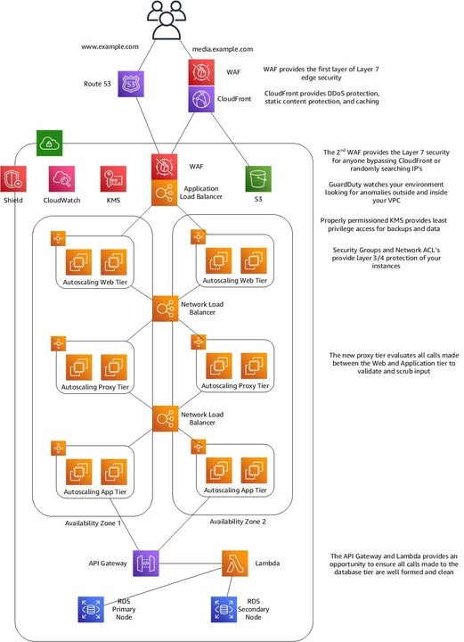

# AWS Security: Zero Trust & Least Privilege
In many traditional network systems, security is often established based on network boundaries. This means that if you are inside the internal network, you are trusted by default. While this approach is quite simple, it is no longer secure enough in a modern cloud environment. If an attacker manages to bypass the outer perimeter, the system can be fully compromised due to the lack of strict protection layers inside.
While exploring AWS, I came across some interesting documents regarding the implementation of Zero Trust architecture and the principle of Least Privilege. These articles (including one from AWS Builder Center published in September 2026) dive deep into how to shift from network-based trust to identity-based trust. What I found particularly fascinating is that solving this challenge does not rely on a single service; rather, it combines multiple AWS services into a complete, multi-layered defense system.
### THE PROBLEM TO BE SOLVED
Imagine a cloud system where services and users constantly interact with one another:
* Users accessing internal applications.
* Microservices connecting to databases.
* Third-party applications invoking internal APIs.
* Management devices connecting to servers.
If we rely solely on network locations—such as assuming "Any request coming from a Private Subnet is safe by default"—the system could face immense risks. In this scenario, granting permissions based on network location is no longer trustworthy.
The solution introduced by AWS is building a Zero Trust security model—never trust anyone or any system by default, regardless of where they are located.
### AWS ARCHITECTURE AND CORE PRINCIPLES
One of the aspects I really like about the Zero Trust model on AWS is how the system divides the defense pipeline into multiple components based on strict principles:
* **Verify and Authenticate**: AWS requires every user and system to continuously prove their identity on a per-request basis rather than logging in just once. The system evaluates context data points such as user identity, location, and device health to grant access.
* **Least Privilege Access**: Users or services are granted only the minimum permissions necessary to perform their tasks. AWS IAM Access Analyzer is used to detect over-privileged permissions and refine exact boundaries.
* **Micro-segmentation**: Data and systems are divided into small, strictly isolated segments. AWS Transit Gateway and Security Groups are used to isolate sensitive workloads within Amazon VPC.
* **Automation & Monitoring**: The system is continuously monitored to detect risks and trigger alerts. AWS GuardDuty and AWS Security Hub continuously analyze events to automatically detect threats or anomalous behaviors.
### HOW DOES ZERO TRUST WORK?
Not all access requests are allowed through easily just because they originate within an internal network. Under this model, the system applies the "Assume Breach" principle—always assuming that the system may already be compromised and restricting all possible attack paths.
For example, instead of just checking an IP address like a traditional network:10.0.0.123
The system performs a comprehensive evaluation of the context:
Identity: Role App-Backend
Action: s3:GetObject
Resource: arn:aws:s3:::customer-data
Condition: MFA Active = True, Source VPC = vpc-12345
Based on this contextual identity information, the system makes an access decision, even if the IP address belongs to a trusted zone.
This is a critical distinction: protection is identity-driven rather than reliant solely on a simple network perimeter. Data encryption and network controls are also strictly enforced to minimize blast radiuses.
### KEY TAKEAWAYS
The most notable realization after reading these documents is the perspective that Zero Trust is not a off-the-shelf product you can just buy.More importantly, Zero Trust is an architectural mindset that must be deeply engineered into the cloud system. AWS IAM handles core identity management, while other services take responsibility for network segmentation, traffic control, monitoring, and automated incident response.You can visualize a basic workflow as follows:Authentication via IAM → Network Traffic Control via Security Groups/VPC → Event Monitoring via CloudTrail → Threat Analysis & Detection via GuardDuty.Each service addresses a specific problem, but when combined, they form a robust defense in depth mechanism that cannot be easily broken.Through this, I also realized that when building real-world cloud applications, getting code to run successfully is only a small part of the job. The security architecture surrounding those cloud resources plays a vital role in survival.
### CONCLUSION
The documents on Zero Trust and Least Privilege offered me a very insightful perspective on re-architecting security on AWS.
Instead of building a large external firewall and letting everything inside communicate freely, AWS guides us on how to continuously verify and minimize access privileges for every single service. In particular, combining Identity Management and Networking completely eliminates the biggest weaknesses of traditional security models.
In my opinion, this is a essential mindset to explore for anyone learning AWS or DevOps who wants to apply security principles directly into real-world enterprise scenarios.
### References
[1] AWS Security - Zero Trust on AWS: https://aws.amazon.com/security/zero-trust/[cite: 1]
[2] Zero Trust Security in AWS: Protecting Modern Cloud Infrastructure: https://builder.aws.com/content/3J2jVMOX6TBxqaso1EDDmXZxa8S/zero-trust-security-in-aws-protecting-modern-cloud-infrastructure[cite: 1]
[3] Understanding Zero Trust principles - AWS Prescriptive Guidance: https://docs.aws.amazon.com/prescriptive-guidance/latest/strategy-zero-trust-architecture/zero-trust-principles.html[cite: 1]

Link blog: https://www.facebook.com/groups/660548818043427/user/100053180442383
