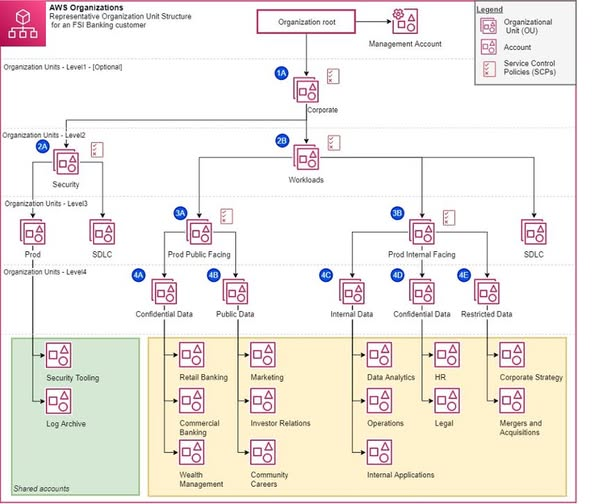

# CENTRALIZED MANAGEMENT OF HUNDREDS OF AWS ACCOUNTS SECURELY WITH ORGANIZATIONS & SERVICE CONTROL POLICIES (SCPs)

Managing systems under a single AWS Account model poses significant risks of information security breaches and service disruptions as scale grows or when applying automated tools such as AI Agents. To completely resolve this challenge, AWS recommends adopting a Multi-Account strategy combined with **AWS Organizations** and **Service Control Policies (SCPs)**.

### Key points to know:

* **Single-Account Model Risks & Challenges from AI Agents:** Consolidating all environments (Dev, Staging, Prod) into a single account easily leads to a complete system crash when an incident occurs. Additionally, operating automated AI Agents without organization-level guardrails can lead to manipulation (Prompt Injection), resulting in wasted costs or accidental deletion of critical resources.
* **AWS Standard Multi-Account Architecture:** Clearly separate the Management Account (root account used solely for management/billing), Organizational Units - OUs (such as Security OU, Workload OU), and enforce centralized security boundaries.
* **The Role of Service Control Policies (SCPs):** SCPs establish maximum privilege limits applied across individual OUs or member accounts. SCPs help protect audit data (blocking deletion/disabling of CloudTrail), restrict geographic regions (limiting resource provisioning to approved regions only), lock down sensitive resources (S3, RDS), and prevent member accounts from leaving the organization autonomously.
* **Centralized Monitoring:** Combine automated log collection via AWS CloudTrail Organizational Trails, configuration management using AWS Config Aggregator, and automated activation of AWS GuardDuty for all newly created accounts.
* **3-Step Migration Roadmap:** (1) Initialize AWS Organizations & centralized SSO login -> (2) Plan OU structures & separate environments -> (3) Tighten SCPs & automate account provisioning using AWS Control Tower.

### Reference
[1] AWS Documentation - Service Control Policies (SCPs) (https://docs.aws.amazon.com/organizations/latest/userguide/orgs_manage_policies_scps.html)
[2] AWS Documentation - Example Service Control Policies (https://docs.aws.amazon.com/organizations/latest/userguide/orgs_manage_policies_scps_examples.html)
[3] AWS Builder Center - Protecting AWS Organization with SCPs (https://builder.aws.com/content/3ItkGyU0Nn5rfYhYQOkbvFiUQ2O/introduction-to-aws-organizations-and-service-control-policies-scps)

Link blog: https://www.facebook.com/groups/660548818043427/user/100084179052828/
