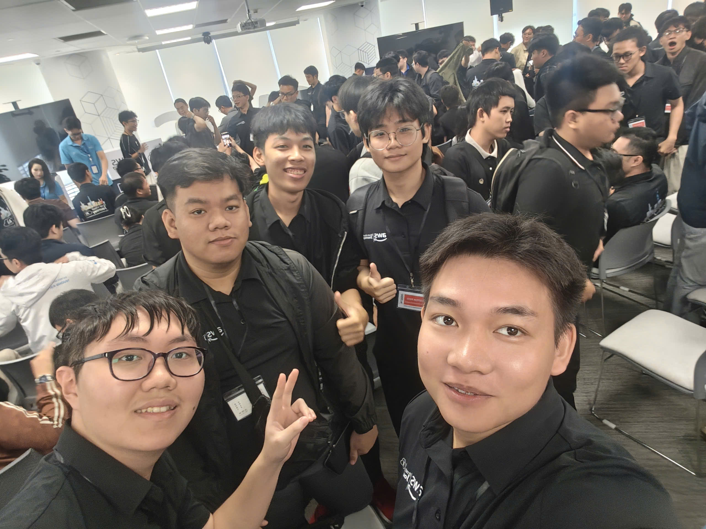
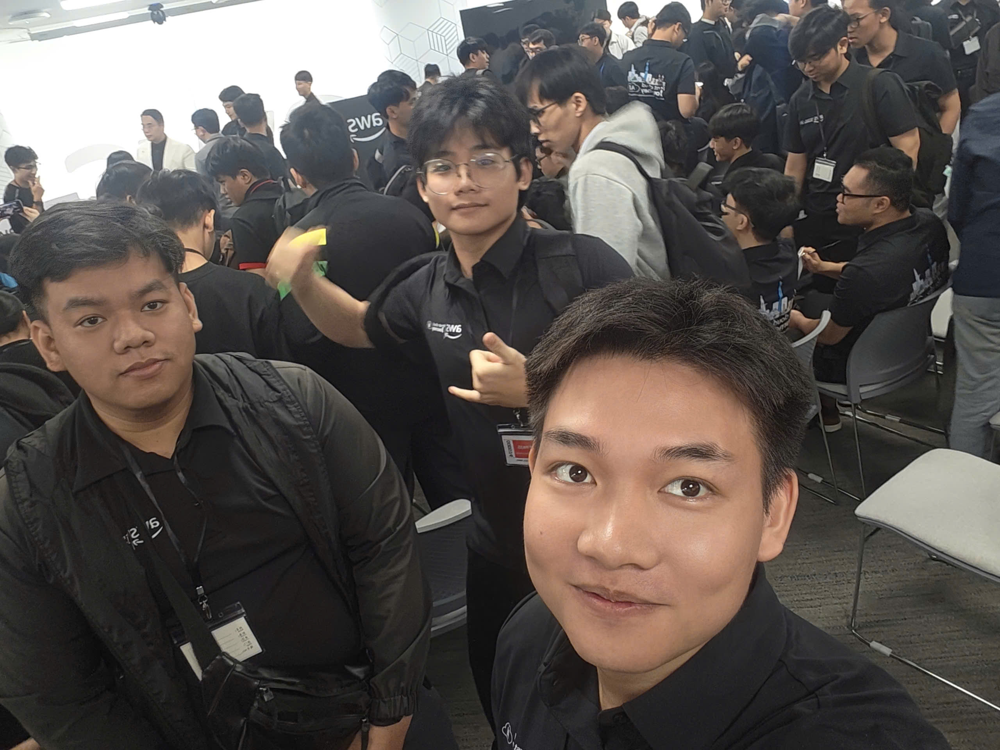
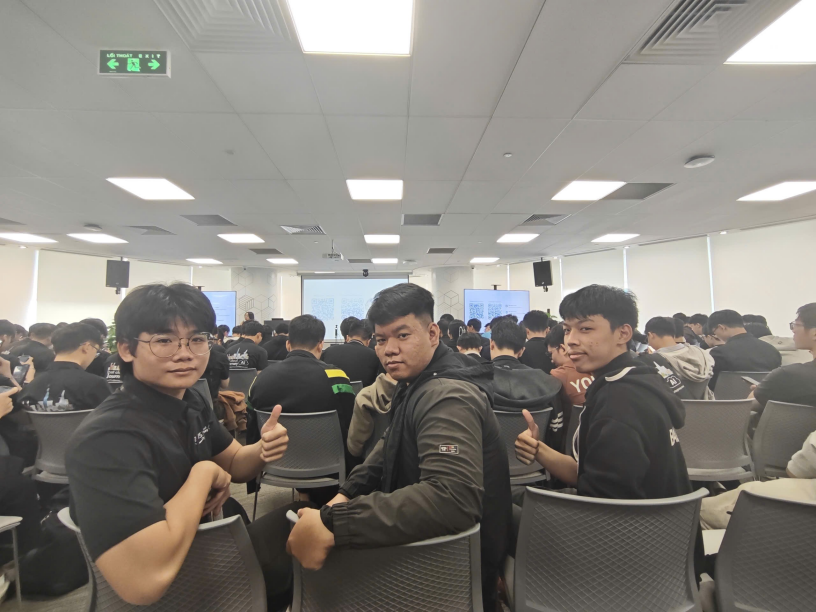

# Summary Report: “Buildrathon Kickoff: Code the Future with CMC Global”

### Event Objectives

The event is organized to help attendees gain a deeper understanding of the AWS profession, practical applications of Generative AI, and how to build a solid career roadmap in the IT industry. This is an opportunity to update on the latest technology trends and directly connect with experts from CMC Global.

### Speakers

- **Nguyễn Gia Hưng** – AWS
- **Bùi Nhật Trường** – CMC Global

### Key Highlights

The event brings special experiences through the following main contents:

- **Exploring Generative AI & AI Agent**: Update a comprehensive perspective on AWS Cloud, Agentic AI trends, and how leading enterprises apply AI to solve real-world problems.
- **Hands-on Practice**: Attendees can ask questions and experience the challenge of building AI Agents under the direct guidance and answers of experts.
- **Quality Networking**: Interact, connect, and find teammates who share a passion for Cloud & AI technology.

### What Was Learned

- **Design Mindset**: Gain a clearer understanding of the business-first approach, starting from business needs rather than focusing solely on technology.
- **Technical Architecture**: Grasp Agentic AI trends and how businesses apply them to practical problems.
- **Modernization Strategy**: Recognize the importance of building a structured career roadmap in the Cloud & AI era.

### Applying to Work

- **Applying Generative AI**: Research and test AI Agent solutions on specific problems in current work.
- **Building Career Roadmap**: Clearly define the skills that need to be cultivated to meet the demands of the labor market in the Cloud & AI field.
- **Enhancing Networking**: Proactively connect with experts and the technology community to learn and share experiences.

### Event Experience

Attending the event “BUILDRATHON KICKOFF: CODE THE FUTURE WITH CMC GLOBAL” is a very rewarding experience, giving me a comprehensive view of how to apply Generative AI and build a career roadmap in the IT industry. Some prominent experiences:

- **Learning from Experts**: Speakers from CMC Global shared the latest technology trends and invaluable practical experience.
- **Practical Technical Experience**: Participating in hands-on sessions helped me better visualize how to build AI Agent solutions.
- **Connection and Exchange**: The event created opportunities for direct exchange with experts, colleagues, and like-minded individuals, helping to expand relationships and learn from each other.

### Key Takeaways

- Applying Generative AI and Agentic AI can help solve many practical problems in enterprises.
- Building a career roadmap in the Cloud & AI era requires thorough preparation and continuous learning.
- AI tools like AWS Cloud can enhance productivity and work efficiency if integrated properly into workflows.

#### Some event photos

> Overall, the event not only provided technical knowledge but also helped me reshape my thinking about application design, system modernization, and cross-team collaboration.
