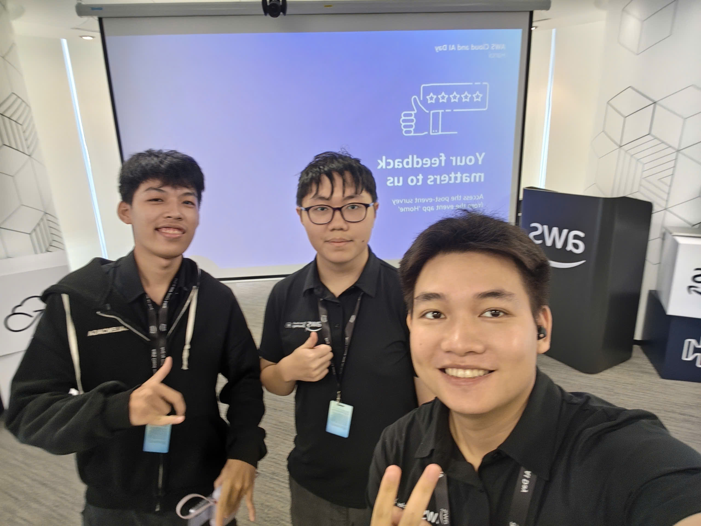

# Bài thu hoạch “AWS CLOUD AND AI DAY HANOI”

### Mục Đích Của Sự Kiện

Sự kiện AWS Cloud and AI Day Hanoi được tổ chức nhằm mang đến một không gian kết nối trực tiếp giữa cộng đồng công nghệ Việt Nam và các chuyên gia hàng đầu từ AWS cùng các đối tác doanh nghiệp. Sự kiện tập trung vào các mục tiêu chiến lược sau:
- **Cập nhật xu hướng công nghệ tiên phong**: Giới thiệu các giải pháp đám mây, kiến trúc dữ liệu hiện đại và đặc biệt là sự bùng nổ của Agentic AI cùng Generative AI trong việc tối ưu hóa quy trình vận hành.
- **Thực hành và trải nghiệm thực chiến**: Cung cấp môi trường trải nghiệm thực tế thông qua các buổi workshop hands-on, giúp các lập trình viên và kỹ sư trực tiếp xây dựng, triển khai các giải pháp AI Agent ngay tại sự kiện.
- **Kết nối cộng đồng và doanh nghiệp**: Tạo bệ phóng giao lưu, trao đổi kinh nghiệm giữa các nhà quản lý IT, các kiến trúc sư giải pháp và những chuyên gia công nghệ hàng đầu.

### Danh Sách Diễn Giả

Sự kiện quy tụ đội ngũ diễn giả đại diện cho các cơ quan quản lý, lãnh đạo tập đoàn công nghệ và chuyên gia giải pháp từ AWS:
- **Phạm Đức Long** – Thứ trưởng Bộ Thông tin và Truyền thông / Bộ Khoa học & Công nghệ
- **Jennifer Wicks** – Đại sứ Mỹ tại Việt Nam
- **Dr. Werner Vogels** – Chief Technology Officer (CTO), Amazon.com
- **Eric Yeo** – Country General Manager (Malaysia, Vietnam, Indochina), AWS
- **Dr. Jens Lottner** – Chief Executive Officer (CEO), Techcombank
- **Mai Le** – Director of Product Management, Katalon
- Cùng dàn Chuyên gia Giải pháp (Solutions Architects) và Kỹ sư hàng đầu từ AWS và đối tác VPBank, Cloud Kinetics.

### Nội Dung Nổi Bật
Chương trình diễn ra với hơn 30 phiên chia sẻ chuyên sâu, bao gồm các chủ đề then chốt:
#### Keynote: Bứt phá giới hạn với Agentic AI và AWS 
Phiên khai mạc tập trung vào câu hỏi "Điều gì sẽ xảy ra nếu chúng ta biến mọi ý tưởng thành hiện thực?". Diễn giả điểm qua cách AWS trang bị công cụ cho các builder hiện đại, đồng thời lắng nghe câu chuyện thành công từ Techcombank và Katalon khi đưa AI vào lõi vận hành.
#### Chuyển đổi và Hiện đại hóa hệ thống với Agentic AI 
Các chuyên đề kỹ thuật đi sâu vào việc ứng dụng AI Agents để giải quyết bài toán hiện đại hóa ứng dụng legacy và tăng tốc quy trình phát triển phần mềm:
  - **Migration at Scale với AWS Transform**: Phương pháp hiện đại hóa ứng dụng và hạ tầng lớn, giảm nợ kỹ thuật (technical debt) thông qua các đại lý tự động.
  - **Xây dựng ứng dụng thế hệ mới**: Tận dụng Agentic AI để tự động hóa chu kỳ SDLC từ lập kế hoạch, viết code đến bảo trì.
#### Nền tảng Dữ liệu cho AI (AI-Ready Data Foundation) 
Để vận hành các mô hình AI hiệu quả, dữ liệu đóng vai trò tiên quyết. Phiên thảo luận tập trung chuẩn hóa kiến trúc dữ liệu, quy trình xử lý dữ liệu quy mô lớn và tính bảo mật nhằm đảm bảo độ chính xác cho các ứng dụng AI.
### Những Gì Học Được
Việc tham dự sự kiện đã giúp tích lũy được nhiều góc nhìn mới từ cả cấp độ tư duy đến kỹ thuật triển khai thực tế.
#### Tư Duy Kiến Trúc & Chiến Lược
  - **Agentic AI Shift**: Nhận thức rõ sự chuyển dịch từ Generative AI đơn thuần (sinh nội dung) sang Agentic AI (có khả năng tự lập kế hoạch, ra quyết định và thực thi nhiệm vụ).
  - **Data-First Mindset**: Muốn triển khai AI thành công trong doanh nghiệp, yếu tố nền tảng không nằm ở mô hình mà nằm ở cấu trúc và chất lượng dữ liệu nền.
#### Kỹ Thuật Chuyên Sâu
  - Thấu hiểu quy trình hiện đại hóa ứng dụng bằng công cụ tự động hóa của AWS giúp rút ngắn thời gian chuyển đổi hệ thống cũ.
  - Nắm bắt cách thiết lập Internal Developer Platform (IDP) trên EKS giúp tăng tốc độ phân phối phần mềm.
  - Kỹ năng tích hợp các mô hình ngôn ngữ lớn (LLMs) vào workflow thông qua hệ sinh thái dịch vụ AWS.
### Ứng Dụng Vào Công Việc

Những kiến thức tiếp thu từ sự kiện mang lại giá trị ứng dụng rõ ràng cho các dự án hiện tại và tương lai:
- **Ứng dụng vào Đồ án & Bài tập lớn**: Thử nghiệm tích hợp các dịch vụ AI như Amazon Bedrock/Amazon Q vào các dự án phần mềm của sinh viên để tối ưu hóa quy trình phát triển.
- **Định hướng học tập về Cloud & AI**: Bổ sung các kiến thức về kiến trúc Microservices, Serverless và Kubernetes (EKS) trên nền tảng AWS vào lộ trình tự học.
- **Chuẩn bị hành trang thực tập**: Tận dụng kiến thức về Agentic AI và Cloud để làm phong phú thêm hồ sơ năng lực (CV), chuẩn bị cho các cơ hội thực tập sắp tới.

### Trải nghiệm trong event
Sự kiện AWS Cloud and AI Day Hanoi là một hành trình học hỏi mang lại nhiều cảm xúc và giá trị thực tế. Không chỉ dừng lại ở các bài thuyết trình lý thuyết, sự kiện mang đến bầu không khí đổi mới sáng tạo tràn đầy năng lượng.
#### Ấn tượng về quy mô và diễn giả 
Sự hiện diện của các tên tuổi lớn như CTO Werner Vogels cùng đại diện từ các Bộ ngành và ngân hàng lớn đã khẳng định tầm quan trọng của làn sóng công nghệ Cloud/AI tại Việt Nam. Cách các diễn giả truyền tải bài toán thực tế của doanh nghiệp giúp bức tranh công nghệ trở nên vô cùng gần gũi và giàu tính chiến lược.
#### Ấn tượng về nội dung chuyên môn và xu hướng AI 
Các phiên chia sẻ kỹ thuật được thiết kế từ mức độ cơ bản đến nâng cao, rất phù hợp cho sinh viên theo dõi và ghi chép.
- **Tiếp cận xu hướng Agentic AI**: Qua các bài trình bày như "Building software like never before with agentic AI", tôi hình dung rõ ràng hơn về cách các lập trình viên sẽ làm việc trong tương lai gần khi kết hợp cùng các AI Agent.
- **Tiết kiệm thời gian & Chủ động tiếp thu**: Việc tham gia từ xa giúp tôi linh hoạt lựa chọn theo dõi các phiên chia sẻ phù hợp nhất với định hướng học tập của bản thân.
#### Môi trường Watch Party & Tương tác 
Tại điểm cầu kết nối trực tuyến ở TP.HCM, tôi vẫn cảm nhận được sức nóng từ sự kiện chính ở Hà Nội.
- **Thảo luận cùng bạn bè**: Cùng với các bạn sinh viên và cộng đồng đam mê AWS tại TP.HCM trao đổi, bàn luận về các giải pháp được trình diễn trong sự kiện.
- **Truyền cảm hứng học tập**: Sự kiện giúp tôi nhận ra tầm quan trọng của việc chủ động học hỏi các công nghệ mới như Cloud & AI ngay từ khi còn ngồi trên ghế nhà trường để không bị tụt hậu.
**Tổng kết**: Sự kiện không chỉ mang lại khối lượng kiến thức kỹ thuật cập nhật mà còn tiếp thêm cảm hứng mạnh mẽ về tư duy đổi mới sáng tạo, giúp tôi tự tin hơn trong việc đề xuất và triển khai các giải pháp AI & Cloud hiện đại vào công việc thực tế.
#### Một số hình ảnh khi tham gia sự kiện

> Tổng thể, sự kiện không chỉ cung cấp kiến thức kỹ thuật mà còn giúp tôi thay đổi cách tư duy về thiết kế ứng dụng, hiện đại hóa hệ thống và phối hợp hiệu quả hơn giữa các team.
