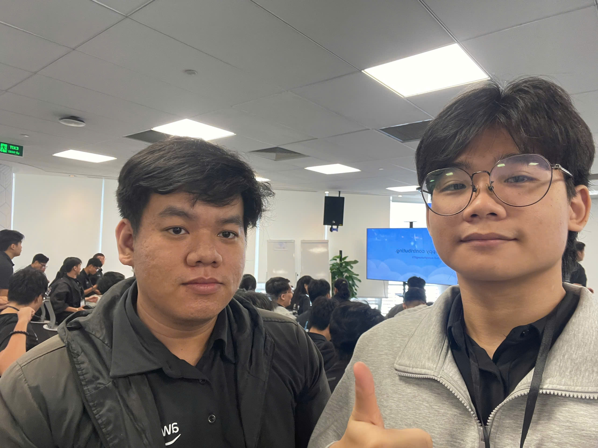
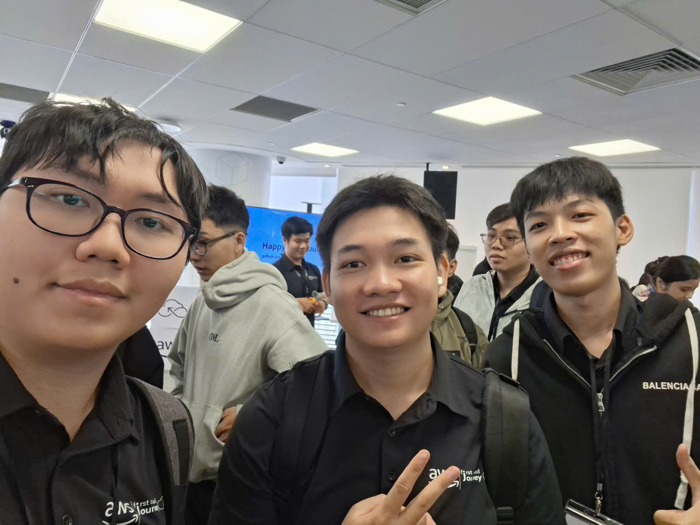

# Summary Report: “AWS First Cloud AI Journey Community Day 2026”

### Event Objectives

The "AWS First Cloud AI Journey - COMMUNITY DAY" event was held at Bitexco Financial Tower to connect technology enthusiasts, students, and cloud engineers. The main objective was to dive deep into hands-on cloud innovations, share real-world software delivery practices, explore cloud learning platforms for certifications, and provide practical internship project insights.

### Speakers

- **Thinh Nguyen** – STYL Solutions
- **Henry Duc Bui** – CloudThinker
- **Hung Tran** – NAB
- **Dao Luong** – FCAJ
- **Khang Duong** – FCAJ
- **Tuan Tran** – FCAJ

### Key Highlights

#### Lessons Learned from Building Software Factories
- Real-world experience in setting up automated software delivery pipelines ("Software Factories") at scale.
- Strategies for automating testing, code inspection, and infrastructure deployment while avoiding common pitfalls in corporate workflows.

#### Cloud Education & Certification Platforms
- Insights from educators and cloud experts on preparing the next generation of Cloud & AI talent.
- Introduction to top cloud learning platforms: AWS Skill Builder, AWS Educate, Coursera, Udemy, and official AWS documentation.
- Roadmap for students to prepare for industry-recognized certifications such as AWS Certified Cloud Practitioner and AWS Certified Solutions Architect - Associate.

#### AWS Lambda Web Functions: Rethinking Serverless Architecture
- Deep dive into native HTTP support and 128-request multi-concurrency features in AWS Lambda.
- Eliminating traditional web server adapter overheads and taking advantage of Active CPU Billing to maximize cost efficiency.
- Performance benchmarks comparing Serverless approaches against Docker containers running on EC2/ECS.

#### Amazon SQS: Building Asynchronous Systems
- The architectural necessity of decoupling microservices using Amazon SQS queues.
- Real-world design patterns for handling high-traffic spikes, dead-letter queues (DLQ), and distributed message processing.

#### My 3-Month AWS Internship Journey
- Personal reflections and milestone experiences during a 3-month intensive cloud internship.
- Walkthrough of a real-world internship project: building a serverless web application using AWS Lambda, Amazon S3, DynamoDB, and CloudFront.
- Practical challenges faced, troubleshooting lessons, and advice for students preparing for their first IT/Cloud internship.

#### Start & Maintain Consistency with Open Source Contributing
- Step-by-step guidance on making initial open-source contributions from scratch.
- Building a sustainable contribution habit, maintaining developer motivation, and leveraging open source for career growth.

### Key Takeaways

#### Technical & Architectural Insights
- **Serverless Optimization**: Understood how AWS Lambda multi-concurrency and active billing reduce operational costs for scalable web services.
- **Asynchronous Messaging**: Mastered message queuing patterns with Amazon SQS to increase application fault tolerance.
- **Project Implementation**: Gained clear visibility into end-to-end cloud project architecture through real internship case studies.

#### Career & Learning Mindset
- **Structured Certification Path**: Identified authoritative learning platforms (AWS Skill Builder, official labs) to prepare systematically for AWS certificates.
- **Open Source Growth**: Realized the long-term impact of open-source contributions on enhancing practical coding skills and building a professional developer profile.

### Applying to Work

- **Study & Certification**: Utilize recommended platforms like AWS Skill Builder to prepare for the AWS Certified Solutions Architect exam.
- **Project Development**: Apply Amazon SQS and AWS Lambda functions into university projects and personal software development.
- **Internship Preparation**: Structure personal GitHub repositories with well-documented projects to showcase cloud hands-on capabilities during job interviews.

### Event Experience

Attending "FCAJ Community Day" at Bitexco Financial Tower was an inspiring and enriching experience:
- **Engaging Speakers**: Hearing directly from industry engineers at STYL Solutions, CloudThinker, NAB, and FCAJ provided grounded, practical knowledge.
- **Clear Internship & Education Guidance**: The specific recommendations on learning platforms and internship project breakdowns made cloud career pathways much clearer.
- **Great Community Atmosphere**: Interacting with fellow learners and cloud professionals encouraged active discussion and networking.

#### Some event photos

> Overall, the event not only provided technical knowledge but also helped me reshape my thinking about application design, system modernization, and cross-team collaboration.
