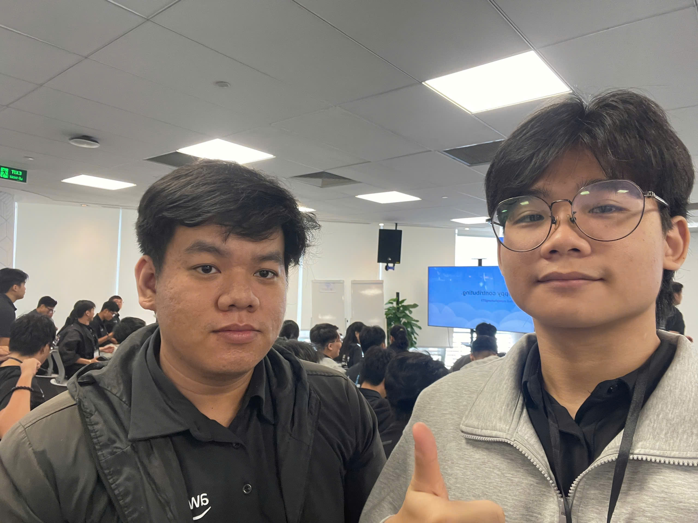
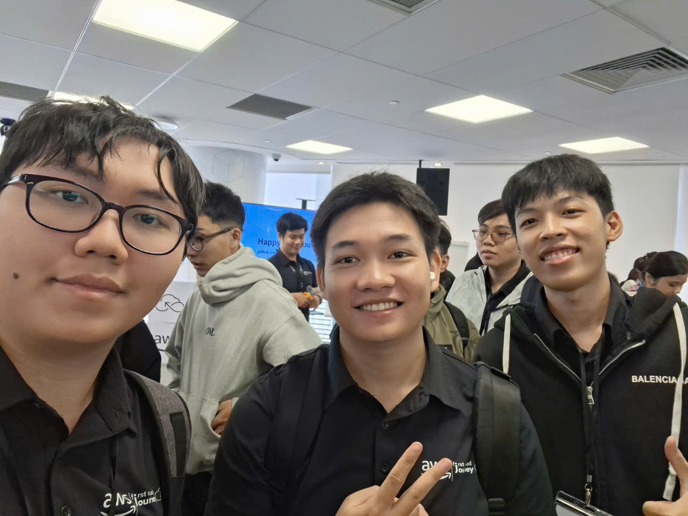

# Bài thu hoạch “AWS First Cloud AI Journey Community Day 2026”

### Mục Đích Của Sự Kiện

Sự kiện "AWS First Cloud AI Journey COMMUNITY DAY 2026" được tổ chức tại Tòa nhà Bitexco Financial Tower nhằm mang đến không gian kết nối cho sinh viên, kỹ sư và cộng đồng yêu thích công nghệ Cloud. Mục tiêu chính của sự kiện là đi sâu vào các giải pháp đám mây thực chiến, chia sẻ quy trình vận hành phần mềm hiện đại, giới thiệu các nền tảng học tập chuẩn bị chứng chỉ AWS và chia sẻ trải nghiệm từ dự án thực tập thực tế.

### Danh Sách Diễn Giả

- **Thịnh Nguyễn** – STYL Solutions
- **Henry Đức Bùi** – CloudThinker
- **Hùng Trần** – NAB
- **Đào Lương** – FCAJ
- **Khang Dương** – FCAJ
- **Tuấn Trần** – FCAJ

### Nội Dung Nổi Bật
#### Bài học từ việc xây dựng Software Factory
- Chia sẻ kinh nghiệm thực tế về việc thiết lập các đường ống đóng gói phần mềm tự động (Software Factory) ở quy mô lớn.
- Các quy trình tự động hóa kiểm thử, kiểm tra chất lượng code, triển khai hạ tầng và các cạm bẫy cần tránh trong môi trường doanh nghiệp.

#### Giáo dục & Các trang web học tập lấy chứng chỉ AWS
- Góc nhìn từ các chuyên gia về việc đào tạo và chuẩn bị hành trang cho thế hệ kỹ sư Cloud & AI tiếp theo.
- Giới thiệu các nền tảng học tập uy tín để ôn luyện chứng chỉ: AWS Skill Builder, AWS Educate, Coursera, Udemy và trang tài liệu chính thức từ AWS (AWS Documentation).
- Lộ trình cho sinh viên từ việc nắm vững kiến thức nền tảng đến khi thi đạt các chứng chỉ quốc tế như AWS Certified Cloud Practitioner và AWS Certified Solutions Architect - Associate.

#### AWS Lambda Web Functions: Tư duy lại kiến trúc Serverless
- Phân tích sâu tính năng hỗ trợ HTTP nguyên bản và khả năng xử lý đồng thời 128 yêu cầu (multi-concurrency) trong AWS Lambda.
- Loại bỏ chi phí trung gian (adapter overhead) và tận dụng cơ chế Active CPU Billing để tối ưu hóa chi phí vận hành ở mức tối đa.
- So sánh hiệu năng giữa mô hình Serverless với việc triển khai Docker container trên EC2/ECS.

#### Amazon SQS: Xây dựng hệ thống bất đồng bộ
- Tầm quan trọng của việc nới lỏng liên kết (decoupling) giữa các microservices bằng hàng đợi Amazon SQS.
- Các mô hình thiết kế thực tế để xử lý lưu lượng truy cập tăng đột biến, xử lý tin nhắn lỗi với Dead Letter Queue (DLQ) và quản lý luồng tin nhắn phân tán.

#### Hành trình 3 tháng thực tập AWS & Dự án thực tế
- Chia sẻ chân thực về những mốc thời gian và trải nghiệm trong kỳ thực tập công nghệ Cloud kéo dài 3 tháng.
- Chi tiết về dự án thực tế đã triển khai trong kỳ thực tập: Xây dựng ứng dụng web Serverless kết hợp các dịch vụ AWS Lambda, Amazon S3, DynamoDB và CloudFront.
- Các khó khăn kỹ thuật gặp phải, bài học sửa lỗi (troubleshooting) và lời khuyên thiết thực cho sinh viên chuẩn bị bước vào kỳ thực tập IT/Cloud.

#### Bắt đầu và duy trì đóng góp Mã nguồn mở (Open Source)
- Hướng dẫn từng bước cách thực hiện đóng góp mã nguồn mở đầu tiên cho người mới bắt đầu.
- Cách tạo lập thói quen đóng góp đều đặn, giữ vững động lực và tận dụng mã nguồn mở để phát triển hồ sơ năng lực cá nhân.

### Những Gì Học Được

#### Về Kiến thức & Kỹ thuật
- **Tối ưu Serverless**: Hiểu rõ cơ chế xử lý đồng thời và tính phí của AWS Lambda giúp giảm đáng kể chi phí vận hành cho các dịch vụ web.
- **Kiến trúc bất đồng bộ**: Nắm vững các pattern hàng đợi với Amazon SQS để tăng độ chịu lỗi cho hệ thống.
- **Thực thi dự án**: Hình dung rõ ràng quy trình xây dựng một dự án Cloud hoàn chỉnh từ khâu thiết kế đến triển khai thông qua trường hợp thực tế của diễn giả thực tập.

#### Về Lộ trình học tập & Sự nghiệp
- **Lộ trình thi chứng chỉ**: Biết tới các nguồn học uy tín (AWS Skill Builder, các bài lab thực hành) để chủ động ôn luyện các chứng chỉ AWS.
- **Tư duy đóng góp cộng đồng**: Nhận thức được giá trị lâu dài của mã nguồn mở trong việc nâng cao kỹ năng lập trình và tạo lợi thế cạnh tranh khi ứng tuyển.

### Ứng Dụng Vào Công Việc

- **Học tập & Thi chứng chỉ**: Tận dụng các trang web như AWS Skill Builder để ôn luyện kiến thức, chuẩn bị thi chứng chỉ AWS Solutions Architect.
- **Triển khai đồ án**: Áp dụng mô hình hàng đợi Amazon SQS và AWS Lambda vào các bài tập lớn và dự án phần mềm cá nhân.
- **Chuẩn bị hồ sơ thực tập**: Đẩy mạnh đóng góp trên GitHub và xây dựng các dự án mẫu có sử dụng dịch vụ AWS để làm phong phú CV trước nhà tuyển dụng.

### Trải nghiệm trong event
Tham gia sự kiện "FCAJ Community Day" tại Bitexco Financial Tower mang lại nhiều cảm xúc và giá trị học hỏi thiết thực:
- **Diễn giả gần gũi & Thực tế**: Các chia sẻ từ kỹ sư tại STYL Solutions, CloudThinker, NAB và FCAJ mang tính ứng dụng cao, không nặng lý thuyết.
- **Định hướng học tập rõ ràng**: Phần giới thiệu tài nguyên học tập và chi tiết dự án thực tập giúp giải đáp trực tiếp những thắc mắc của sinh viên về ngành Cloud.
- **Không khí giao lưu tích cực**: Môi trường sự kiện cởi mở, tạo điều kiện thuận lợi để trao đổi kiến thức với các bạn sinh viên và chuyên gia.
#### Một số hình ảnh khi tham gia sự kiện

> Tổng thể, sự kiện không chỉ cung cấp kiến thức kỹ thuật mà còn giúp tôi thay đổi cách tư duy về thiết kế ứng dụng, hiện đại hóa hệ thống và phối hợp hiệu quả hơn giữa các team.
