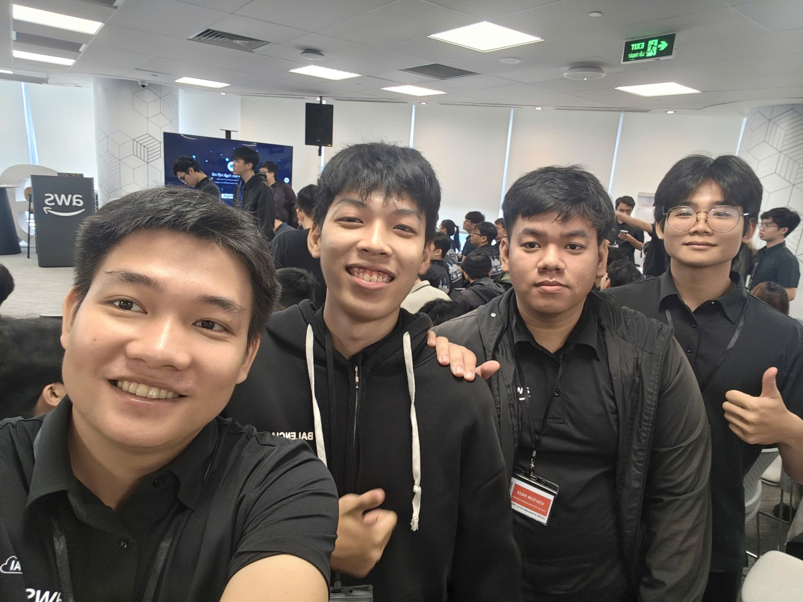

# Summary Report: “The Invariable Lessons of Tech and Humanity: Key Takeaways from Amazon CTO Werner Vogels”

### Event Objectives

“Navigating the Future of Cloud & AI in Vietnam” brought the technology community together with AWS and industry experts. Its themes included Cloud and AI trends, large-scale data architecture, operational excellence, and the skills software engineers need in the future. This report summarizes key insights shared by Dr. Werner Vogels, CTO & VP of Amazon.com.

> The source document does not specify the event date or venue.

### Speaker

- **Dr. Werner Vogels** – CTO & VP, Amazon.com

### Key Highlights

#### Dynamo and choosing technology based on real needs

The keynote described a database incident during a peak shopping period that caused a prolonged outage and significant losses. An analysis of query patterns showed that most of the workload consisted of Key-Value operations, while only a smaller portion required complex relational capabilities. The lesson is to understand how an application uses data before choosing its architecture; this analysis also contributed to the development of Dynamo and DynamoDB.

#### Four principles of operational excellence

- **Measure at P99.9:** Average latency can hide the experience of the most affected users. High-percentile measurements help identify and improve slow cases.
- **Design assuming failures will happen:** Distributed systems should continue operating when a component or an availability zone fails.
- **Practice GameDays:** Simulate failures to test detection, recovery, and failover.
- **Understand the impact of usage-based pricing:** With pay-as-you-go, cost and operational quality need continuous attention.

#### The “Renaissance Developer”

The speaker encouraged engineers to develop five qualities: curiosity and continuous learning; systems thinking; ownership; deep expertise combined with broad, T-shaped knowledge; and communication skills to understand business goals and explain technical trade-offs.

#### AI as an assistant, with people remaining accountable

AI can accelerate prototyping and support software development, but its output still requires human review for correctness, security, edge cases, and performance. Judgment, creativity, empathy, and professional responsibility remain core engineering capabilities.

### Key Takeaways

- **Think from first principles:** Analyze actual data patterns and access behavior before selecting a database or adopting a technology.
- **Measure performance appropriately:** Track P99.9 alongside averages to understand latency in the worst cases.
- **Design for resilience:** Expect failures and validate recovery through exercises such as GameDays.
- **Build well-rounded capabilities:** Combine deep technical expertise with systems thinking, communication, and business understanding.
- **Use AI responsibly:** Treat AI as a productivity tool and review generated code before production use.

### Applying to Work

- Identify an application's main queries and read/write patterns before selecting a database.
- Track percentile latency and set performance objectives based on user experience.
- Plan failure, recovery, and failover tests for critical system components.
- Use AI to assist with prototyping and implementation while personally verifying security, logic, and performance.
- Develop systems thinking and explain technical decisions in terms stakeholders can understand.

### Event Experience

The keynote connected practical operational lessons with system-design principles and career guidance for engineers. The Dynamo story illustrated the value of designing around actual usage patterns, while the discussion of AI emphasized that technology can assist work but does not replace human judgment and accountability.

#### Some event photos

