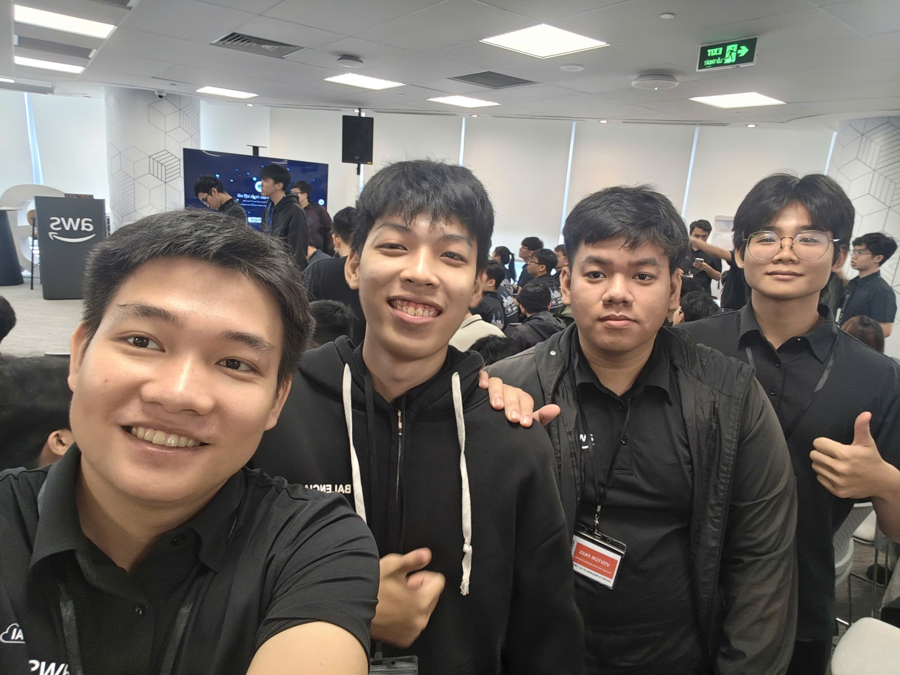

# Bài thu hoạch “The Invariable Lessons of Tech and Humanity: Key Takeaways from Amazon CTO Werner Vogels”

### Mục Đích Của Sự Kiện

Sự kiện “Navigating the Future of Cloud & AI in Vietnam” tạo cơ hội kết nối cộng đồng công nghệ với các chuyên gia AWS và doanh nghiệp. Nội dung tập trung vào xu hướng Cloud và AI, kiến trúc dữ liệu quy mô lớn, vận hành xuất sắc và những năng lực cần có của kỹ sư phần mềm trong tương lai. Bài thu hoạch ghi lại các chia sẻ nổi bật từ Dr. Werner Vogels, CTO & VP của Amazon.com.

> Thời gian và địa điểm tổ chức không được nêu trong tài liệu nguồn.

### Diễn Giả

- **Dr. Werner Vogels** – CTO & VP, Amazon.com

### Nội Dung Nổi Bật

#### Bài học về Dynamo và lựa chọn công nghệ từ nhu cầu thực tế

Diễn giả chia sẻ về một sự cố cơ sở dữ liệu trong mùa mua sắm cao điểm, gây gián đoạn kéo dài và thiệt hại lớn. Khi phân tích mô hình truy vấn, đội ngũ nhận thấy phần lớn tải là các thao tác Key-Value, trong khi chỉ một phần nhỏ cần các tính năng quan hệ phức tạp. Bài học là cần hiểu cách ứng dụng sử dụng dữ liệu trước khi chọn kiến trúc; phân tích này cũng góp phần dẫn đến việc phát triển Dynamo và DynamoDB.

#### Bốn nguyên tắc vận hành xuất sắc

- **Đo lường ở P99.9:** Độ trễ trung bình có thể che khuất trải nghiệm của nhóm người dùng bị ảnh hưởng nặng nhất. Theo dõi các bách phân vị cao giúp nhận diện và cải thiện các trường hợp chậm.
- **Thiết kế với giả định sự cố sẽ xảy ra:** Hệ thống phân tán cần tiếp tục phục vụ khi một thành phần hoặc một vùng gặp lỗi.
- **Thực hành GameDays:** Chủ động mô phỏng sự cố để kiểm tra khả năng phát hiện, phục hồi và chuyển đổi dự phòng.
- **Hiểu tác động của mô hình trả theo mức sử dụng:** Mô hình pay-as-you-go khiến chi phí và chất lượng vận hành trở thành các yếu tố cần được theo dõi liên tục.

#### Chân dung “Renaissance Developer”

Diễn giả khuyến khích kỹ sư phát triển năm phẩm chất: tò mò và học tập liên tục; tư duy hệ thống; tinh thần chịu trách nhiệm (ownership); chuyên môn sâu kết hợp hiểu biết rộng theo hình chữ T; và khả năng giao tiếp để hiểu mục tiêu kinh doanh cũng như giải thích các đánh đổi kỹ thuật.

#### AI là công cụ hỗ trợ, con người vẫn chịu trách nhiệm

AI có thể tăng tốc tạo mẫu và hỗ trợ phát triển phần mềm, nhưng kết quả vẫn cần được con người đánh giá về tính đúng đắn, bảo mật, các trường hợp biên và hiệu năng. Khả năng phán đoán, sáng tạo, thấu cảm và trách nhiệm nghề nghiệp tiếp tục là những năng lực cốt lõi của kỹ sư.

### Những Gì Học Được

- **Tư duy từ nguyên lý cơ bản:** Phân tích mô hình dữ liệu và hành vi truy cập thực tế trước khi lựa chọn cơ sở dữ liệu hoặc áp dụng một công nghệ.
- **Đo lường hiệu năng đúng cách:** Theo dõi P99.9 bên cạnh các chỉ số trung bình để hiểu rõ độ trễ ở các trường hợp xấu.
- **Thiết kế khả năng chịu lỗi:** Xem sự cố là điều cần dự liệu và kiểm chứng bằng các bài diễn tập như GameDays.
- **Phát triển năng lực toàn diện:** Kết hợp chuyên môn kỹ thuật sâu với tư duy hệ thống, giao tiếp và hiểu biết về nghiệp vụ.
- **Sử dụng AI có trách nhiệm:** Xem AI là công cụ tăng năng suất; kiểm tra mã do AI tạo ra trước khi đưa vào môi trường thật.

### Ứng Dụng Vào Công Việc

- Trước khi chọn cơ sở dữ liệu, xác định các truy vấn chính và tỷ lệ đọc/ghi của ứng dụng.
- Xây dựng theo dõi độ trễ theo bách phân vị và đặt mục tiêu hiệu năng phù hợp với trải nghiệm người dùng.
- Lập kế hoạch kiểm thử sự cố, khả năng phục hồi và chuyển đổi dự phòng cho các thành phần quan trọng.
- Dùng AI để hỗ trợ tạo mẫu hoặc tăng tốc công việc, đồng thời tự chịu trách nhiệm kiểm tra bảo mật, logic và hiệu năng.
- Rèn luyện tư duy hệ thống và kỹ năng giải thích các lựa chọn kỹ thuật bằng ngôn ngữ phù hợp với các bên liên quan.

### Trải Nghiệm Trong Event

Phần chia sẻ kết nối các bài học vận hành thực tế với những nguyên tắc thiết kế hệ thống và định hướng nghề nghiệp cho kỹ sư. Câu chuyện về Dynamo giúp làm rõ giá trị của việc dựa trên mô hình sử dụng thực tế; phần trao đổi về AI nhấn mạnh rằng công nghệ có thể hỗ trợ công việc nhưng không thay thế trách nhiệm và phán đoán của con người.

#### Một số hình ảnh khi tham gia sự kiện

