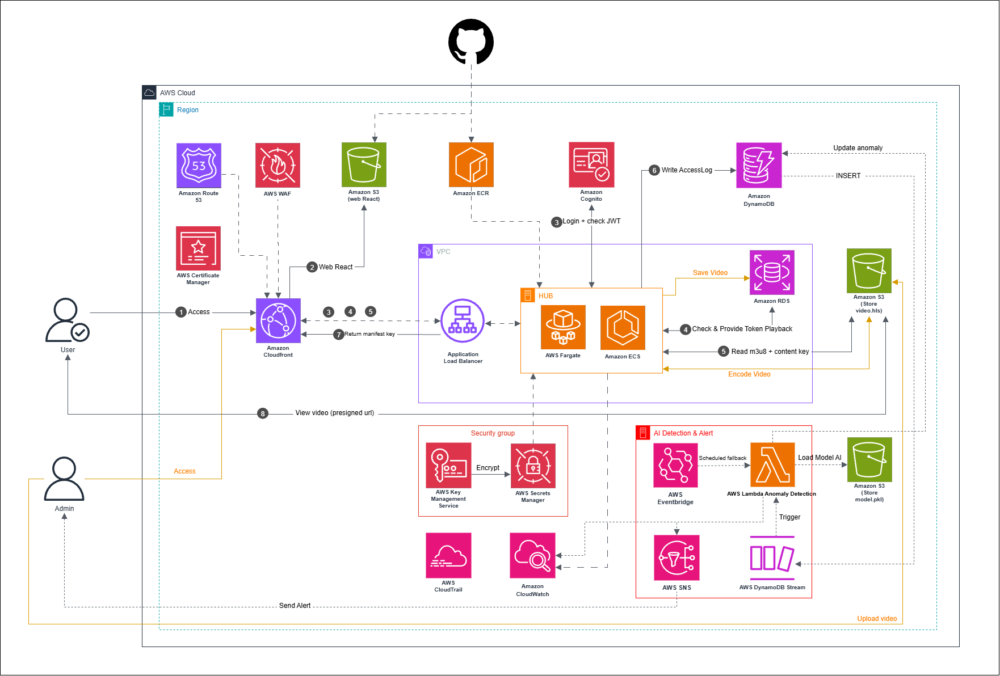

### 1. Problem Statement & Solution Overview
Small and medium-sized educational centers (SMEs) face severe intellectual property leakage when lecture videos are downloaded, screen-recorded, and redistributed illegally. Commercial DRM solutions (Widevine, PlayReady) carry prohibitive licensing fees and integration complexity.

**SecureLearn** solves this using an AWS–Cloudflare Hybrid Serverless architecture:
* **Media Pipeline:** Videos uploaded to Cloudflare R2 trigger Cloudflare Queues and Consumer Workers to coordinate transcoding via **AWS Elemental MediaConvert** into HLS/DASH formats.
* **Delivery & Access Control:** Students authenticate via **Amazon Cognito** (JWT). **AWS Lambda** verifies course entitlements in **Amazon DynamoDB** and issues a short-lived HMAC-SHA256 signed playback token (1-hour TTL), validated at the edge by **Cloudflare Workers**.
* **Security & Key Management:** **AWS KMS** and **AWS Secrets Manager** protect API credentials, while **AWS CloudTrail** logs all audit events.
* **AI & Leak Tracing:** **AWS EventBridge** triggers an **Isolation Forest** Lambda function every 5 minutes to detect abnormal access patterns and send alerts via **Amazon SNS**, paired with a JavaScript dynamic watermark displaying the student's User ID and IP.

### 2. Architecture Diagrams

