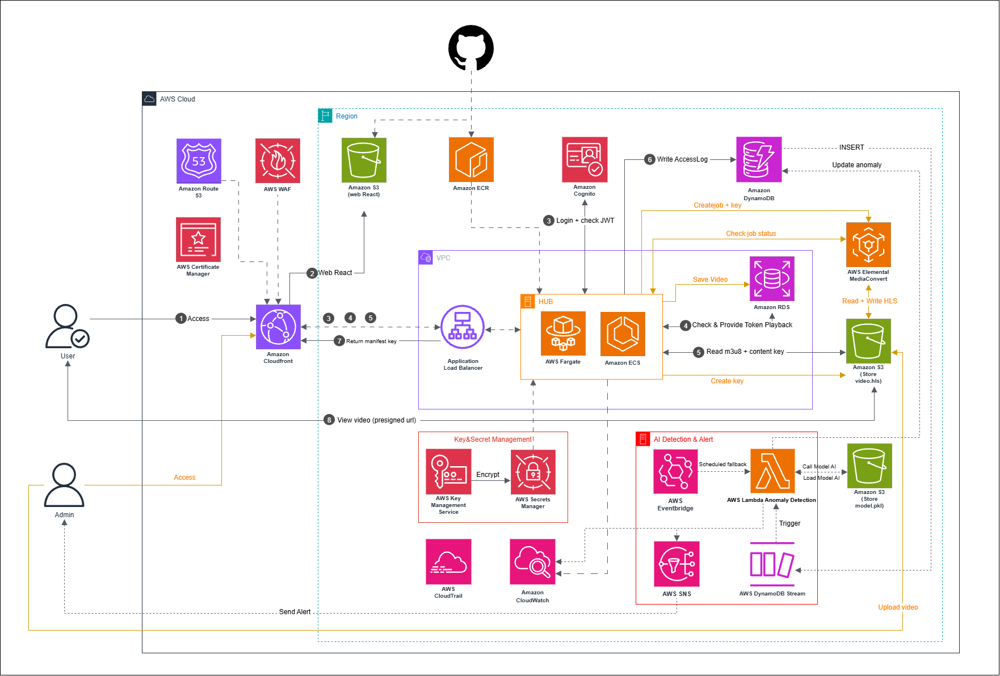

### 1. Bối cảnh Bài toán & Giải pháp
Các trung tâm đào tạo vừa và nhỏ (SMEs) đối mặt với nguy cơ thất thoát tài sản trí tuệ nghiêm trọng do video bài giảng bị tải xuống, quay màn hình và phát tán trái phép. Các giải pháp DRM thương mại (Widevine, PlayReady) có chi phí bản quyền quá cao và tích hợp phức tạp.

**SecureLearn** là một LMS gồm frontend ReactJS và backend Spring Boot, bảo vệ video bằng nhiều lớp:
* **Lớp Upload & Xử lý (Media Pipeline):** Giảng viên upload video gốc thẳng lên Amazon S3 bằng presigned URL. Backend Spring Boot chạy trên Amazon ECS Fargate dùng MediaConvert chuyển video sang HLS (segment 6 giây) và mã hóa AES-128 từng segment bằng khóa riêng cho mỗi bài học.
* **Lớp Phân phối & Kiểm soát truy cập:** Học viên đăng nhập qua Amazon Cognito nhận JWT. Backend cấp playback token (HMAC-SHA256, thời hạn 2 giờ), chỉ trả khóa giải mã cho đúng người giữ token, và mỗi segment chỉ tải được qua presigned URL S3 hạn 60 giây. Frontend ReactJS được phân phối qua Amazon CloudFront (lọc bởi AWS WAF), dữ liệu nghiệp vụ lưu trong Amazon RDS for PostgreSQL.
* **Lớp Bảo mật & Quản lý khóa:** **AWS KMS** và **AWS Secrets Manager** bảo vệ thông tin xác thực API, **AWS CloudTrail** ghi lại toàn bộ nhật ký truy cập.
* **Lớp AI & Truy vết:** **AWS EventBridge** kích hoạt Lambda chạy mô hình **Isolation Forest** mỗi 5 phút để phát hiện hành vi bất thường và gửi cảnh báo qua **Amazon SNS**, kết hợp watermark động hiển thị User ID và IP của học viên.

### 2. Sơ đồ Kiến trúc Hệ thống

