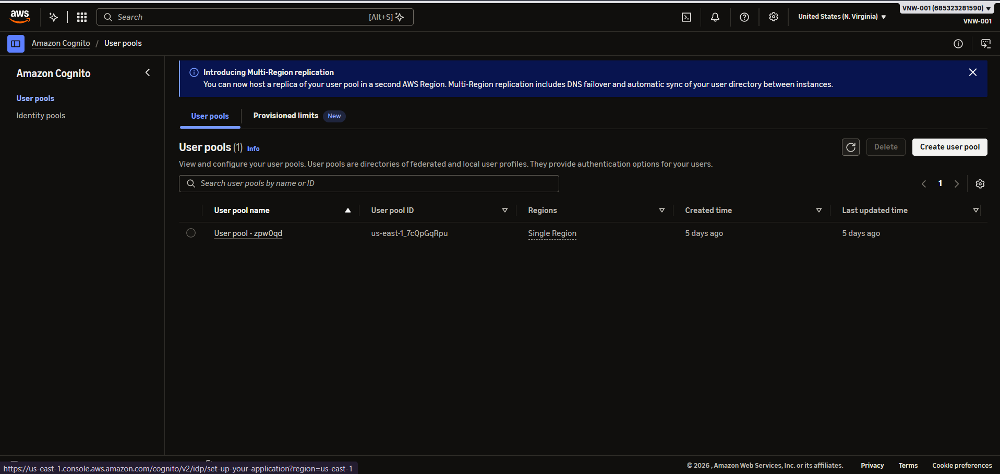
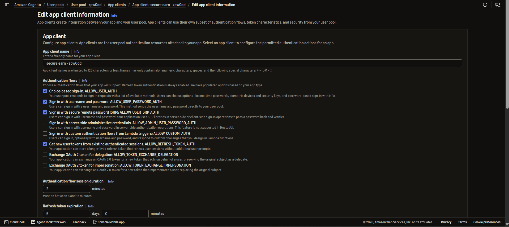
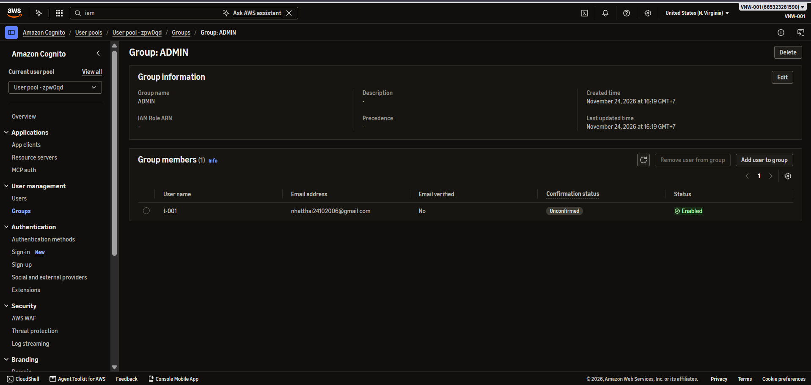
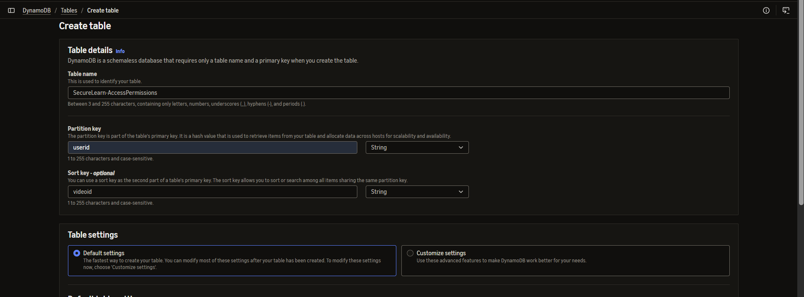

### Step 1: Create User Pool
1. Go to Amazon Cognito > User pools > Create user pool.

2. **Define your application:**
* **Application type:** Select **Traditional web application**. The Spring Boot backend uses the app client secret when calling Cognito; keep the secret on the backend and never expose it to ReactJS.
* **Name your application:** SecureLearn.

3. **Expand "Configure options":**
* **Options for sign-in identifiers:** Select only "Email" (deselect "Username" and "Phone number").
* **Self-registration:** Check "Enable self-registration" (if you want students to register themselves), or leave it unchecked if accounts will be created by an administrator.
* **Required attributes for sign-up:** Select "email".
* **Add a return URL:** Configure `http://localhost:3000/` and your production URL only if you use Cognito Hosted UI/OAuth redirects. The workshop's backend password-authentication flow does not use a redirect URL.

4. Click "Create User Directory".

### Step 2: Configure the App Client and Admin Group
1. Go to **App clients** > select **SecureLearn** > **Edit** > **Authentication flows**. Enable `ALLOW_USER_PASSWORD_AUTH` and `ALLOW_REFRESH_TOKEN_AUTH`, then save (the Spring Boot backend uses `USER_PASSWORD_AUTH`).

2. Go to **Groups** > **Create group** > create `ADMIN` (Spring Security authorizes admin APIs using the `cognito:groups` claim).
3. Go to **Users** > **Create user** to create an administrator account, then **Add user to group** > `ADMIN`.

### Step 3: Save Configuration Identifiers
Record the following parameters for the Spring Boot backend and, if enabled, the AI Lambda account-lockout feature:
* **User pool ID** (ví dụ: `us-east-1_NgBOkcb38`)
* **App client ID** (`1ts3buhe230pqn3ldfdv90qj7f`)
* **Cognito domain** (ví dụ: `https://us-east-1ngbokcb38.auth.us-east-1.amazoncognito.com`)

### Create DynamoDB
1. Access DynamoDB > Create table.

2. Table name: SecureLearn-AccessLog.

3. Partition key: userId (String).

4. Sort key: videoId (String).

5. Select Default settings > Create table.

