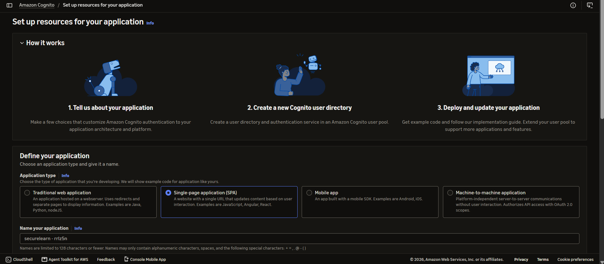
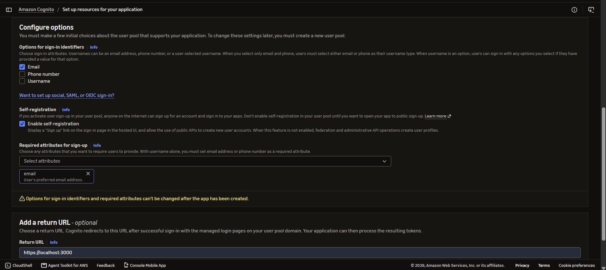
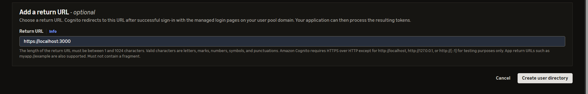
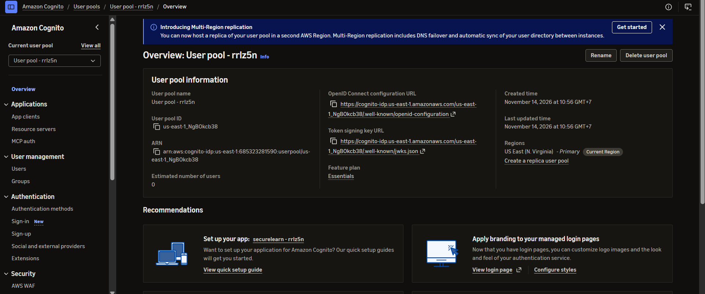

### Step 1: Create User Pool
1. Go to Amazon Cognito > User pools > Create user pool.

2. **Define your application:**
* **Application type:** Select "Single-page application (SPA)" (since ReactJS runs in the browser).
* **Name your application:** SecureLearn.

3. **Expand "Configure options":**
* **Options for sign-in identifiers:** Select only "Email" (deselect "Username" and "Phone number").
* **Self-registration:** Check "Enable self-registration" (if you want students to register themselves), or leave it unchecked if accounts will be created by an administrator.
* **Required attributes for sign-up:** Select "email".
* **Add a return URL:** Enter `http://localhost:3000/` (for development) and your actual domain (for production). This step is mandatory for OAuth redirection.

4. Click "Create User Directory".

### Step 2: Save Configuration Identifiers
Record the following parameters for your API Gateway and React frontend configuration:
* **User pool ID** (ví dụ: `us-east-1_NgBOkcb38`)
* **App client ID** (`1ts3buhe230pqn3ldfdv90qj7f`)
* **Cognito domain** (ví dụ: `https://us-east-1ngbokcb38.auth.us-east-1.amazoncognito.com`)

