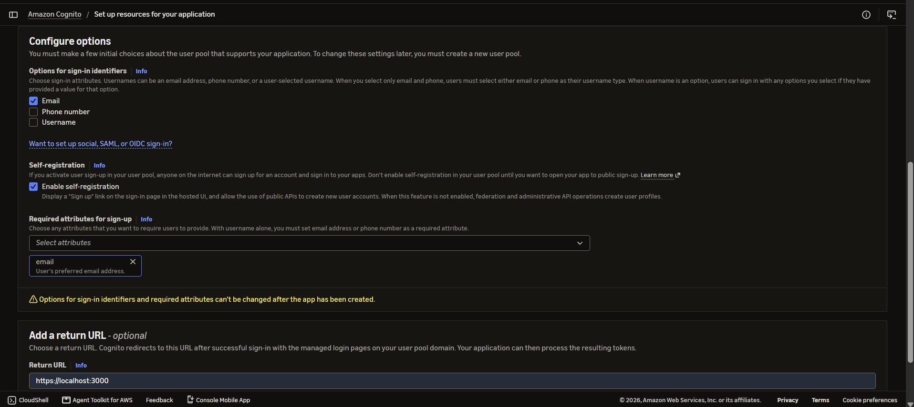

### Bước 1: Khởi tạo User Pool
1. Truy cập Amazon Cognito > User pools > Create user pool.

2. **Define your application:**
* **Application type:** Chọn Single-page application (SPA) (Vì ReactJS chạy trên trình duyệt).
* **Name your application:** SecureLearn.

3. **Mở rộng Configure options:**
* Options for sign-in identifiers: Chỉ tích chọn Email (Bỏ chọn Username và Phone number).
* Self-registration: Tích chọn Enable self-registration (nếu muốn học viên tự đăng ký) hoặc bỏ tích nếu admin tạo tài khoản.
* Required attributes for sign-up: Chọn email.
* **Add a return URL:** Chỉ cấu hình `http://localhost:3000/` và domain production nếu dùng Cognito Hosted UI/OAuth redirect. Luồng xác thực bằng mật khẩu của backend trong workshop không dùng URL chuyển hướng.

4. Nhấn Create User Directory.

### Bước 2: Cấu hình App client & Nhóm quyền
1. Vào App clients > chọn SecureLearn > Edit > Authentication flows: tích ALLOW_USER_PASSWORD_AUTH và ALLOW_REFRESH_TOKEN_AUTH > Save changes (backend Spring Boot đăng nhập bằng luồng USER_PASSWORD_AUTH).

2. Vào Groups > Create group > tạo nhóm ADMIN (Spring Security phân quyền API quản trị theo claim cognito:groups).
3. Vào Users > Create user để tạo tài khoản quản trị, sau đó Add user to group > ADMIN.

### Bước 3: Lưu lại Thông tin Định danh
Ghi chú lại các giá trị sau để cấu hình cho backend Spring Boot và ReactJS:
* **User pool ID** (ví dụ: `us-east-1_NgBOkcb38`)
* **App client ID** (`1ts3buhe230pqn3ldfdv90qj7f`)
* **Cognito domain** (ví dụ: `https://us-east-1ngbokcb38.auth.us-east-1.amazoncognito.com`)

### Tạo DynamoDB
1. Truy cập DynamoDB > Create table.

2. Table name: SecureLearn-AccessPermissions.

3. Partition key: userId (String).

4. Sort key: videoId (String).

5. Chọn Default settings > Create table.

