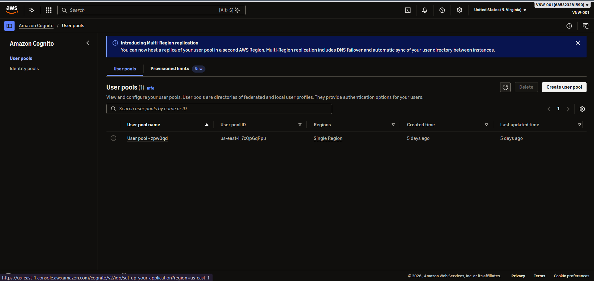
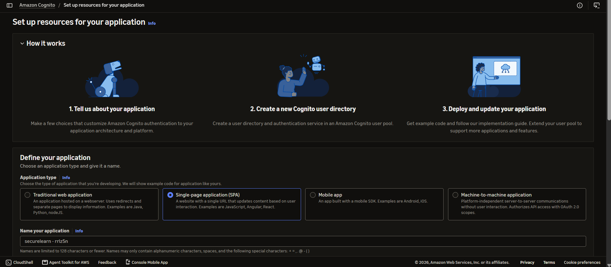
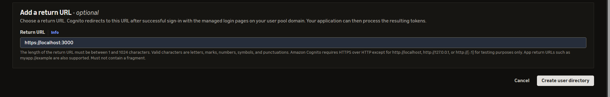
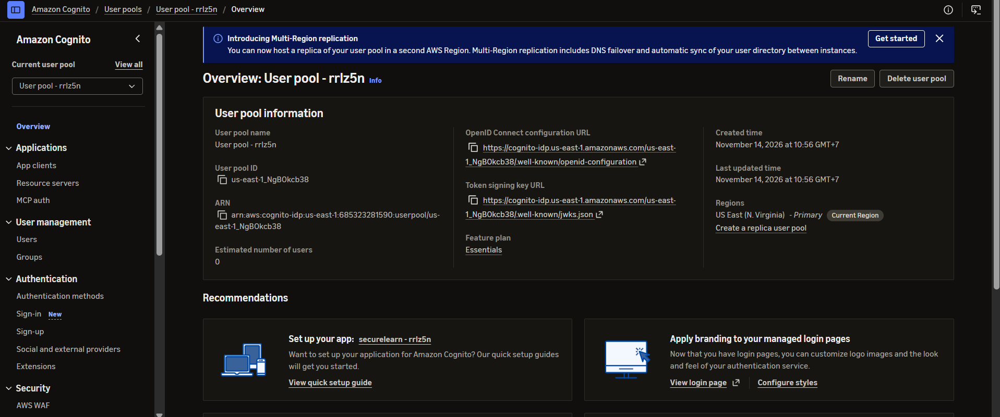

### Bước 1: Khởi tạo User Pool
1. Truy cập Amazon Cognito > User pools > Create user pool.

2. **Define your application:**
* **Application type:** Chọn Single-page application (SPA) (Vì ReactJS chạy trên trình duyệt).
* **Name your application:** SecureLearn.

3. **Mở rộng Configure options:**
* Options for sign-in identifiers: Chỉ tích chọn Email (Bỏ chọn Username và Phone number).
* Self-registration: Tích chọn Enable self-registration (nếu muốn học viên tự đăng ký) hoặc bỏ tích nếu admin tạo tài khoản.
* Required attributes for sign-up: Chọn email.
* Add a return URL: Nhập http://localhost:3000/ (cho dev) và domain thực tế của bạn (cho production). Bước này bắt buộc phải có để OAuth chuyển hướng.

4. Nhấn Create User Directory.

### Bước 2: Lưu lại Thông tin Định danh
Ghi chú lại các giá trị sau để cấu hình cho API Gateway và ReactJS:
* **User pool ID** (ví dụ: `us-east-1_NgBOkcb38`)
* **App client ID** (`1ts3buhe230pqn3ldfdv90qj7f`)
* **Cognito domain** (ví dụ: `https://us-east-1ngbokcb38.auth.us-east-1.amazoncognito.com`)

