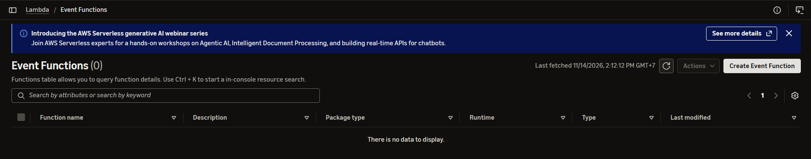
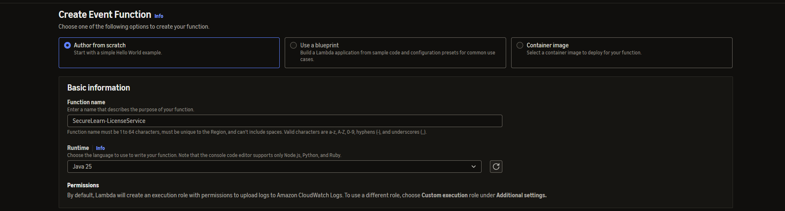
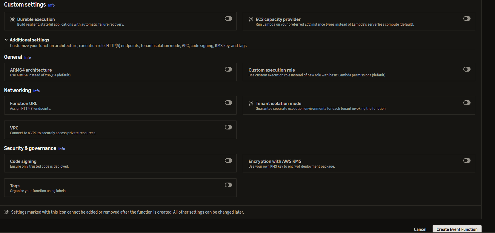
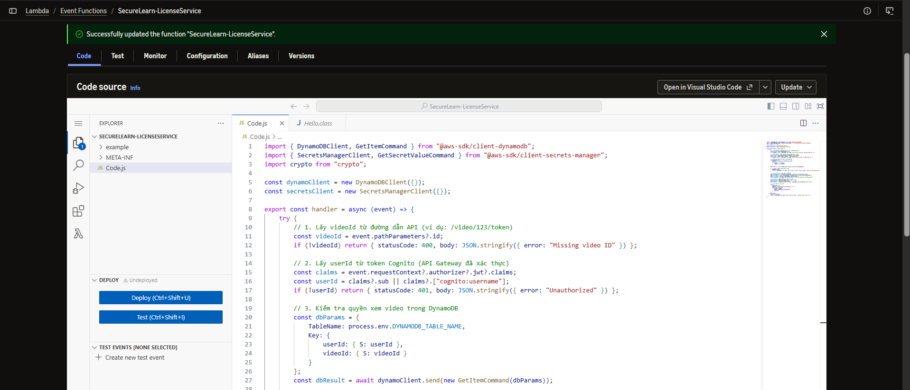
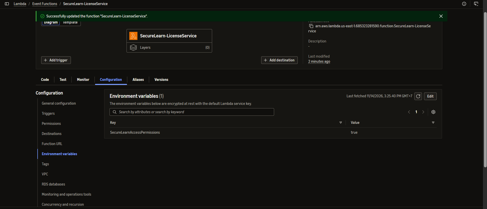

### Step 1: Create Lambda License Service
1. Go to **AWS Lambda** > **Create event function**.

2. Select **Author from scratch** > **Function name:** `SecureLearn-LicenseService`
3. **Runtime:** Select **Node.js 20.x** / **Python 3.12**.

4. **Custom settings / Additional settings**: Leave as default
5. Click Create function.



6. In the Code tab, delete the sample code and paste the following Node.js code (This code is used to check DynamoDB and create HMAC-SHA256 signature):
```js
import { DynamoDBClient, GetItemCommand } from "@aws-sdk/client-dynamodb";
import { SecretsManagerClient, GetSecretValueCommand } from "@aws-sdk/client-secrets-manager";
import crypto from "crypto";

const dynamoClient = new DynamoDBClient({});
const secretsClient = new SecretsManagerClient({});

export const handler = async (event) => {
    try {
        // 1. Lấy videoId từ đường dẫn API (ví dụ: /video/123/token)
        const videoId = event.pathParameters?.id;
        if (!videoId) return { statusCode: 400, body: JSON.stringify({ error: "Missing video ID" }) };

        // 2. Lấy userId từ token Cognito (API Gateway đã xác thực)
        const claims = event.requestContext?.authorizer?.jwt?.claims;
        const userId = claims?.sub || claims?.["cognito:username"];
        if (!userId) return { statusCode: 401, body: JSON.stringify({ error: "Unauthorized" }) };

        // 3. Kiểm tra quyền xem video trong DynamoDB
        const dbParams = {
            TableName: process.env.DYNAMODB_TABLE_NAME,
            Key: { 
                userId: { S: userId }, 
                videoId: { S: videoId } 
            }
        };
        const dbResult = await dynamoClient.send(new GetItemCommand(dbParams));
        
        // Nếu không có quyền trong DB thì chặn
        if (!dbResult.Item) {
            return { statusCode: 403, body: JSON.stringify({ error: "Access Denied. You do not have permission to view this video." }) };
        }

        // 4. Lấy Secret Key từ AWS Secrets Manager
        const secretParams = { SecretId: process.env.CLOUDFLARE_API_TOKEN_SECRET_NAME };
        const secretResult = await secretsClient.send(new GetSecretValueCommand(secretParams));
        const secretData = JSON.parse(secretResult.SecretString);
        const signingKey = secretData.CDN_SIGNING_SECRET; // Key dùng chung với Cloudflare Worker

        // 5. Tạo chữ ký (HMAC-SHA256) có thời hạn 1 giờ
        const expiresAt = Math.floor(Date.now() / 1000) + 3600; 
        const payload = `${videoId}:${expiresAt}`;
        const signature = crypto.createHmac('sha256', signingKey).update(payload).digest('hex');

        // 6. Trả token về cho Client
        return {
            statusCode: 200,
            headers: { "Access-Control-Allow-Origin": "*" },
            body: JSON.stringify({ 
                videoId: videoId,
                token: `${signature}:${expiresAt}`, 
                expiresAt 
            })
        };
    } catch (error) {
        console.error(error);
        return { statusCode: 500, body: JSON.stringify({ error: "Internal Server Error" }) };
    }
}; 
```


7. Click Deploy.

8. Configure environment variables: Go to Configuration > Environment variables > Edit, and add the following two variables:

* DYNAMODB_TABLE_NAME: SecureLearn-AccessPermissions

* CLOUDFLARE_API_TOKEN_SECRET_NAME: SecureLearn/CloudflareCredentials (to be created in a later step).


### Step 2: Create an HTTP API Gateway & JWT Authorizer
1. Navigate to **Amazon API Gateway** > **Create API** > **HTTP API** > **Build**.

2. **API name:** `SecureLearn-API` > **IP address type:** `IPv4` > Click **Next**.

3. **Integrations:** Click **Add integration** > Lambda > **AWS Region:** us-east-1 > **Lambda function:** select the newly created license Lambda function > **Version:** 2 > Click **Next**.

4. **Configure Route:**
* **Method:** `GET`
* **Path:** `/video/{id}/token`
* **Integration target:** The `SecureLearn-LicenseService` Lambda function.


5. Keep the `$default` stage with **Auto-deploy** enabled, then click **Create**.


6. **Attach a JWT Authorizer:**
* Go to **Authorization** > **Manage authorizers** > **Create**. 
 
* **Name:** `CognitoAuthorizer` 
* **Type:** `JWT` 
* **Issuer URL:** `https://us-east-1ngbokcb38.auth.us-east-1.amazoncognito.com` 
* **Audience:** `1ts3buhe230pqn3ldfdv90qj7f`


7. **Attach Authorizer:** Go back to Routes, select GET /video/{id}/token > Attach authorization > select CognitoAuthorizer.
