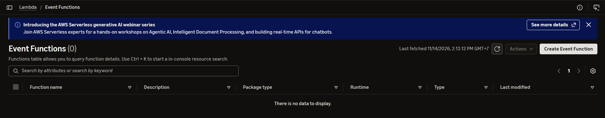
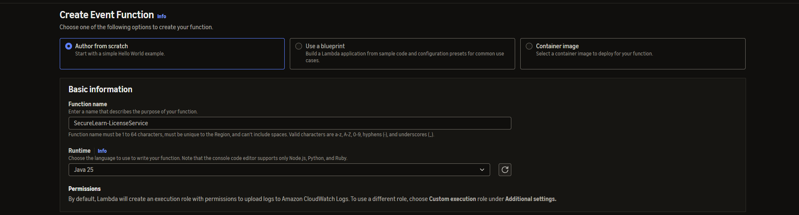

### Bước 1: Tạo SecureLearn-AnomalyDetection
1. Truy cập AWS Lambda > Create function. 

2. Chọn Author from scratch > Function name: SecureLearn-AnomalyDetection 
3. Runtime: Chọn Python 3.12; Architecture: x86_64.

4. Custom settings / Additional settings: Để default (Lambda tự tạo execution role với quyền ghi log cơ bản).
5. Nhấn Create function. 

6. Code load model AI, đọc log (giả lập), phát hiện bất thường, gửi cảnh báo SNS. (Mô hình Isolation Forest (pkl) và các thư viện scikit-learn, numpy, scipy cần được đóng gói thành một Lambda Layer (cài đặt vào thư mục python/lib/python3.12/site-packages/, nén ZIP)).

```python
import os, json, pickle, datetime as dt
from collections import defaultdict

import boto3
from boto3.dynamodb.conditions import Key

TABLE = boto3.resource("dynamodb").Table(os.environ["TABLE_NAME"])
S3 = boto3.client("s3")
SNS = boto3.client("sns")
WINDOW_MINUTES = 5
_model = None


def load_model():
    # 1. Tải model.pkl từ S3 (giữ trong bộ nhớ giữa các lần gọi)
    global _model
    if _model is None:
        obj = S3.get_object(Bucket=os.environ["MODEL_BUCKET"], Key=os.environ["MODEL_KEY"])
        _model = pickle.loads(obj["Body"].read())
    return _model


def fetch_logs():
    # 2. Query GSI LogInADay lấy log 5 phút gần nhất (query cả 2 ngày nếu vắt qua nửa đêm)
    now = dt.datetime.now(dt.timezone.utc)
    start = now - dt.timedelta(minutes=WINDOW_MINUTES)
    items = []
    for day in sorted({start.strftime("%Y-%m-%d"), now.strftime("%Y-%m-%d")}):
        kwargs = {
            "IndexName": os.environ["GSI_NAME"],
            "KeyConditionExpression": Key("day").eq(day)
            & Key("timestamp").between(start.isoformat(), now.isoformat()),
        }
        while True:
            resp = TABLE.query(**kwargs)
            items.extend(resp["Items"])
            if "LastEvaluatedKey" not in resp:
                break
            kwargs["ExclusiveStartKey"] = resp["LastEvaluatedKey"]
    return items


def build_features(items):
    # 3. Đặc trưng theo từng tài khoản (thứ tự phải giống lúc huấn luyện):
    #    [số request, số IP, số thiết bị, số bài học, số request KEY]
    acc = defaultdict(lambda: {"n": 0, "ips": set(), "fps": set(), "lessons": set(), "keys": 0})
    for it in items:
        a = acc[it["username"]]
        a["n"] += 1
        a["ips"].add(it.get("ip"))
        a["fps"].add(it.get("fingerprint"))
        a["lessons"].add(it.get("lessonId"))
        if it.get("action") == "KEY":
            a["keys"] += 1
    users = list(acc)
    X = [[acc[u]["n"], len(acc[u]["ips"]), len(acc[u]["fps"]),
          len(acc[u]["lessons"]), acc[u]["keys"]] for u in users]
    return users, X


def lambda_handler(event, context):
    items = fetch_logs()
    if not items:
        return {"scanned": 0, "flagged": 0}

    users, X = build_features(items)
    preds = load_model().predict(X)  # -1 = bất thường, 1 = bình thường
    flagged = [
        {"username": u, "requests": x[0], "distinct_ips": x[1],
         "distinct_devices": x[2], "distinct_lessons": x[3], "key_requests": x[4]}
        for u, x, p in zip(users, X, preds) if p == -1
    ]

    # 4. Nếu phát hiện bất thường, gửi cảnh báo qua SNS
    if flagged:
        SNS.publish(
            TopicArn=os.environ["SNS_TOPIC_ARN"],
            Subject="[SecureLearn] AI Anomaly Alert",
            Message=json.dumps(flagged, ensure_ascii=False, indent=2),
        )
    return {"scanned": len(users), "flagged": len(flagged)}
```

7. Upload file ZIP lên làm Layer trong Lambda > Nhấn Deploy
8. Cấu hình Environment Variables: TABLE_NAME: AccessLog
GSI_NAME: LogInADay
MODEL_BUCKET: securelearn-media-<account-id> (tạo ở mục 5.4.1).
MODEL_KEY: models/model.pkl
SNS_TOPIC_ARN: ARN của SNS Topic SecureLearn-Alerts (sẽ tạo ở mục 5.3.5).
9. Vào Configuration > General configuration > Edit: Memory 1024 MB, Timeout 1 min.


