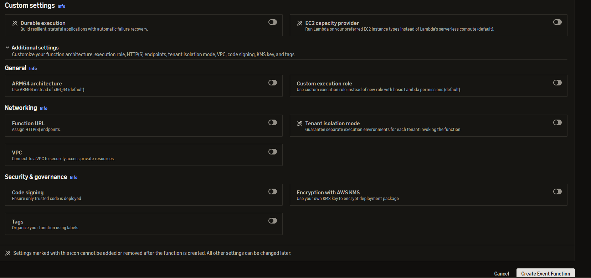
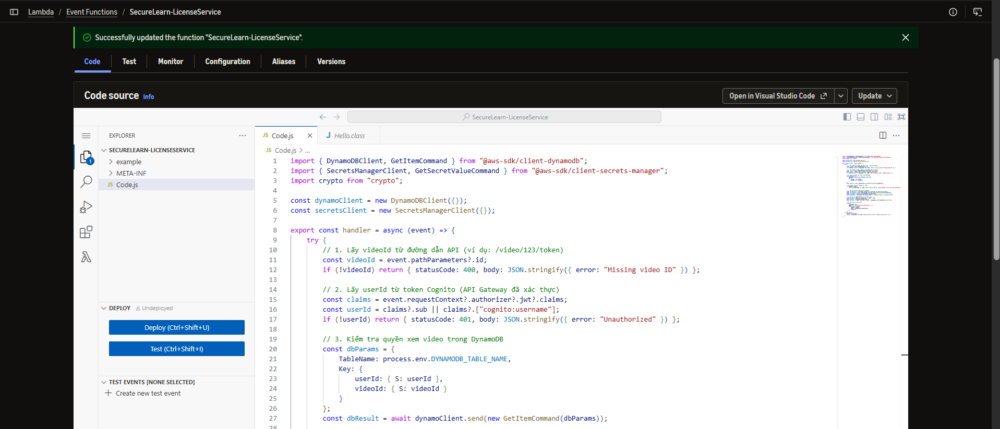
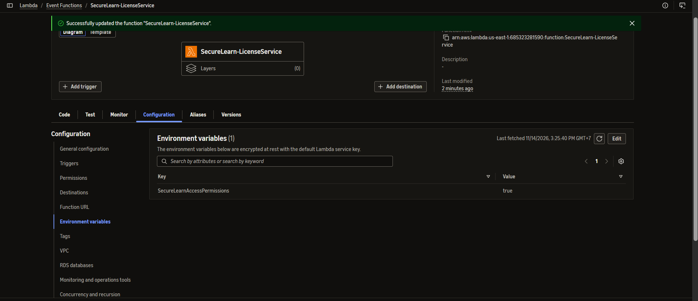
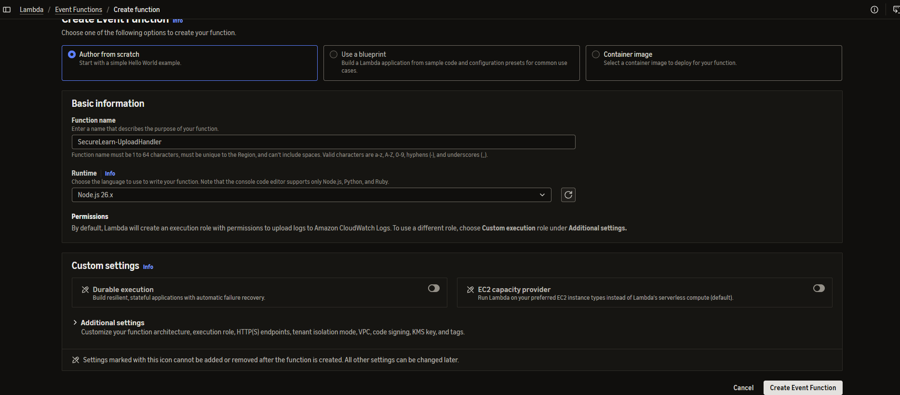
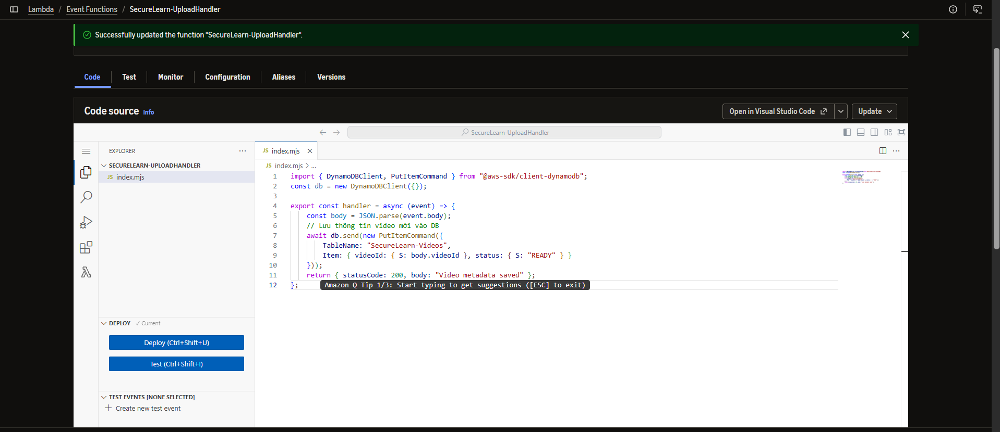
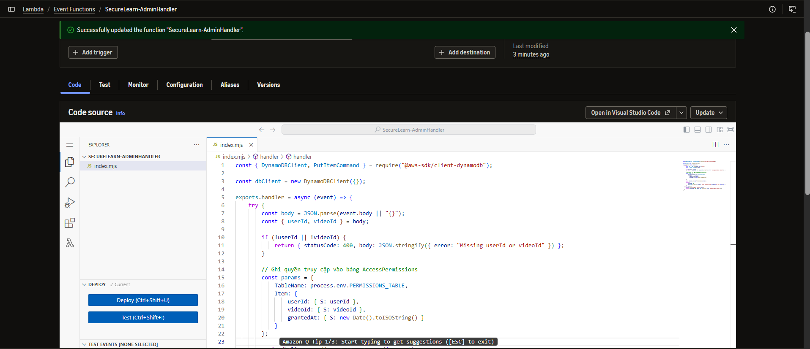
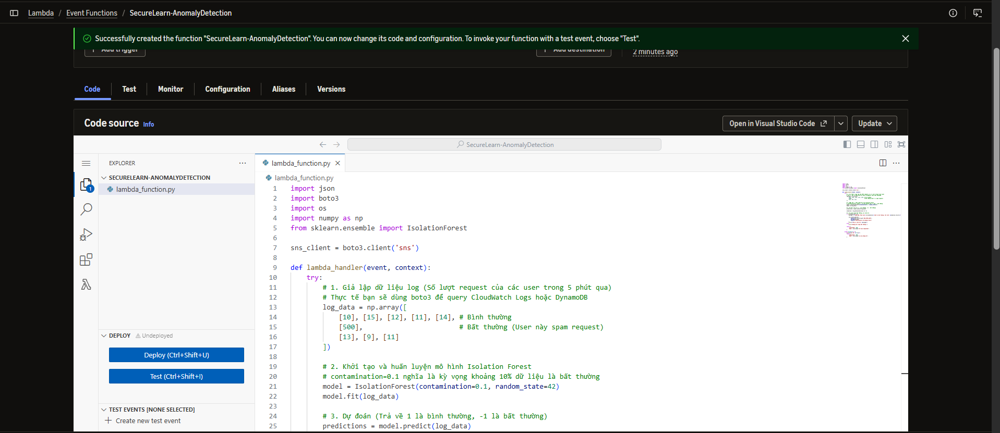

### Bước 1: Tạo Lambda License Service
1. Truy cập **AWS Lambda** > **Create event function**.

2. Chọn **Author from scratch** > **Function name:** `SecureLearn-LicenseService`
3. **Runtime:** Chọn **Node.js 20.x** / **Python 3.12**.

4. **Custom settings / Additional settings**: Để default 
5. Nhấn Create function.



6. Tại tab Code, xóa code mẫu và dán đoạn code Node.js sau vào (Code này dùng để check DynamoDB và tạo chữ ký HMAC-SHA256):
```js
import { DynamoDBClient, GetItemCommand } from "@aws-sdk/client-dynamodb";
import { SecretsManagerClient, GetSecretValueCommand } from "@aws-sdk/client-secrets-manager";
import crypto from "crypto";

const dynamoClient = new DynamoDBClient({});
const secretsClient = new SecretsManagerClient({});

export const handler = async (event) => {
    try {
        // 1. Lấy videoId từ đường dẫn API (ví dụ: /video/123/token)
        const videoId = event.pathParameters?.id;
        if (!videoId) return { statusCode: 400, body: JSON.stringify({ error: "Missing video ID" }) };

        // 2. Lấy userId từ token Cognito (API Gateway đã xác thực)
        const claims = event.requestContext?.authorizer?.jwt?.claims;
        const userId = claims?.sub || claims?.["cognito:username"];
        if (!userId) return { statusCode: 401, body: JSON.stringify({ error: "Unauthorized" }) };

        // 3. Kiểm tra quyền xem video trong DynamoDB
        const dbParams = {
            TableName: process.env.DYNAMODB_TABLE_NAME,
            Key: { 
                userId: { S: userId }, 
                videoId: { S: videoId } 
            }
        };
        const dbResult = await dynamoClient.send(new GetItemCommand(dbParams));
        
        // Nếu không có quyền trong DB thì chặn
        if (!dbResult.Item) {
            return { statusCode: 403, body: JSON.stringify({ error: "Access Denied. You do not have permission to view this video." }) };
        }

        // 4. Lấy Secret Key từ AWS Secrets Manager
        const secretParams = { SecretId: process.env.CLOUDFLARE_API_TOKEN_SECRET_NAME };
        const secretResult = await secretsClient.send(new GetSecretValueCommand(secretParams));
        const secretData = JSON.parse(secretResult.SecretString);
        const signingKey = secretData.CDN_SIGNING_SECRET; // Key dùng chung với Cloudflare Worker

        // 5. Tạo chữ ký (HMAC-SHA256) có thời hạn 1 giờ
        const expiresAt = Math.floor(Date.now() / 1000) + 3600; 
        const payload = `${videoId}:${expiresAt}`;
        const signature = crypto.createHmac('sha256', signingKey).update(payload).digest('hex');

        // 6. Trả token về cho Client
        return {
            statusCode: 200,
            headers: { "Access-Control-Allow-Origin": "*" },
            body: JSON.stringify({ 
                videoId: videoId,
                token: `${signature}:${expiresAt}`, 
                expiresAt 
            })
        };
    } catch (error) {
        console.error(error);
        return { statusCode: 500, body: JSON.stringify({ error: "Internal Server Error" }) };
    }
}; 
```


7. Nhấn Deploy.

8. Cấu hình biến môi trường: Vào Configuration > Environment variables > Edit, thêm 2 biến:

* DYNAMODB_TABLE_NAME: SecureLearn-AccessPermissions

* CLOUDFLARE_API_TOKEN_SECRET_NAME: SecureLearn/CloudflareCredentials (sẽ tạo ở bước sau).


### Bước 2: Tạo Lambda: SecureLearn-UploadHandler
1. Truy cập **AWS Lambda** > **Create event function**.

2. Chọn **Author from scratch** > **Function name:** `SecureLearn-UploadHandler`
3. **Runtime:** Chọn **Node.js 20.x** / **Python 3.12**.

4. **Custom settings / Additional settings**: Để default 
5. Nhấn Create function.

6. Code nhận thông báo khi có video mới được upload thành công (từ Cloudflare), thực hiện lưu metadata video vào DynamoDB
```js
const { DynamoDBClient, PutItemCommand } = require("@aws-sdk/client-dynamodb");

const dbClient = new DynamoDBClient({});

exports.handler = async (event) => {
    try {
        // 1. Parse body từ Cloudflare Worker gửi sang
        const body = JSON.parse(event.body || "{}");
        const videoId = body.videoId;
        
        if (!videoId) {
            return { statusCode: 400, body: JSON.stringify({ error: "Missing videoId" }) };
        }

        // 2. Lưu metadata vào bảng DynamoDB (Tự động gán trạng thái READY)
        const params = {
            TableName: process.env.VIDEOS_TABLE,
            Item: {
                videoId: { S: videoId },
                status: { S: "READY" },
                uploadedAt: { S: new Date().toISOString() }
            }
        };
        
        await dbClient.send(new PutItemCommand(params));

        return { 
            statusCode: 200, 
            body: JSON.stringify({ message: "Video metadata saved successfully", videoId }) 
        };

    } catch (error) {
        console.error("Lỗi Upload Handler:", error);
        return { statusCode: 500, body: JSON.stringify({ error: "Internal Server Error" }) };
    }
};
```

7. Nhấn Deploy.
8. Cấu hình Environment Variables: VIDEOS_TABLE = SecureLearn-Videos (Cần tạo thêm bảng này trên DynamoDB với Partition key là videoId)
### Bước 3: Tạo SecureLearn-AdminHandler
Tương tự như ở trên tới bước 6.
6. Code API cho phép Admin cấp quyền xem video cho một User
```js
const { DynamoDBClient, PutItemCommand } = require("@aws-sdk/client-dynamodb");

const dbClient = new DynamoDBClient({});

exports.handler = async (event) => {
    try {
        const body = JSON.parse(event.body || "{}");
        const { userId, videoId } = body;

        if (!userId || !videoId) {
            return { statusCode: 400, body: JSON.stringify({ error: "Missing userId or videoId" }) };
        }

        // Ghi quyền truy cập vào bảng AccessPermissions
        const params = {
            TableName: process.env.PERMISSIONS_TABLE,
            Item: {
                userId: { S: userId },
                videoId: { S: videoId },
                grantedAt: { S: new Date().toISOString() }
            }
        };
        
        await dbClient.send(new PutItemCommand(params));

        return { 
            statusCode: 200, 
            body: JSON.stringify({ message: `Đã cấp quyền xem video ${videoId} cho user ${userId}` }) 
        };

    } catch (error) {
        console.error("Lỗi Admin Handler:", error);
        return { statusCode: 500, body: JSON.stringify({ error: "Internal Server Error" }) };
    }
};
```

7. Nhấn Deploy
8. Cấu hình Environment Variables: PERMISSIONS_TABLE = SecureLearn-AccessPermissions

### Bước 4: Tạo SecureLearn-AnomalyDetection
**Runtime:** Chọn **Python 3.15**
Các bước còn lại tương tự như trên tới 6.
6. Code load model AI, đọc log (giả lập), phát hiện bất thường, gửi cảnh báo SNS. (Mô hình Isolation Forest (pkl) và các thư viện scikit-learn, numpy, scipy cần được đóng gói thành một Lambda Layer (cài đặt vào thư mục python/lib/python3.12/site-packages/, nén ZIP)).

```python
import json
import boto3
import os
import numpy as np
from sklearn.ensemble import IsolationForest

sns_client = boto3.client('sns')

def lambda_handler(event, context):
    try:
        # 1. Giả lập dữ liệu log (Số lượt request của các user trong 5 phút qua)
        # Thực tế bạn sẽ dùng boto3 để query CloudWatch Logs hoặc DynamoDB
        log_data = np.array([
            [10], [15], [12], [11], [14], # Bình thường
            [500],                        # Bất thường (User này spam request)
            [13], [9], [11]
        ])

        # 2. Khởi tạo và huấn luyện mô hình Isolation Forest
        # contamination=0.1 nghĩa là kỳ vọng khoảng 10% dữ liệu là bất thường
        model = IsolationForest(contamination=0.1, random_state=42)
        model.fit(log_data)

        # 3. Dự đoán (Trả về 1 là bình thường, -1 là bất thường)
        predictions = model.predict(log_data)
        
        anomalies = log_data[predictions == -1]

        # 4. Nếu phát hiện bất thường, gửi cảnh báo
        if len(anomalies) > 0:
            message = f"CANH BAO: Phat hien {len(anomalies)} hanh vi bat thuong. Chi tiet: {anomalies.tolist()}"
            
            sns_client.publish(
                TopicArn=os.environ.get('SNS_TOPIC_ARN'),
                Message=message,
                Subject="[SecureLearn] AI Anomaly Alert"
            )
            print(f"Đã gửi cảnh báo: {message}")
        else:
            print("Không phát hiện bất thường.")

        return {
            'statusCode': 200,
            'body': json.dumps('AI Scan Completed')
        }

    except Exception as e:
        print(f"Lỗi AI: {str(e)}")
        return {
            'statusCode': 500,
            'body': json.dumps('Lỗi hệ thống AI')
        }
```

7. Upload file ZIP lên làm Layer trong Lambda > Nhấn Deploy
8. Cấu hình Environment Variables: SNS_TOPIC_ARN = (ARN của SNS Topic bạn đã tạo).


