### Create HTTP API Gateway & JWT Authorizer
1. Go to **Amazon API Gateway** > **Create API** > **HTTP API** > **Build**.
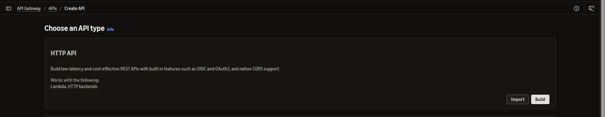
2. **API name:** `SecureLearn-API` > **IP address type:** `IPv4` > Click **Next**.
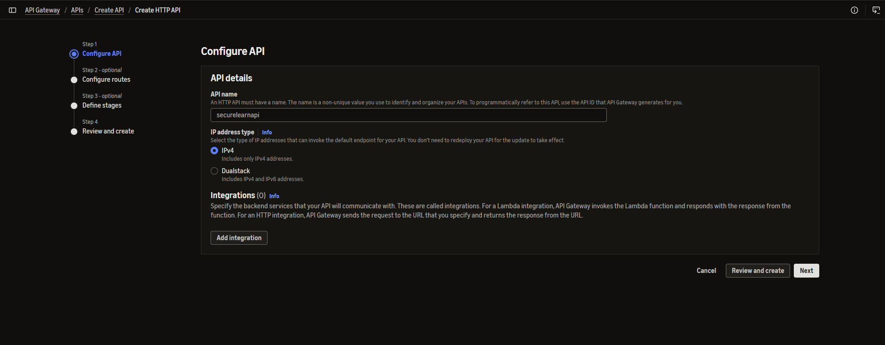
3. **Integrations:** Click **add integrations** > Lambda > **AWS Region**: us-east-1 > **Lambda function:** select the newly created Lambda license > **version:** 2 > Click **Next**
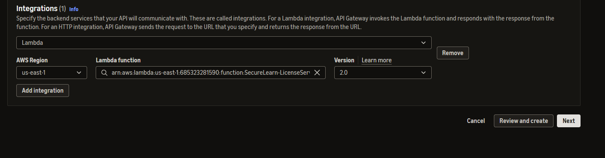
4. **Route configuration:** 
* **Create Route 1:** Method GET, Path /video/{id}/license, Integration select Lambda SecureLearn-LicenseService.
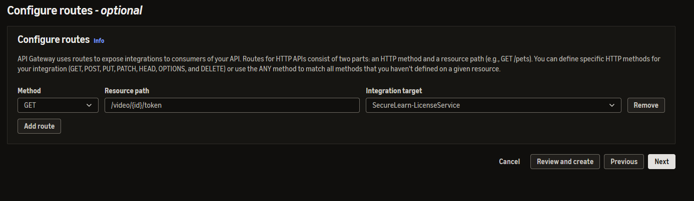 

* **Create Route 2:** Method POST, Path /upload/webhook, Integration select Lambda SecureLearn-UploadHandler.
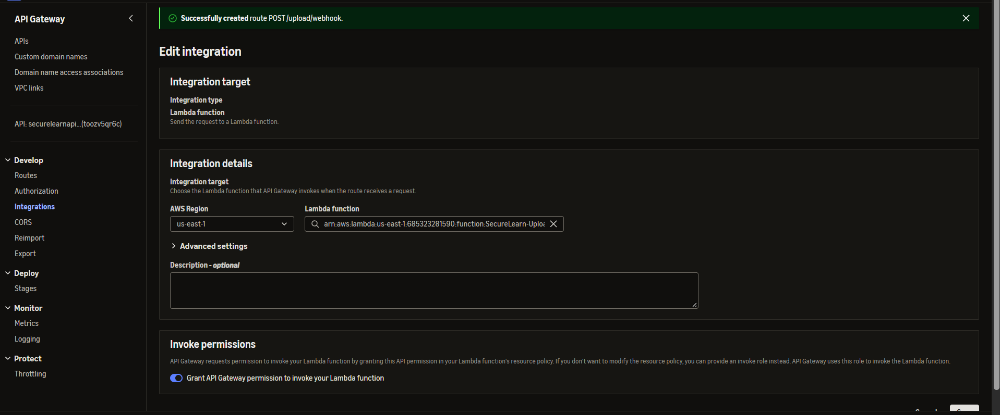 
* **Create Route 3:** Method GET, Path /admin/data, Integration select Lambda SecureLearn-AdminHandler.
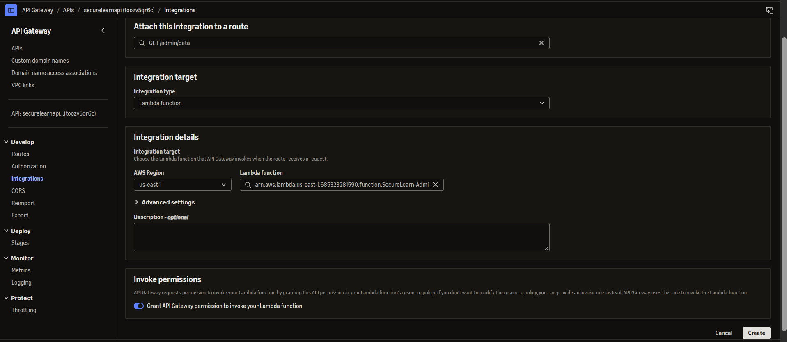

5. Keep stage `$default` with **Auto-deploy** enabled and press **Create**.
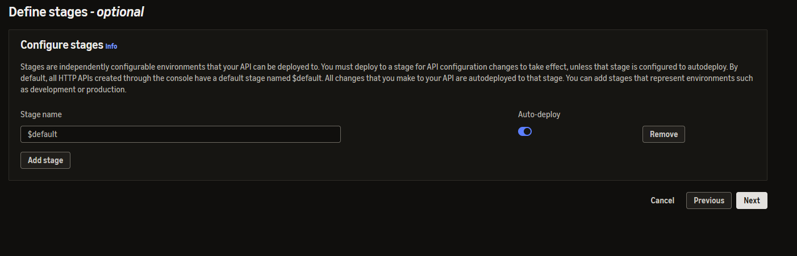

6. **Attach JWT Authorizer:** 
* Go to **Authorization** > **Manage authorizers** > **Create**. 
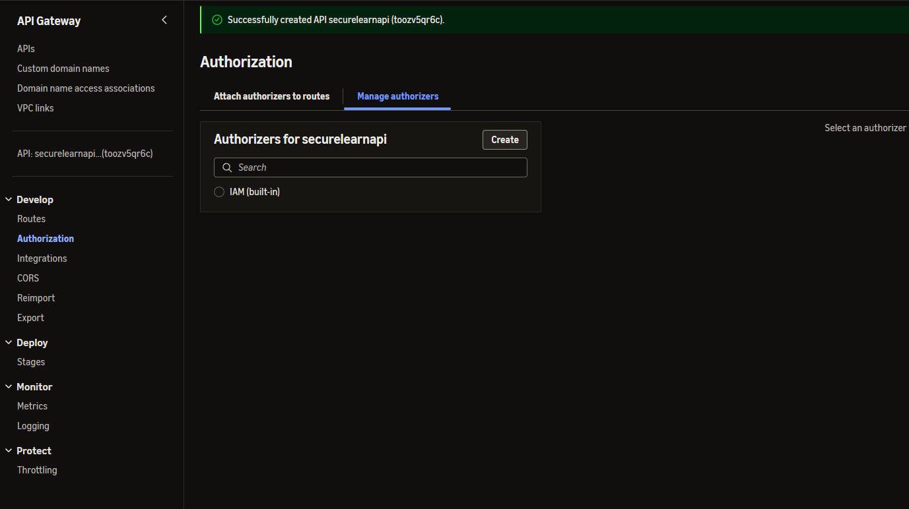 
* **Name:** `CognitoAuthorizer` 
* **Type:** `JWT` 
* **Issuer URL:** `https://us-east-1ngbokcb38.auth.us-east-1.amazoncognito.com` 
* **Audience:** `1ts3buhe230pqn3ldfdv90qj7f`
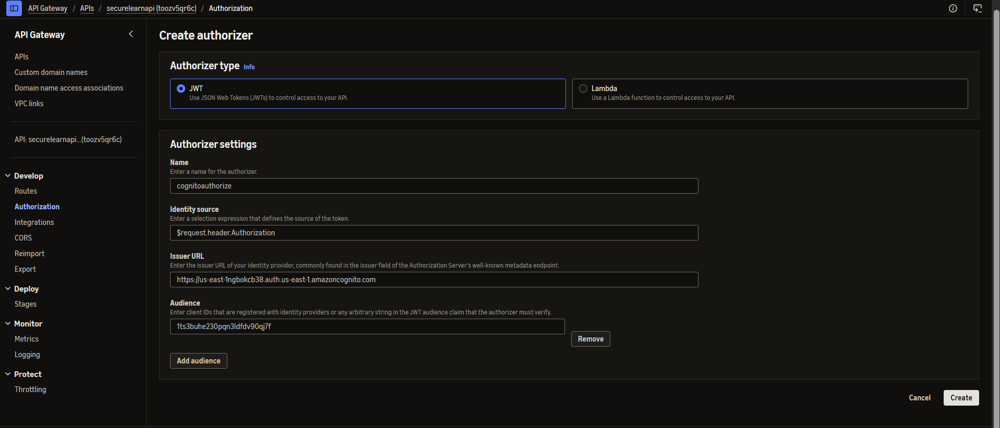

7. **Attach Authorizer:** Go back to Routes, select GET /video/{id}/token > Attach authorization > select CognitoAuthorizer.
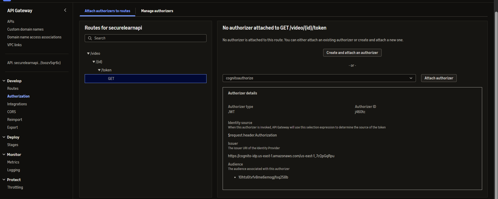

8. Configure CORS: Go to CORS > Configure.

* **Allow-Origin:** http://localhost:3000.

* **Allow-Headers:** authorization,content-type.

* **Allow-Methods:** Select GET, POST.

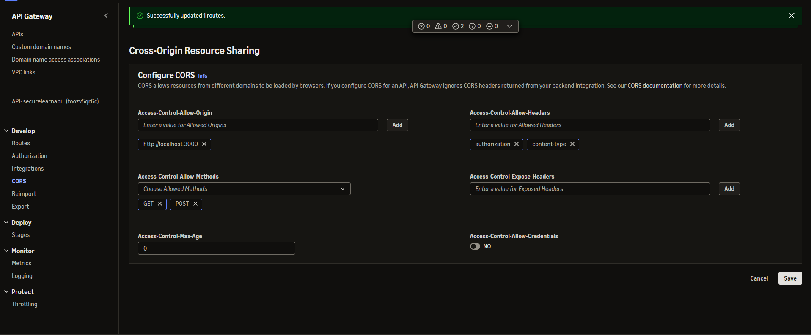