### Tạo HTTP API Gateway & JWT Authorizer
1. Truy cập **Amazon API Gateway** > **Create API** > **HTTP API** > **Build**.
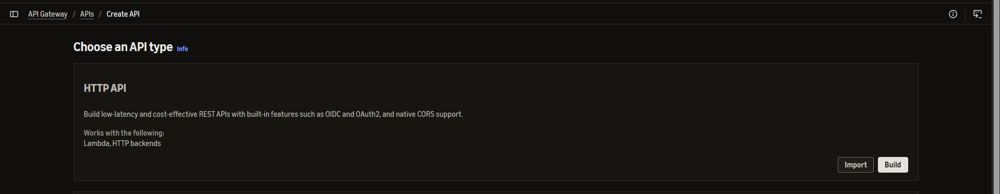
2. **API name:** `SecureLearn-API` > **IP address type:** `IPv4` > Nhấn **Next**.
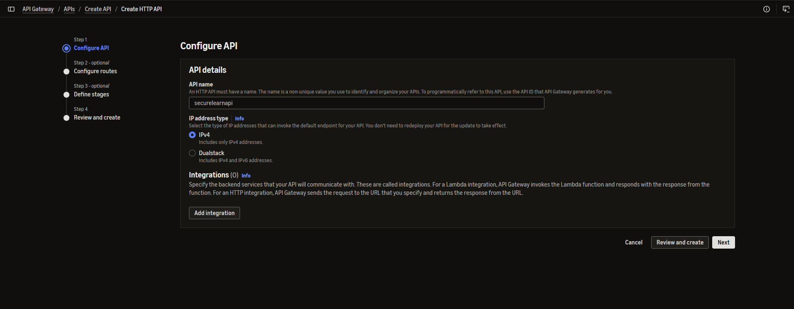
3. **Integrations:** Nhấn **add integrations** > Lambda > **AWS Region**: us-east-1 > **Lambda function:** chọn Lambda license mới tạo > **version:** 2 > Nhấn **Next**
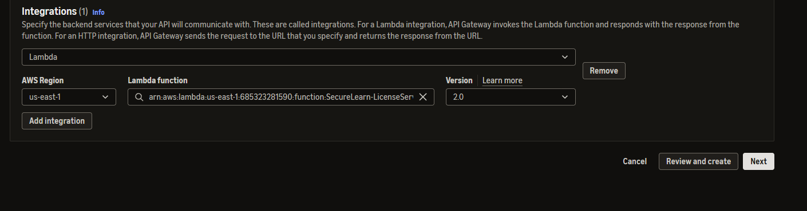
4. **Cấu hình Route:**
   * **Tạo Route 1:** Method GET, Path /video/{id}/license, Integration chọn Lambda SecureLearn-LicenseService.
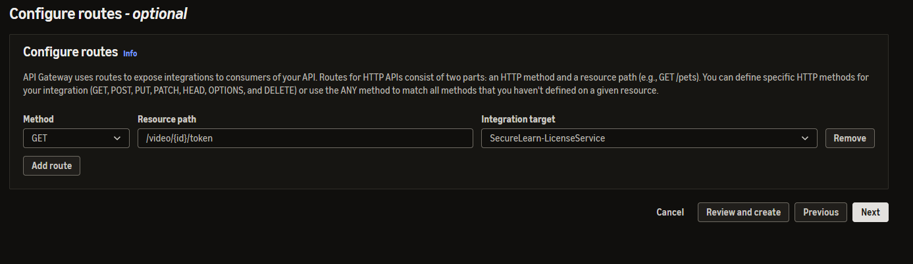

   * **Tạo Route 2:** Method POST, Path /upload/webhook, Integration chọn Lambda SecureLearn-UploadHandler.
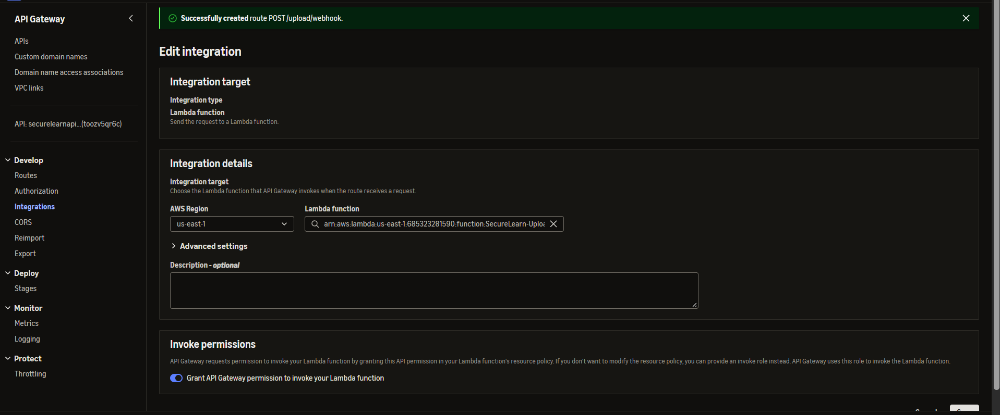
   * **Tạo Route 3:** Method GET, Path /admin/data, Integration chọn Lambda SecureLearn-AdminHandler.
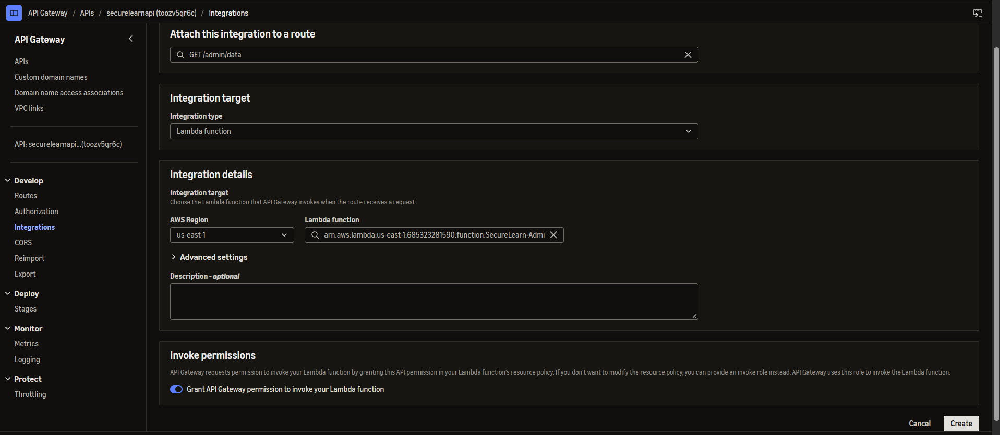

5. Giữ stage `$default` với **Auto-deploy** được bật và nhấn **Create**.
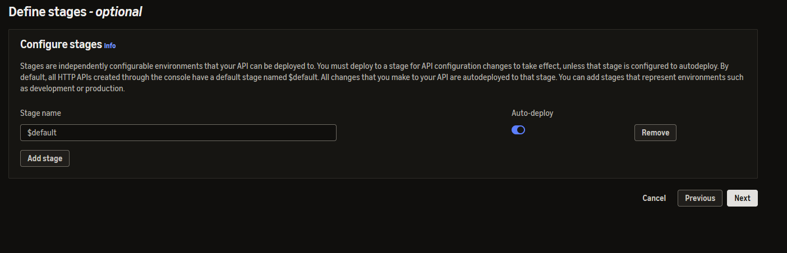

6. **Gắn JWT Authorizer:**
   * Vào **Authorization** > **Manage authorizers** > **Create**.
   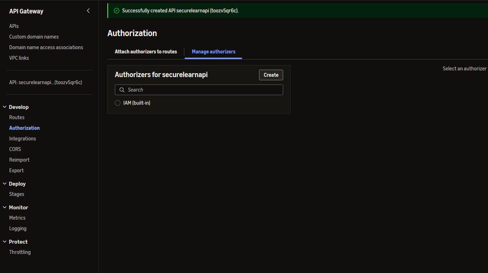
   * **Name:** `CognitoAuthorizer`
   * **Type:** `JWT`
   * **Issuer URL:** `https://us-east-1ngbokcb38.auth.us-east-1.amazoncognito.com`
   * **Audience:** `1ts3buhe230pqn3ldfdv90qj7f`
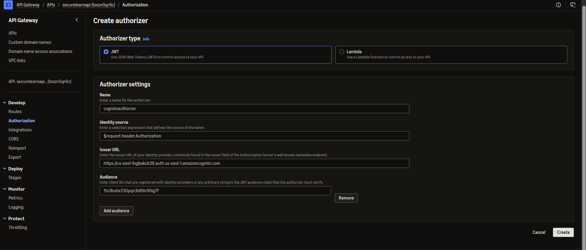

7. **Gắn Authorizer:** Quay lại Routes, chọn GET /video/{id}/token > Attach authorization > chọn CognitoAuthorizer.
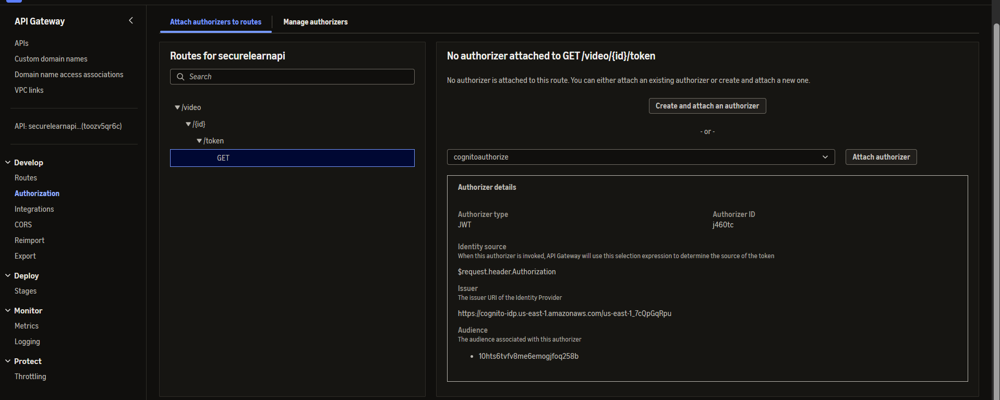

8. Cấu hình CORS: Vào CORS > Configure.

* **Allow-Origin:** http://localhost:3000.

* **Allow-Headers:** authorization,content-type.

* **Allow-Methods:** Chọn GET, POST.

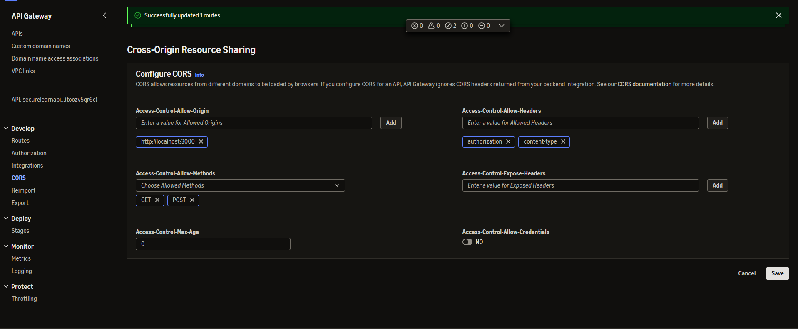