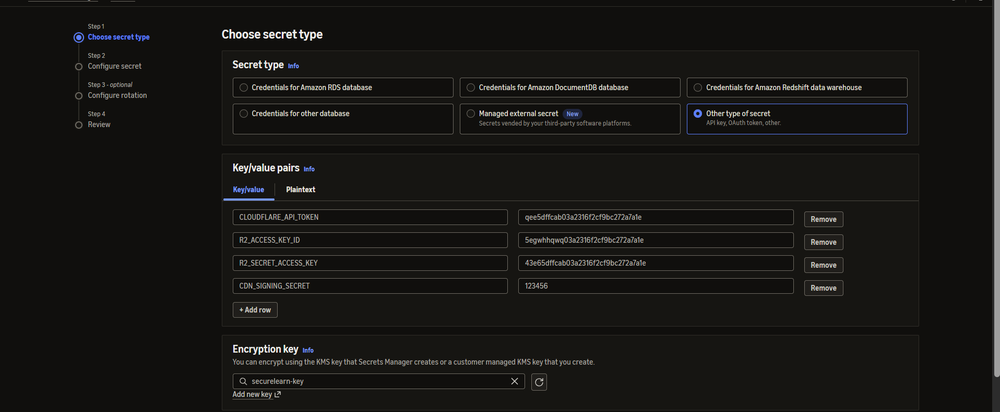

### Step 1: Create an AWS KMS Encryption Key
1. Go to **AWS KMS** and select **Create a new key**.
2. **Key type:** Select **Symmetric**.
3. **Key usage:** Select **Encrypt and decrypt**.
4. **Key material origin:** Select **KMS**.
5. **Regionality:** Select **Single-Region key**.

4. **Alias ​​/ Description:** `SecureLearn-Key`.
5. Assign administrative and usage permissions for the key to the Lambda IAM role, then click **Finish**.

### Step 2: Store Credentials in Secrets Manager
1. Go to **AWS Secrets Manager** > **Store a new secret**.
2. **Secret type:** Select **Other type of secret**.
3. **Key/value pairs:**
* `CLOUDFLARE_API_TOKEN`: `<your-cloudflare-api-token>`
* `R2_ACCESS_KEY_ID`: `<your-r2-access-key>`
* `R2_SECRET_ACCESS_KEY`: `<your-r2-secret-key>`
* `PLAYBACK_SIGNING_SECRET`: `<HMAC-secret-key-shared-with-the-worker>`
4. **Encryption key:** Select the `SecureLearn-Key` created in Step 1.

5. **Secret name:** `SecureLearn/CloudflareCredentials`.

6. Click **Store** and ensure that the Lambda IAM role has the necessary permissions: `kms:Decrypt` and `secretsmanager:GetSecretValue`.
