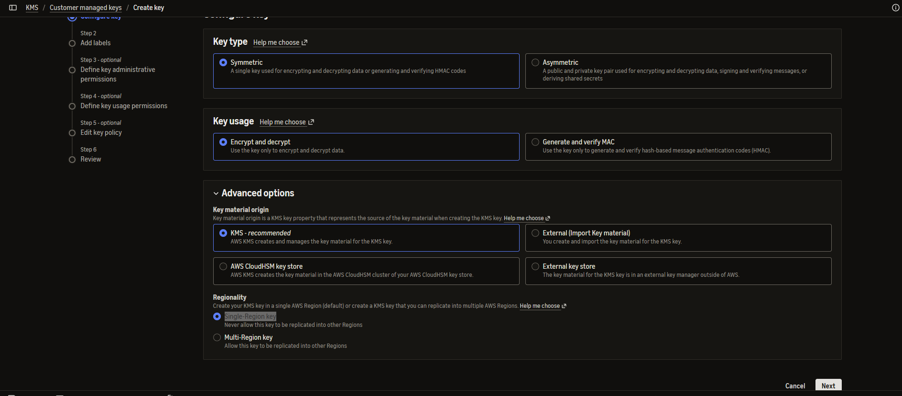
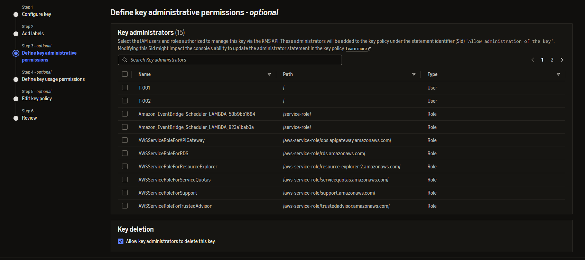
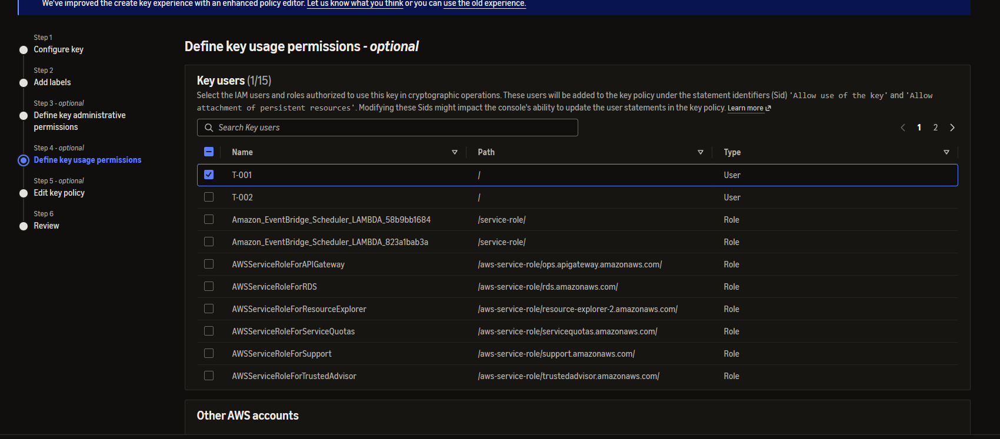
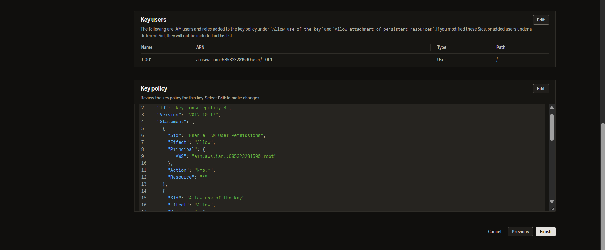
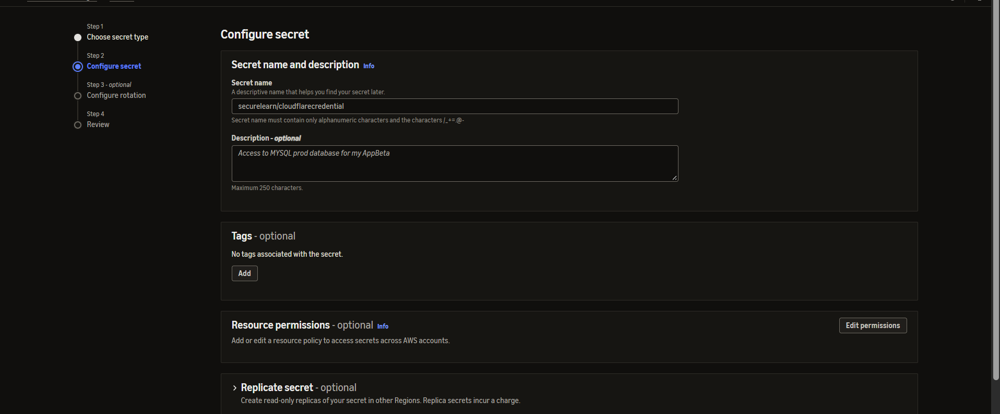
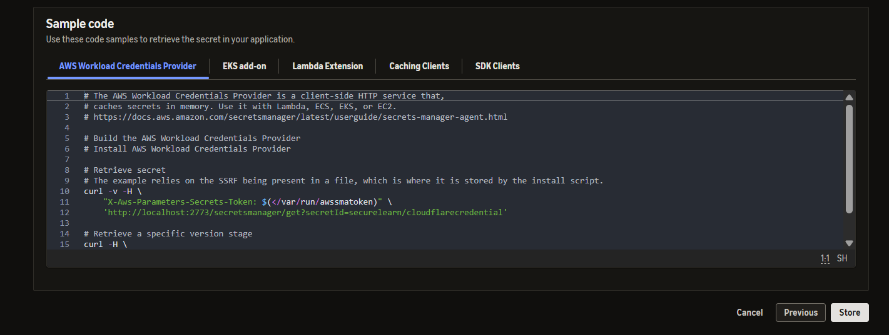

### Step 1: Create an AWS KMS Encryption Key
1. Go to **AWS KMS** and select **Create a new key**.
2. **Key type:** Select **Symmetric**.
3. **Key usage:** Select **Encrypt and decrypt**.
4. **Key material origin:** Select **KMS**.
5. **Regionality:** Select **Single-Region key**.

6. **Alias / Description:** `SecureLearn-Key`.
7. Assign key administration to your IAM user/role. Grant key usage to the ECS execution role for reading the encrypted secret and to the ECS task role for video encryption/decryption, using IAM policies; then click **Finish**.

This key encrypts the secret in Step 2 and the video bucket (SSE-KMS, section 5.4.1), which holds each lesson's `content.key`.

### Step 2: Store Credentials in Secrets Manager
1. Generate the playback-token signing key with `openssl rand -base64 48`.
2. Go to **AWS Secrets Manager** > **Store a new secret**.
3. **Secret type:** Select **Other type of secret**.
4. **Key/value pairs:**
   * `SPRING_DATASOURCE_PASSWORD`: `<RDS-master-password>` (section 5.3.3)
   * `COGNITO_CLIENT_SECRET`: `<app-client-secret>` (section 5.3.1)
   * `PLAYBACK_TOKEN_SECRET`: `<string-generated-in-step-1>`
5. **Encryption key:** Select the `SecureLearn-Key` created in Step 1.

6. **Secret name:** `SecureLearn/be`.

7. Click **Store**, note the **Secret ARN** for the task definition (section 5.3.3, Step 6), and make sure `securelearn-ecs-execution-role` has `kms:Decrypt` and `secretsmanager:GetSecretValue`.
