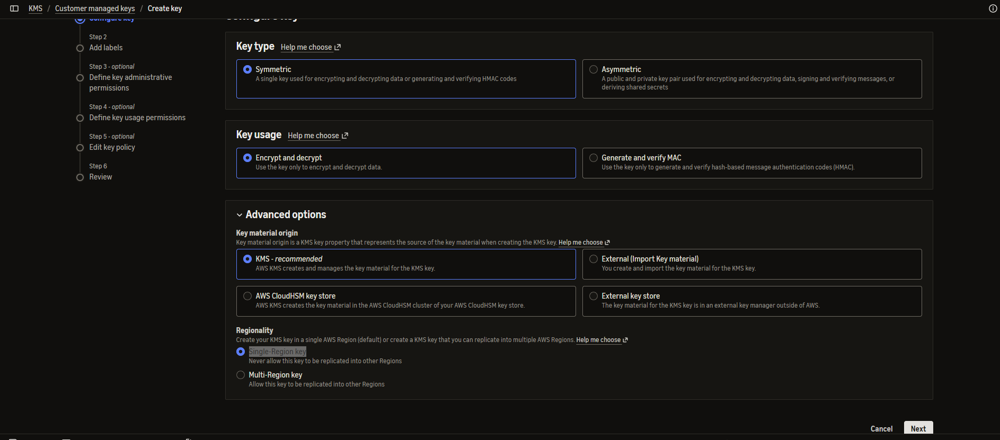
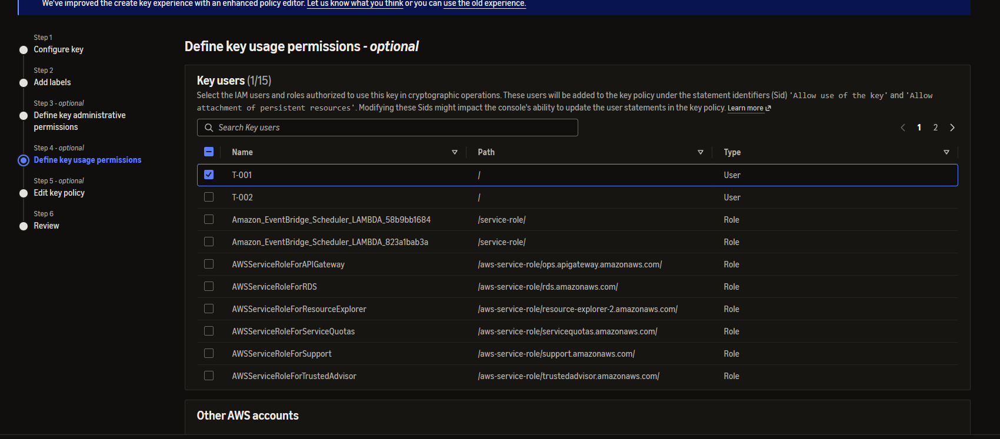
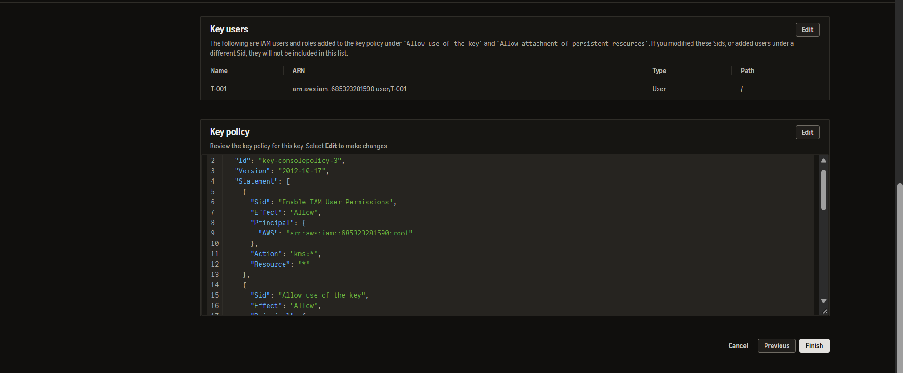
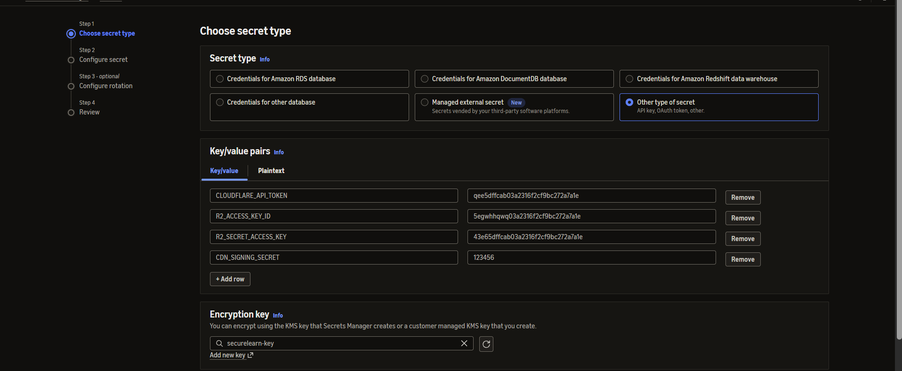
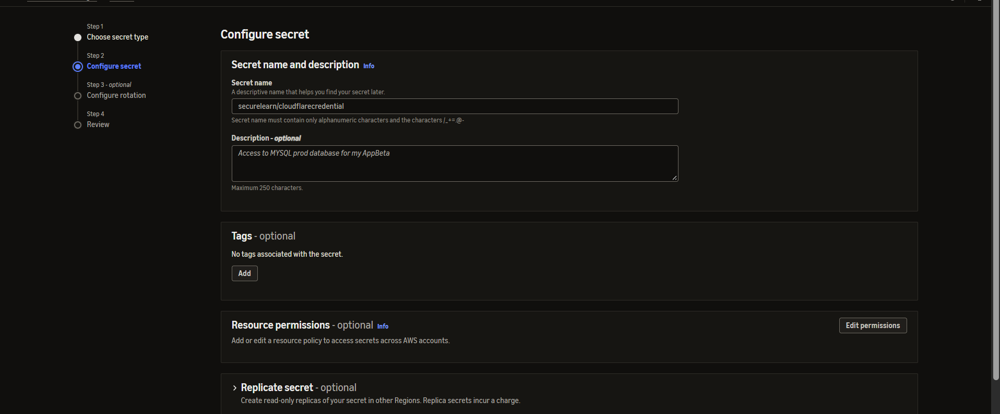
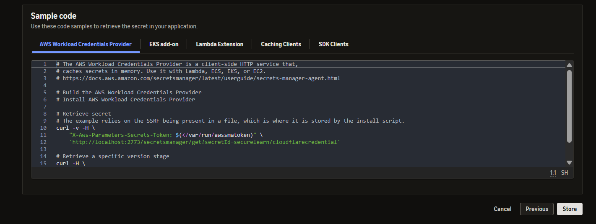

### Bước 1: Tạo Khóa Mã hóa AWS KMS
1. Truy cập **AWS KMS** và chọn **Create a new key**.
2. **Key type:** Chọn **Symmetric**.
3. **Key usage:** Chọn **Encrypt and decrypt**.
4. **Key material origin:** chọn **KMS**.
5. **Regionality:** chọn **Single-Region key**.

4. **Alias / Mô tả:** `SecureLearn-Key`.
5. Chỉ định quyền quản trị và quyền sử dụng khóa cho IAM Role của Lambda, sau đó nhấn **Finish**.

### Bước 2: Lưu Thông tin Xác thực vào Secrets Manager
1. Truy cập **AWS Secrets Manager** > **Store a new secret**.
2. **Secret type:** Chọn **Other type of secret**.
3. **Key/value pairs:**
   * `CLOUDFLARE_API_TOKEN`: `<your-cloudflare-api-token>`
   * `R2_ACCESS_KEY_ID`: `<your-r2-access-key>`
   * `R2_SECRET_ACCESS_KEY`: `<your-r2-secret-key>`
   * `PLAYBACK_SIGNING_SECRET`: `<khóa-bí-mật-hmac-dùng-chung-với-worker>`
4. **Encryption key:** Chọn khóa `SecureLearn-Key` vừa tạo ở Bước 1.

5. **Secret name:** `SecureLearn/CloudflareCredentials`.

6. Nhấn **Store** và đảm bảo IAM Role của Lambda có đủ quyền `kms:Decrypt` và `secretsmanager:GetSecretValue`.
