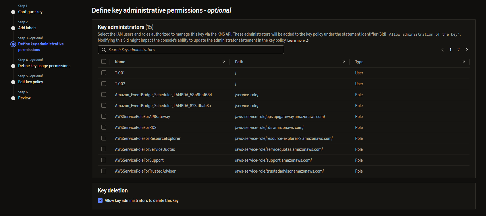

### Bước 1: Tạo Khóa Mã hóa AWS KMS
1. Truy cập **AWS KMS** và chọn **Create a new key**.
2. **Key type:** Chọn **Symmetric**.
3. **Key usage:** Chọn **Encrypt and decrypt**.
4. **Key material origin:** chọn **KMS**.
5. **Regionality:** chọn **Single-Region key**.

6. **Alias / Mô tả:** `SecureLearn-Key`.
7. Chỉ định quyền quản trị và quyền sử dụng khóa cho IAM Role của Lambda, sau đó nhấn **Finish**.

Khóa này mã hóa secret ở Bước 2 và bucket video (SSE-KMS, mục 5.4.1), nơi lưu file `content.key` của từng bài học.

### Bước 2: Lưu Thông tin Xác thực vào Secrets Manager
1. Sinh khóa ký playback token bằng lệnh `openssl rand -base64 48`.
2. Truy cập **AWS Secrets Manager** > **Store a new secret**.
3. **Secret type:** Chọn **Other type of secret**.
4. **Key/value pairs:**
   * `SPRING_DATASOURCE_PASSWORD`: `<mật-khẩu-master-của-RDS>` (mục 5.3.3)
   * `COGNITO_CLIENT_SECRET`: `<client-secret-của-app-client>` (mục 5.3.1)
   * `PLAYBACK_TOKEN_SECRET`: `<chuỗi-vừa-sinh-ở-bước-1>`
5. **Encryption key:** Chọn khóa `SecureLearn-Key` vừa tạo ở Bước 1.

6. **Secret name:** `SecureLearn/be`.

7. Ghi lại **Secret ARN** để khai báo trong task definition (mục 5.3.3, Bước 7), và đảm bảo `securelearn-ecs-execution-role` có đủ quyền `kms:Decrypt` và `secretsmanager:GetSecretValue`.
