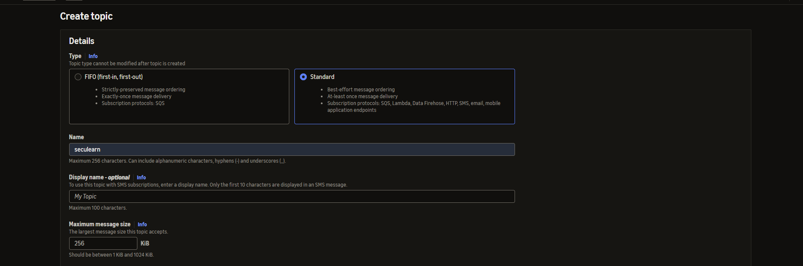
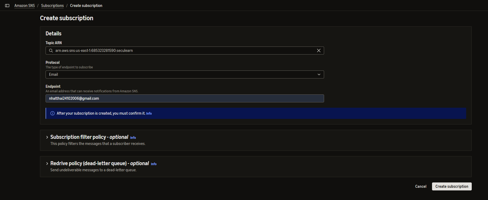
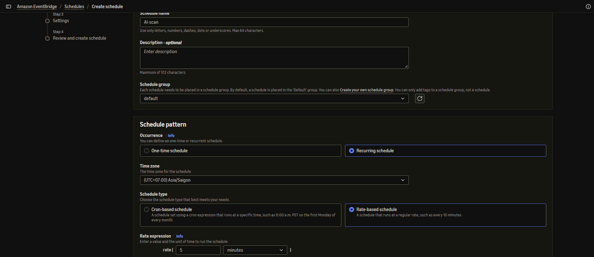
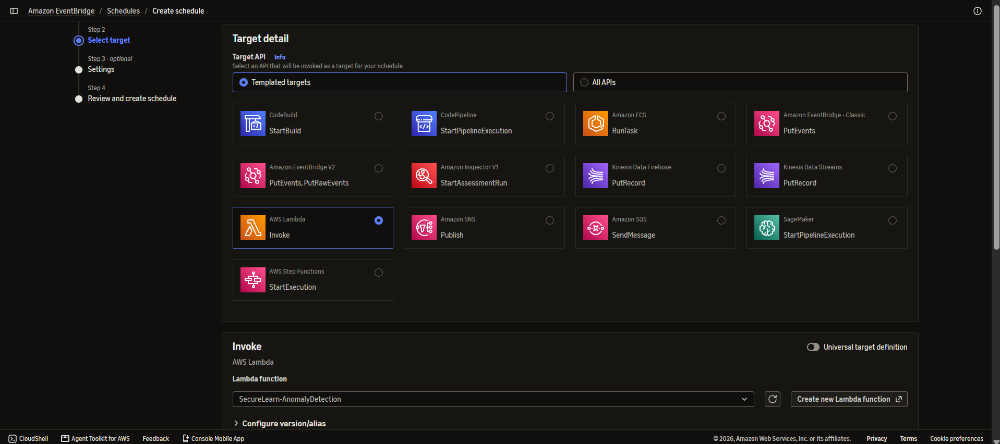

### Configure SNS & EventBridge (Scheduler)
1. **Create SNS:** Go to Amazon SNS > Topics > Create topic.

2. Select Standard. **Name:** SecureLearn-Alerts > Create.

3. Create Subscription: Protocol select Email, Endpoint fill in your email. Confirm via email.

(Copy the RNA of this SNS Topic, paste it into the SNS_TOPIC_ARN environment variable of Lambda AI Anomaly Detection.)

### Create EventBridge Scheduler
1. Go to Amazon EventBridge > Scheduler > Create schedule.

2. Name: AI-Scan.

3. Schedule pattern: Select Recurring schedule > Rate-based schedule > Fill in 5 minutes.

4. Target: Select AWS Lambda > Select SecureLearn-AnomalyDetection.

5. Click Create schedule.