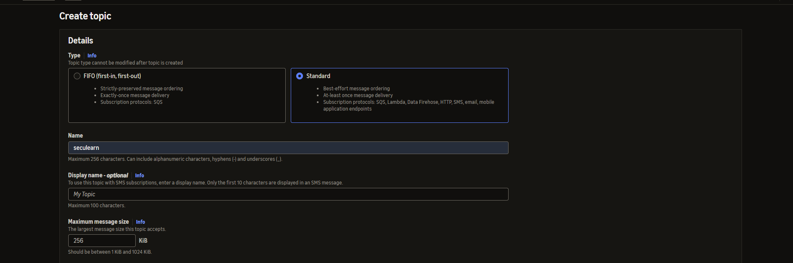
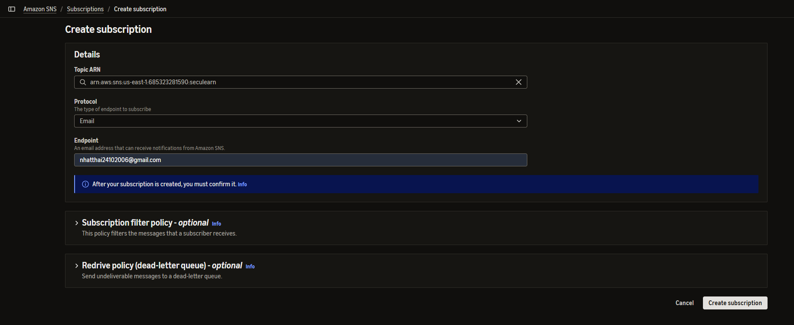
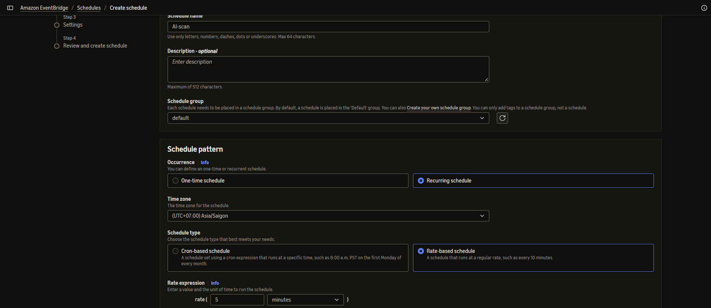
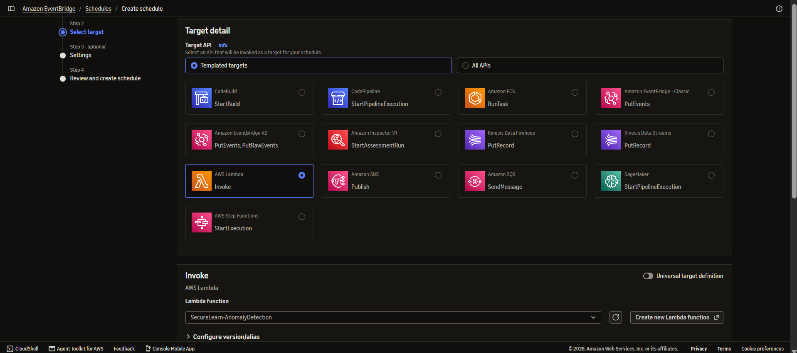

### Cấu hình SNS & EventBridge (Scheduler)
1. **Tạo SNS:** Truy cập Amazon SNS > Topics > Create topic.

2. Chọn Standard. **Name:** SecureLearn-Alerts > Create.

3. Tạo Subscription: Protocol chọn Email, Endpoint điền email của bạn. Xác nhận qua email.

(Copy ARN của SNS Topic này, dán vào biến môi trường SNS_TOPIC_ARN của Lambda AI Anomaly Detection.)

### Tạo EventBridge Scheduler 
1. Truy cập Amazon EventBridge > Scheduler > Create schedule.

2. Name: AI-Scan.

3. Schedule pattern: Chọn Recurring schedule > Rate-based schedule > Điền 5 minutes.

4. Target: Chọn AWS Lambda > Chọn SecureLearn-AnomalyDetection.

5. Nhấn Create schedule.