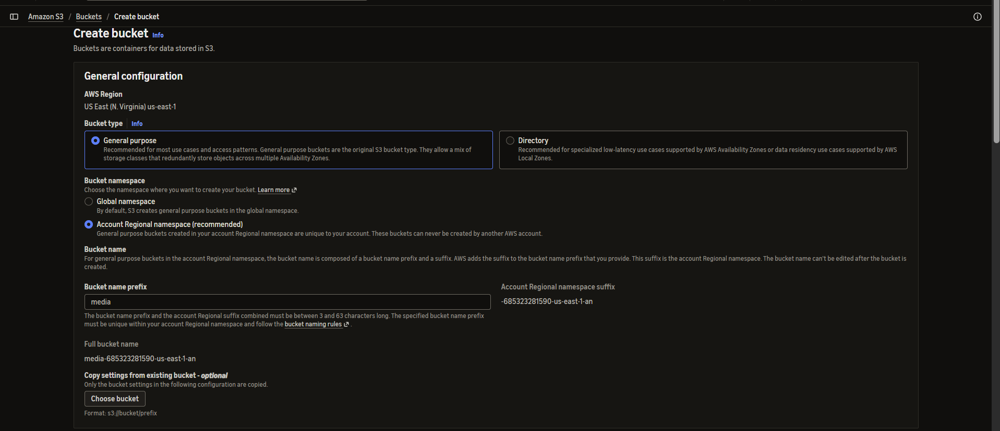
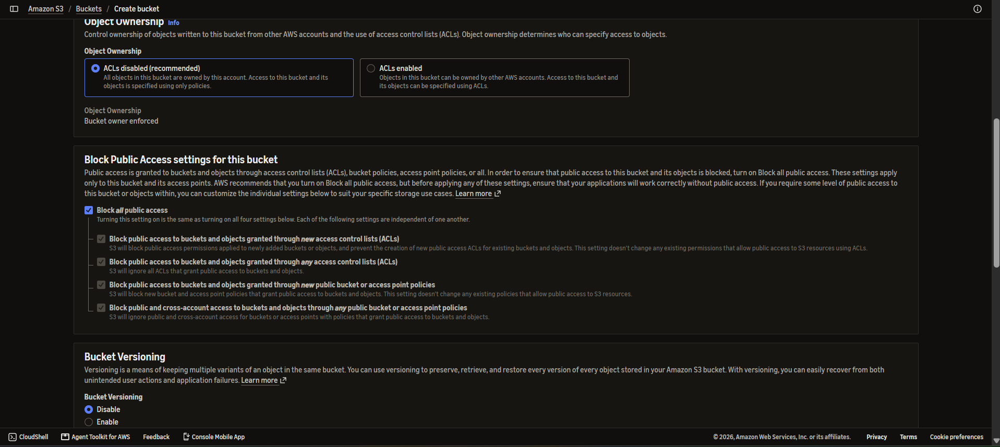
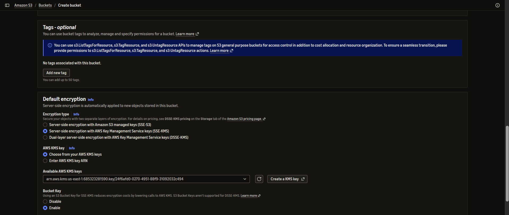
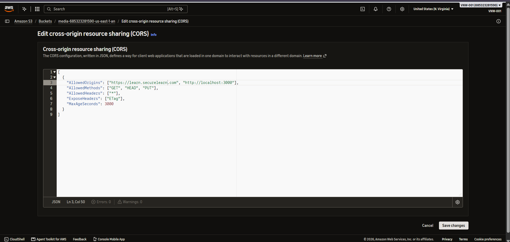
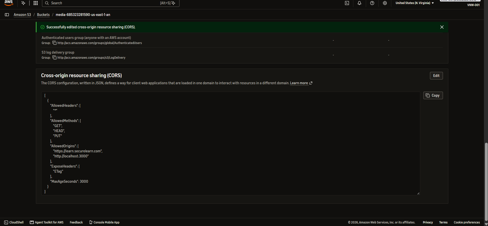
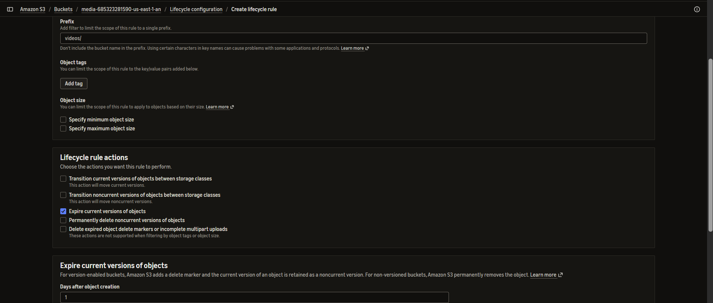

### Step 1: Create the Video Bucket
1. Go to **Amazon S3** > **Create bucket**.
2. **Bucket type:** General purpose > **Bucket name:** `securelearn-media-<account-id>`.

3. **Block all public access:** keep it **on**. There is no public URL like `pub-*.r2.dev` any more; videos are only reachable through presigned URLs signed by the backend.

4. **Default encryption:** choose **SSE-KMS** > key `SecureLearn-Key` (section 5.3.4) > **Bucket Key:** Enable.
5. Click **Create bucket**.


The active backend workflow uses these prefixes:
* `videos/{courseId}/`: raw videos uploaded by instructors, deleted by the backend after processing.
* `hls/{courseId}/{lesson-name}/`: `master.m3u8`, `content.key` (16-byte AES-128 key) and each lesson's encrypted `segment_XXX.ts` files.
* `models/`: the AI Lambda's `model.pkl`.

The optional MediaConvert exercise in section 5.4.4 writes HLS without AES-128 media encryption to `mediaconvert-output/{courseId}/{lesson-name}/`. S3 still applies the bucket's default SSE-KMS encryption at rest. This separate prefix is not used by the current playback backend.

### Step 2: Configure CORS
The browser PUTs the raw video (15-minute presigned URL) and downloads segments after the backend's `302` (60-second presigned URL) directly from S3, so the bucket must allow CORS.
1. **Permissions** tab > **Cross-origin resource sharing (CORS)** > **Edit**, paste:
```json
[
  {
    "AllowedOrigins": ["https://learn.yourdomain.com", "http://localhost:3000"],
    "AllowedMethods": ["GET", "HEAD", "PUT"],
    "AllowedHeaders": ["*"],
    "ExposeHeaders": ["ETag"],
    "MaxAgeSeconds": 3000
  }
]
```


2. Click **Save changes**.


### Step 3: Create a Lifecycle Rule (recommended)
1. **Management** tab > **Create lifecycle rule** > **Name:** `cleanup-source-videos`.
2. **Prefix:** `videos/` > check **Expire current versions of objects** > **Days:** `1`.
3. Click **Create rule** (removes raw videos left behind by failed processing).



### Step 4: Test the Pipeline
After finishing section 5.4.2, sign in as an `INSTRUCTOR`, upload a short video (under 1 minute), then check:
```bash
aws s3 ls s3://securelearn-media-<account-id>/hls/ --recursive | head
aws s3 cp s3://securelearn-media-<account-id>/hls/<courseId>/<tên-bài>/master.m3u8 - | head -8
```
The playlist must contain `#EXT-X-KEY:METHOD=AES-128,URI="securelearn-key"`, and `videos/` no longer holds the raw video. Opening a segment's S3 URL without a signature returns `403 AccessDenied`.
