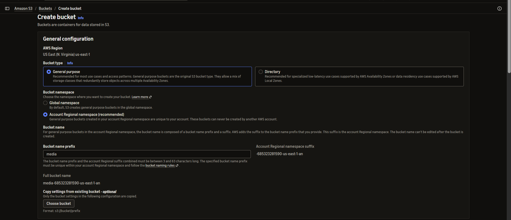
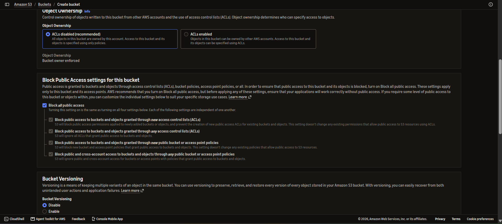
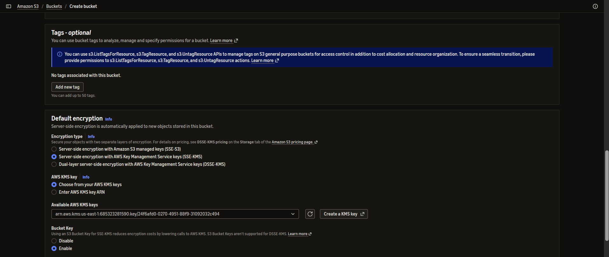
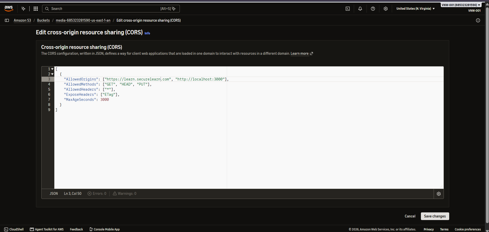
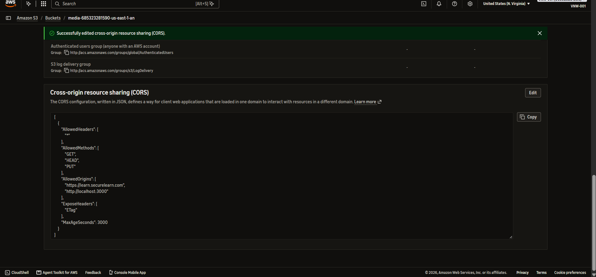
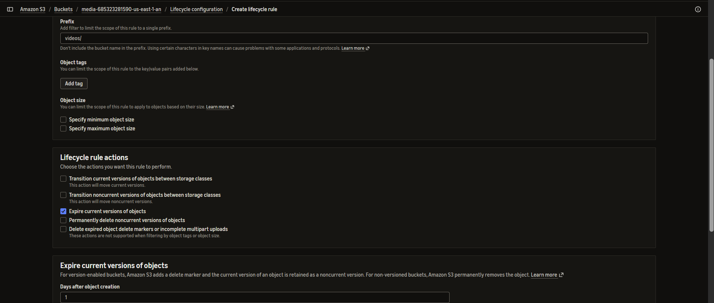

### Bước 1: Tạo bucket lưu video
1. Truy cập **Amazon S3** > **Create bucket**.
2. **Bucket type:** General purpose > **Bucket name:** `securelearn-media-<account-id>`.

3. **Block all public access:** Giữ **bật**. video chỉ truy cập được qua presigned URL do backend ký.

4. **Default encryption:** Chọn **SSE-KMS** > chọn khóa `SecureLearn-Key` (mục 5.3.4) > **Bucket Key:** Enable.
5. Nhấn **Create bucket**.

Luồng backend hiện tại sử dụng các prefix sau:
* `videos/{courseId}/`: video gốc giảng viên upload, bị backend xóa sau khi xử lý xong.
* `hls/{courseId}/{tên-bài}/`: `master.m3u8`, `content.key` (khóa AES-128 16 byte) và các `segment_XXX.ts` đã mã hóa của từng bài học.
* `models/`: file `model.pkl` của Lambda AI.

Bài thực hành MediaConvert tùy chọn ở mục 5.4.4 ghi HLS không mã hóa AES-128 vào `mediaconvert-output/{courseId}/{tên-bài}/`. S3 vẫn mã hóa dữ liệu lưu trữ bằng SSE-KMS theo cấu hình mặc định của bucket. Backend phát video hiện tại không sử dụng prefix riêng này.

### Bước 2: Cấu hình CORS
Trình duyệt PUT video gốc (presigned URL 15 phút) và tải segment sau khi backend trả `302` (presigned URL 60 giây) trực tiếp từ S3, nên bucket phải cho phép CORS.
1. Vào tab **Permissions** > **Cross-origin resource sharing (CORS)** > **Edit**, dán:
```json
[
  {
    "AllowedOrigins": ["https://learn.yourdomain.com", "http://localhost:3000"],
    "AllowedMethods": ["GET", "HEAD", "PUT"],
    "AllowedHeaders": ["*"],
    "ExposeHeaders": ["ETag"],
    "MaxAgeSeconds": 3000
  }
]
```

2. Nhấn **Save changes**.

### Bước 3: Tạo Lifecycle rule (khuyến nghị)
1. Vào tab **Management** > **Create lifecycle rule** > **Name:** `cleanup-source-videos`.
2. **Prefix:** `videos/` > tích **Expire current versions of objects** > **Days:** `1`.
3. Nhấn **Create rule** (dọn video gốc còn sót khi xử lý bị lỗi).


### Bước 4: Kiểm tra pipeline
Sau khi hoàn thành mục 5.4.2, đăng nhập bằng tài khoản `INSTRUCTOR`, upload một video ngắn (dưới 1 phút), rồi kiểm tra:
```bash
aws s3 ls s3://securelearn-media-<account-id>/hls/ --recursive | head
aws s3 cp s3://securelearn-media-<account-id>/hls/<courseId>/<tên-bài>/master.m3u8 - | head -8
```
Playlist phải có dòng `#EXT-X-KEY:METHOD=AES-128,URI="securelearn-key"`, và thư mục `videos/` không còn video gốc. Mở URL S3 của một segment mà không có chữ ký sẽ nhận `403 AccessDenied`.
