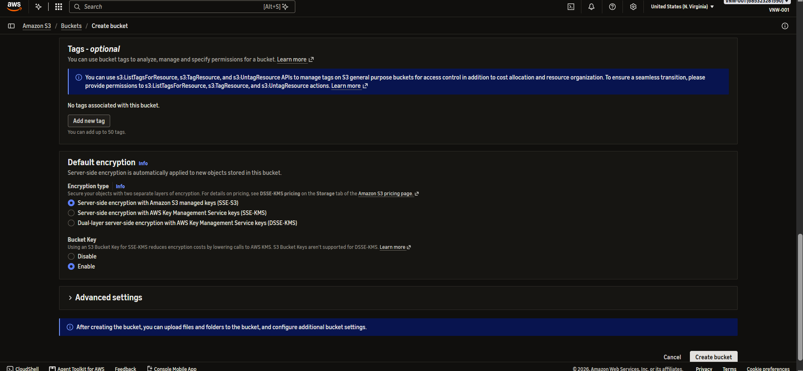
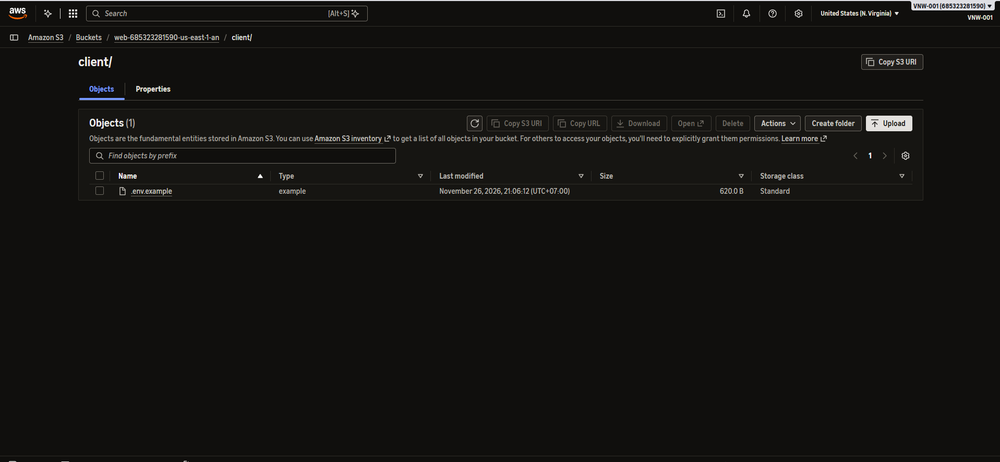
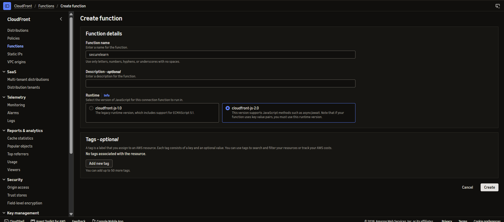
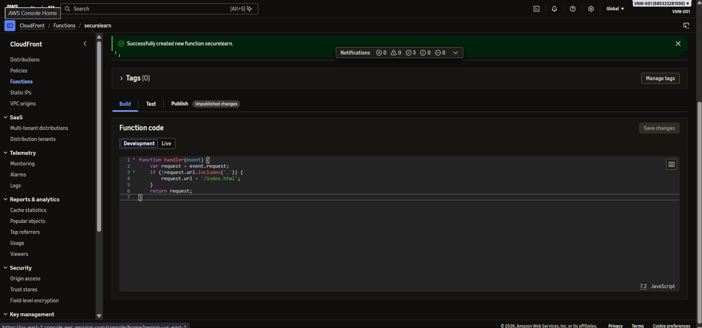
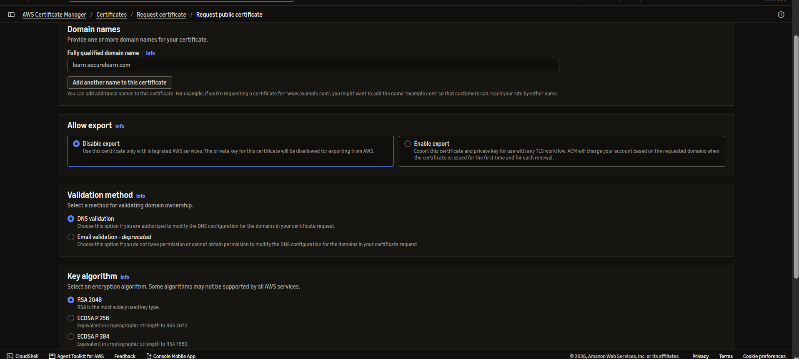
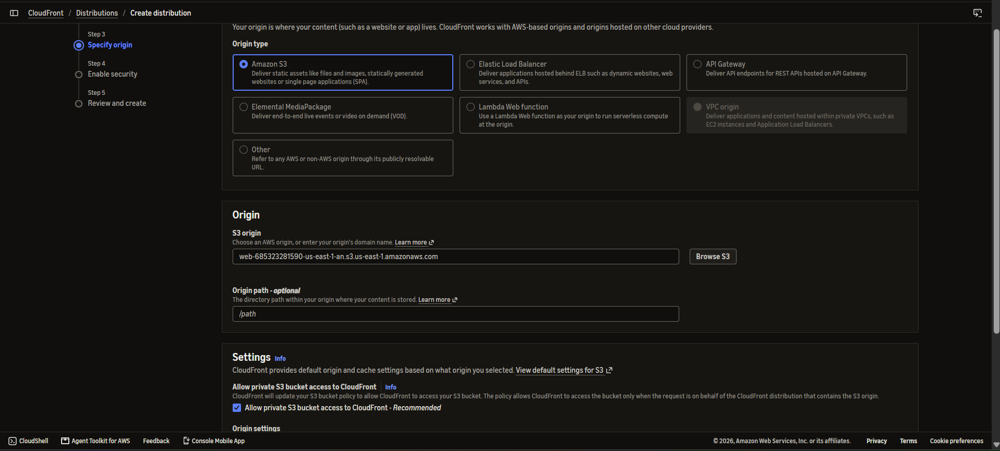

### Step 1: Build & Upload the Frontend to S3
1. Create bucket `securelearn-web-<account-id>` , keep **Block all public access** on, and do **not** enable Static website hosting.

2. In `client/`, create `.env.production` containing `VITE_API_URL=/api/v1` (frontend and API share one domain, so no CORS is needed).

3. Build and sync to the bucket:
```bash
npm ci
npm run build
aws s3 sync dist/ s3://securelearn-web-<account-id>/ --delete
```

### Step 2: Create a CloudFront Function for the SPA
1. Go to **CloudFront** > **Functions** > **Create function** > **Name:** `securelearn-spa-rewrite`.

2. Paste the following code > **Save changes** > **Publish** tab > **Publish function**:
```js
function handler(event) {
    var request = event.request;
    // Đường dẫn không phải file tĩnh (vd /vi/student/courses) => trả về index.html cho React Router
    if (!request.uri.includes('.')) {
        request.uri = '/index.html';
    }
    return request;
}
```


### Step 3: Create the CloudFront Distribution
1. **Certificate Manager** in region **us-east-1** > **Request** > domain `learn.yourdomain.com` > DNS validation (CloudFront only uses certificates from us-east-1).

2. **CloudFront** > **Distributions** > **Create distribution**.
3. **Origin domain:** the bucket.
4. **Default cache behavior:** Redirect HTTP to HTTPS > **Cache policy:** `CachingOptimized` > **Function associations (Viewer request):** `securelearn-spa-rewrite`.

