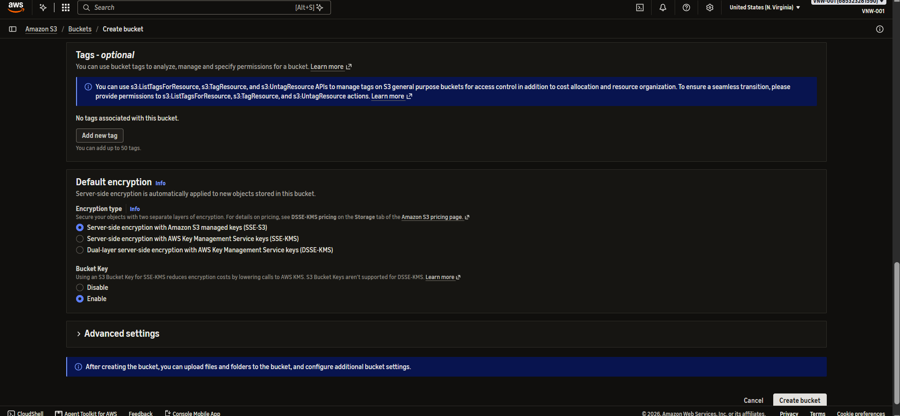
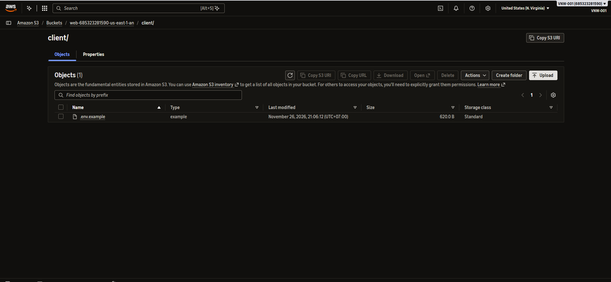
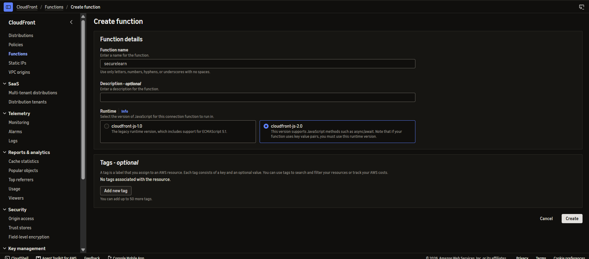
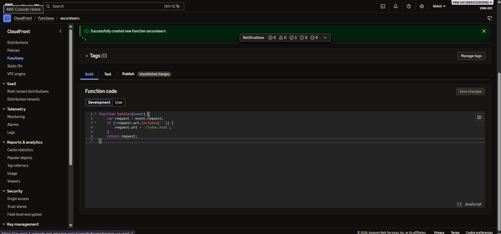
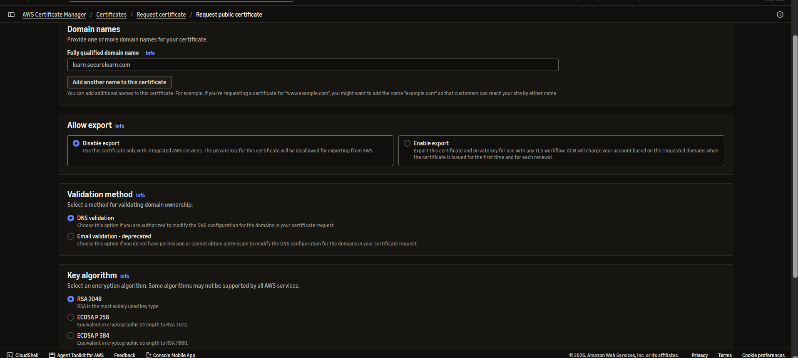
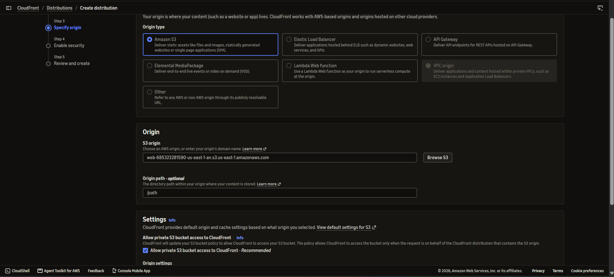

### Bước 1: Build & tải Frontend lên S3
1. Tạo bucket `securelearn-web-<account-id>` , giữ **Block all public access** bật, **không** bật Static website hosting.

2. Trong thư mục `client/`, tạo file `.env.production` với nội dung `VITE_API_URL=/api/v1` (frontend và API dùng chung tên miền nên không cần CORS).

3. Build và đồng bộ lên bucket:
```bash
npm ci
npm run build
aws s3 sync dist/ s3://securelearn-web-<account-id>/ --delete
```

### Bước 2: Tạo CloudFront Function cho SPA
1. Truy cập **CloudFront** > **Functions** > **Create function** > **Name:** `securelearn`.

2. Dán code sau > **Save changes** > tab **Publish** > **Publish function**:
```js
function handler(event) {
    var request = event.request;
    if (!request.uri.includes('.')) {
        request.uri = '/index.html';
    }
    return request;
}
```

### Bước 3: Tạo CloudFront Distribution
1. **Certificate Manager** ở region **us-east-1** > **Request** > domain `learn.securelearn.com` > DNS validation (CloudFront chỉ dùng chứng chỉ tạo ở us-east-1).

2. **CloudFront** > **Distributions** > **Create distribution**.
3. **Origin domain:** chọn bucket.
4. **Default cache behavior:** Redirect HTTP to HTTPS > **Cache policy:** `CachingOptimized` > **Function associations (Viewer request):** `securelearn`.



