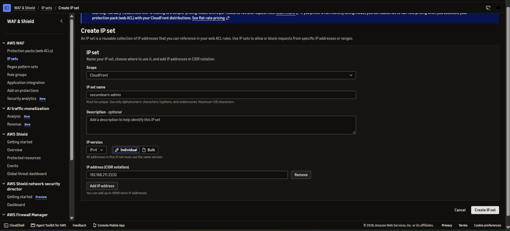
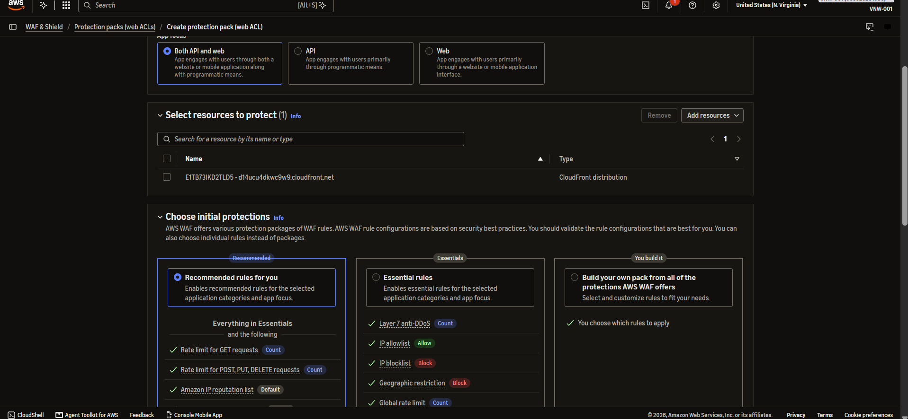
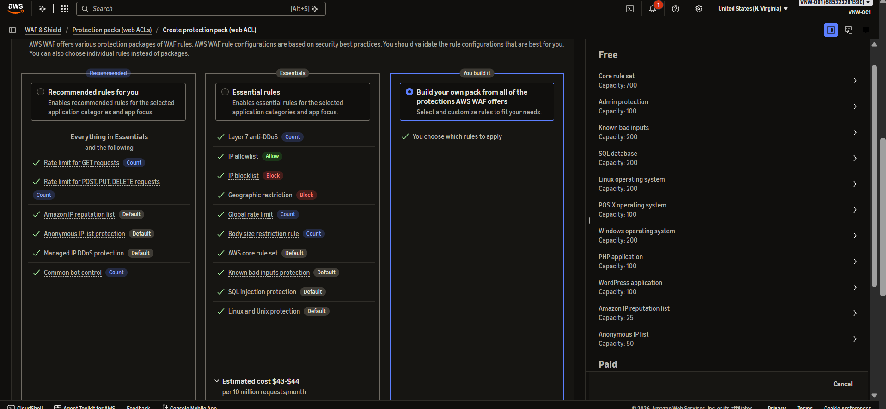
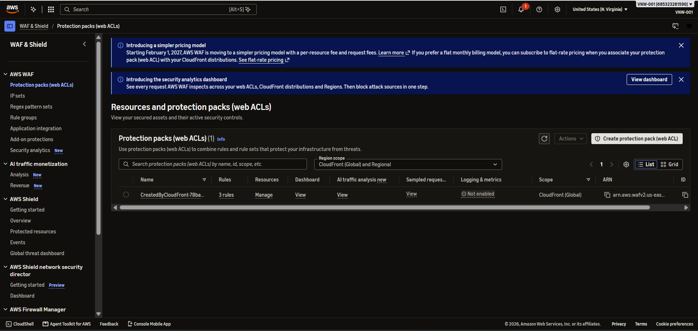

AWS WAF replaces Cloudflare WAF and Cloudflare Zero Trust. The admin UI is the `/{lang}/admin/*` routes of the same React app, so what must be protected is the **API**: every admin action goes through `/api/v1/admin/**` and `/api/v1/ai/**`.

### Step 1: Create an IP Set for Administrators
1. Go to **AWS WAF & Shield** > **IP sets** > region **Global (CloudFront)** > **Create IP set**.
2. **Name:** `securelearn-admin-allowlist` > **IP version:** IPv4.
3. **IP addresses:** the admin machine's public IP as `/32` (e.g. `203.0.113.10/32`) > **Create IP set**.


### Step 2: Create the Web ACL
1. **Web ACLs** > **Create web ACL** > **Resource type:** Amazon CloudFront distributions > **Name:** `securelearn-waf`.
2. **Add AWS resources:** select the SecureLearn distribution.

3. **Add managed rule groups:** enable `Core rule set`, `Known bad inputs`, `Amazon IP reputation list`.
4. **Add my own rules** > **Rule builder**:
   * **Name:** `admin-ip-allowlist` > **If a request:** matches all the statements (AND).
   * **Statement 1:** URI path > **Starts with string** > `/api/v1/admin` (create a similar rule for `/api/v1/ai`).
   * **Statement 2:** **Negate** > Originates from an IP address in > `securelearn-admin-allowlist`.
   * **Action:** Block > **Add rule**.

5. **Add my own rules** > **Rate-based rule:** `auth-rate-limit`, limit `100` requests / 5 minutes / IP, **Scope-down:** URI path starts with `/api/v1/auth/` (against password and OTP guessing), Action Block.
6. **Add my own rules** > **Rate-based rule:** `rate-limit-per-ip`, limit `2000` requests / 5 minutes, Action Block. A learner watching a video generates about 50 segment requests every 5 minutes, so this threshold does not affect normal users.
7. **Rule priority:** `admin-ip-allowlist` first > **Default action:** Allow > **Create web ACL**.


### Step 3: Test
1. From an IP **not** in the allow-list, call `https://learn.yourdomain.com/api/v1/admin/user` > `403` from WAF.
2. From the admin IP, the admin pages work normally.
3. Call `POST /api/v1/auth/login` with a wrong password more than 100 times in 5 minutes > blocked.

### Step 4: Fix Authorization in the Backend
WAF is only a temporary barrier. In the current code, `SecurityConfiguration` declares `hasRole("ADMIN")` for the pattern `"/api/v1/admin"`, which does not match the sub-paths `/register`, `/update`, `/delete`, `/user`. As a result, **any signed-in account can create and delete accounts and reset other users' passwords**. Fix the pattern to match all sub-paths, then rebuild the image and update the ECS service (section 5.3.3):
```java
.requestMatchers("/api/v1/admin/**").hasRole("ADMIN")
.requestMatchers("/api/v1/ai/**").hasRole("ADMIN")
```
After the fix, a learner token calling admin APIs gets a JSON `403` from `ApiAccessDeniedHandler` even from an allowed IP.

> Do not enforce MFA on the user pool yet: `AuthService.login` does not handle the `SOFTWARE_TOKEN_MFA` challenge, so enabling it breaks sign-in.

### Step 5: Monitor CloudTrail
Go to **CloudTrail** > **Event history** to see management actions on AWS resources for the last 90 days (enabled by default, free). For longer retention, create a `securelearn-trail` trail that writes Management events to an S3 bucket.
