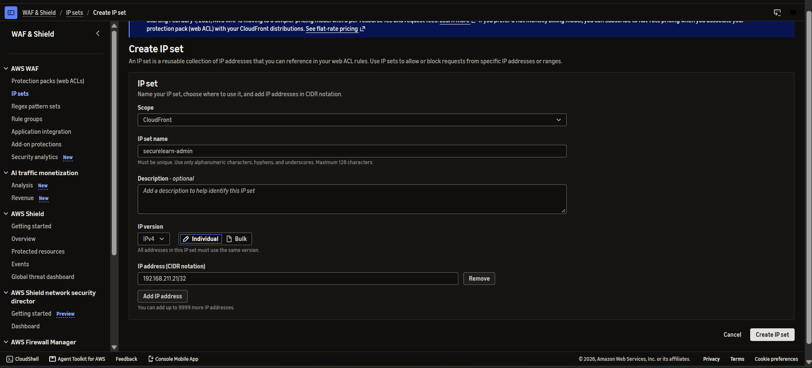
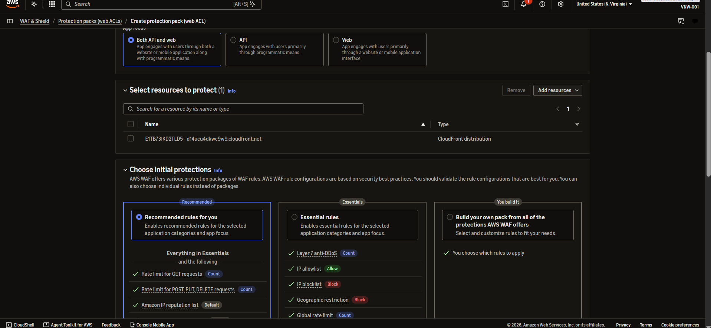
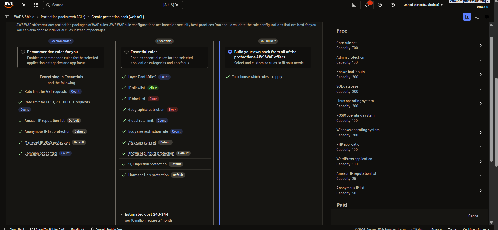
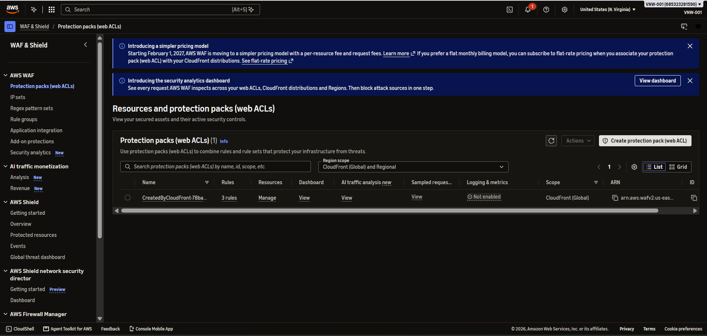

AWS WAF thay cho Cloudflare WAF và Cloudflare Zero Trust. Giao diện quản trị là các route `/{lang}/admin/*` của chính ứng dụng React, nên thứ cần bảo vệ là **API**: mọi thao tác quản trị đi qua `/api/v1/admin/**` và `/api/v1/ai/**`.

### Bước 1: Tạo IP set cho quản trị viên
1. Truy cập **AWS WAF & Shield** > **IP sets** > region **Global (CloudFront)** > **Create IP set**.
2. **Name:** `securelearn-admin-allowlist` > **IP version:** IPv4.
3. **IP addresses:** IP public của máy quản trị, dạng `/32` (ví dụ `192.168.211.12/32`) > **Create IP set**.

### Bước 2: Tạo Web ACL
1. **Web ACLs** > **Create web ACL** > **Resource type:** Amazon CloudFront distributions > **Name:** `securelearn-waf`.
2. **Add AWS resources:** chọn distribution của SecureLearn.

3. **Add managed rule groups:** bật `Core rule set`, `Known bad inputs`, `Amazon IP reputation list`.
4. **Add my own rules** > **Rule builder**:
   * **Name:** `admin-ip-allowlist` > **If a request:** matches all the statements (AND).
   * **Statement 1:** URI path > **Starts with string** > `/api/v1/admin` (tạo thêm rule tương tự cho `/api/v1/ai`).
   * **Statement 2:** **Negate** > Originates from an IP address in > `securelearn-admin-allowlist`.
   * **Action:** Block > **Add rule**.

5. **Add my own rules** > **Rate-based rule:** `auth-rate-limit`, giới hạn `100` request / 5 phút / IP, **Scope-down:** URI path starts with `/api/v1/auth/` (chống dò mật khẩu và OTP), Action Block.
6. **Add my own rules** > **Rate-based rule:** `rate-limit-per-ip`, giới hạn `2000` request / 5 phút, Action Block. Một học viên xem video sinh khoảng 50 request segment mỗi 5 phút, nên ngưỡng này không ảnh hưởng người dùng bình thường.
7. **Rule priority:** `admin-ip-allowlist` đứng đầu > **Default action:** Allow > **Create web ACL**.

### Bước 3: Kiểm tra
1. Từ IP **không** nằm trong allowlist, gọi `https://learn.yourdomain.com/api/v1/admin/user` > nhận `403` từ WAF.
2. Từ IP quản trị, trang quản trị hoạt động bình thường.
3. Gọi `POST /api/v1/auth/login` sai mật khẩu liên tục hơn 100 lần trong 5 phút > bị chặn.

### Bước 4: Sửa phân quyền trong backend
WAF chỉ là lớp chặn tạm thời. Trong code hiện tại, `SecurityConfiguration` khai báo `hasRole("ADMIN")` cho pattern `"/api/v1/admin"`, pattern này không khớp các đường dẫn con `/register`, `/update`, `/delete`, `/user`. Kết quả là **mọi tài khoản đã đăng nhập đều tạo, xóa tài khoản và đổi mật khẩu người khác được**. Sửa pattern để khớp mọi đường dẫn con, sau đó build lại image và cập nhật ECS service (mục 5.3.3):
```java
.requestMatchers("/api/v1/admin/**").hasRole("ADMIN")
.requestMatchers("/api/v1/ai/**").hasRole("ADMIN")
```
Sau khi sửa, token của học viên gọi API quản trị sẽ nhận `403` JSON từ `ApiAccessDeniedHandler` dù đứng trong IP allowlist.


### Bước 5: Theo dõi CloudTrail
Truy cập **CloudTrail** > **Event history** để xem các thao tác quản trị trên tài nguyên AWS trong 90 ngày gần nhất (mặc định đã bật, miễn phí). Nếu cần lưu lâu hơn, tạo trail `securelearn-trail` ghi Management events vào một bucket S3.
