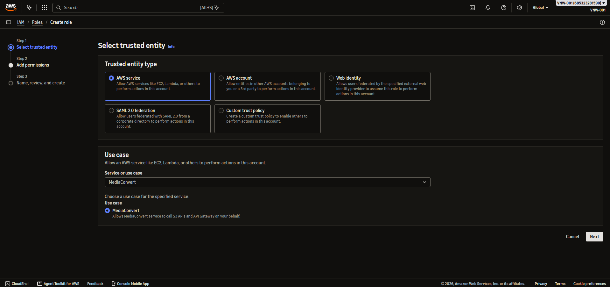
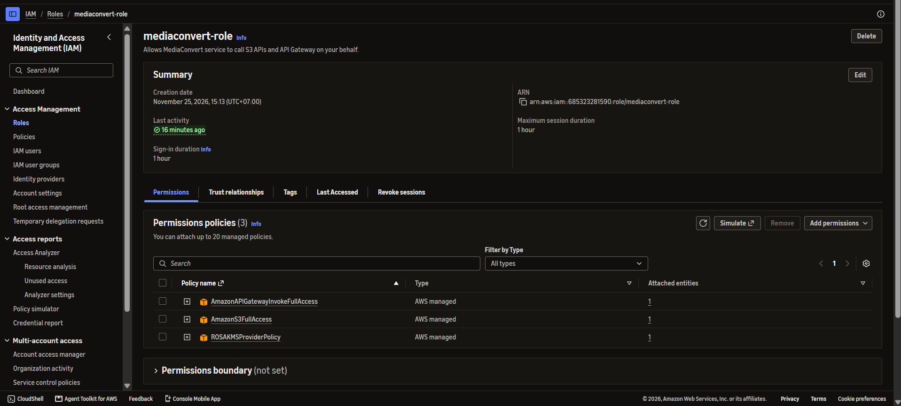
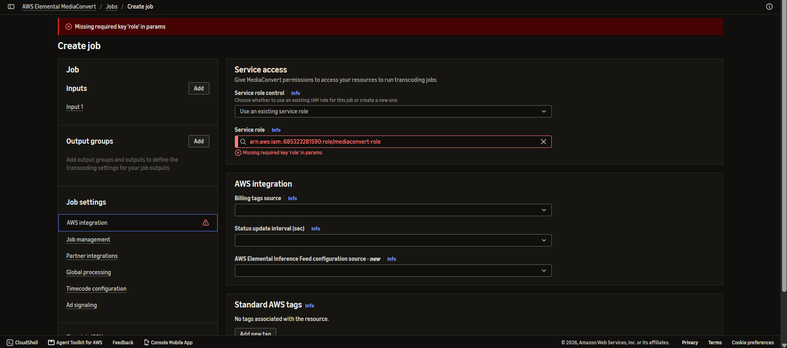
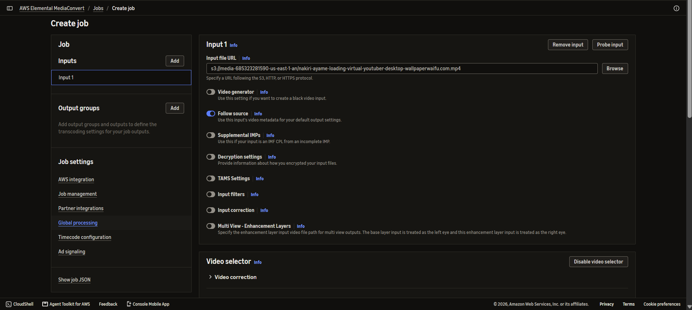
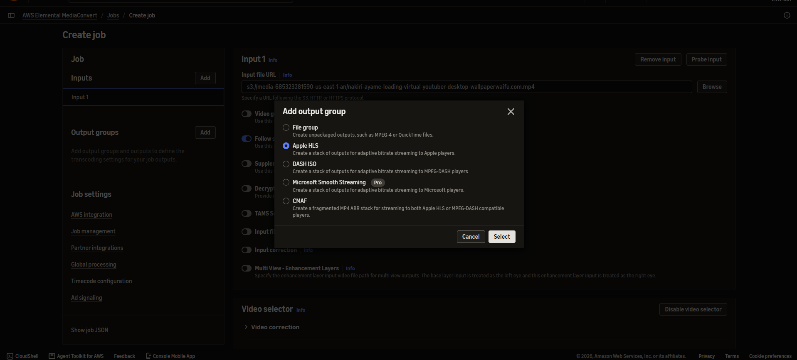
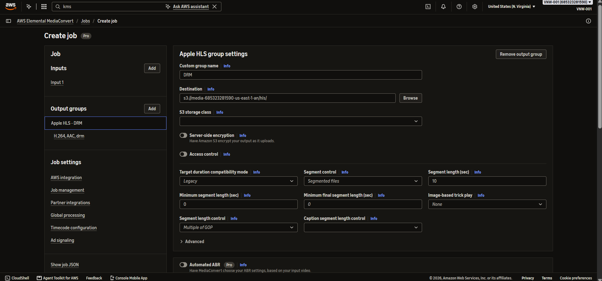
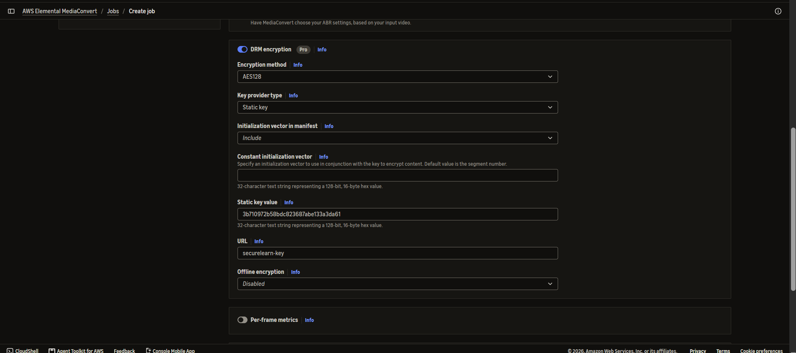
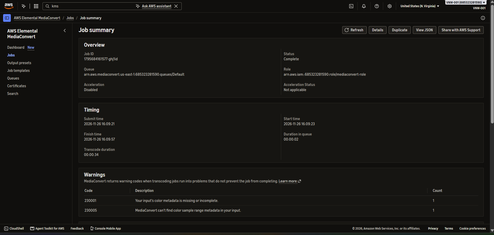
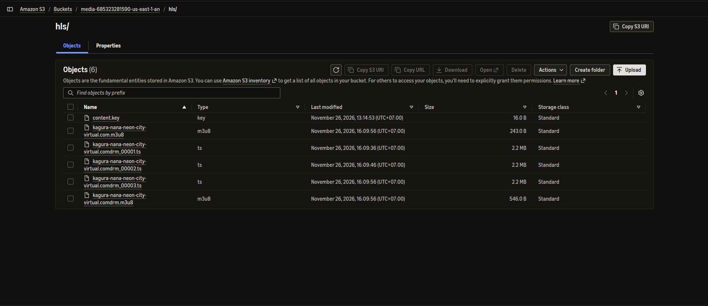

This optional exercise creates an AES-128-encrypted HLS output with AWS Elemental MediaConvert. Replace the placeholder values with values for your AWS account and SecureLearn lesson. The current SecureLearn upload and playback flow also stores generated lessons under `hls/`; keep an immutable key and the key delivery URL consistent with the player.

> **Important:** The job below uses the MediaConvert AES-128 static key setting. Do not publish or expose the static key value in the application source, lesson metadata, or public S3 objects.

### Prerequisites

* Complete section 5.4.1 and use the `securelearn-media-<account-id>` bucket.
* Run MediaConvert in the same AWS Region as the bucket (the workshop uses `ap-southeast-1`).
* Have the ARN of the `SecureLearn-Key` KMS key from section 5.3.4.
* Use a short test video stored under `videos/<courseId>/`.

> MediaConvert is billed for transcoding. Use a short test clip and review current AWS pricing before submitting a job.

### Step 1: Create a MediaConvert service role

1. In **IAM** > **Roles**, create a role for the **AWS Elemental MediaConvert** service. Name it `securelearn-mediaconvert-role`.

2. In the role's **Permissions** tab, choose **Add permissions** and attach the existing S3 and KMS permission policies available in your account. Make sure the attached S3 permissions allow the role to locate/list the bucket, read source objects under `videos/`, and write output objects under `hls/`. The KMS permissions and key policy must allow the role to use `SecureLearn-Key` for the SSE-KMS bucket.
3. In the key policy for `SecureLearn-Key`, allow `securelearn-mediaconvert-role` to use the key. The role needs to decrypt the SSE-KMS source and use the key when writing SSE-KMS output.
4. If the MediaConvert console creates a service role while you create the first job, use that role instead and attach the same existing S3 and KMS permission policies through **Add permissions**.

### Step 2: Start a MediaConvert job

1. Open **AWS Elemental MediaConvert** in the Region where the S3 bucket was created.
2. Choose **Jobs** > **Create job**.
3. In **Job settings**, select `securelearn-mediaconvert-role`.

4. Configure the input in the console:
  * Set **Input 1** > **Input file** to `s3://<bucket>/videos/<courseId>/<timestamp>_<name>.mp4`.
  * Keep the video selector at its default. Under **Audio selectors**, use **Audio Selector 1** with **Default selection** set to **Default**.
  * Set **Timecode source** to **Start at 0** (zero-based).

5. Add an **Apple HLS** output group. Set its **Destination** to `s3://<bucket>/hls/<courseId>/<timestamp>_<name>/master`. Use a unique `<timestamp>_<name>` prefix for each job.

6. In the HLS group settings, set **Segment length** to `6` seconds and **Segment control** to **Segmented files**. Set **Minimum segment length** to `0` if the field is shown.

7. In the HLS encryption settings, enable encryption and choose **AES-128** with **Static key**. Enter a randomly generated 16-byte key as 32 hexadecimal characters, set the key URL to `securelearn-key`, and include the initialization vector in the manifest. Do not reuse the key across lessons or expose it in public storage.

The `securelearn-key` URL must be implemented or configured in SecureLearn as the endpoint that returns the matching static key; it must not reveal the key in the public manifest. Console labels can vary slightly by Region or UI version, but enter the values above in the corresponding input, HLS group, encryption, video, and audio settings.

### Step 3: Run and monitor the job

1. Choose **Create** to submit the job.
2. In **Jobs**, wait until the status is **COMPLETE**. If it fails, open the job details and check the IAM or KMS access error before retrying.

3. Open the destination prefix in Amazon S3 and confirm that the playlist and media segments were created.

