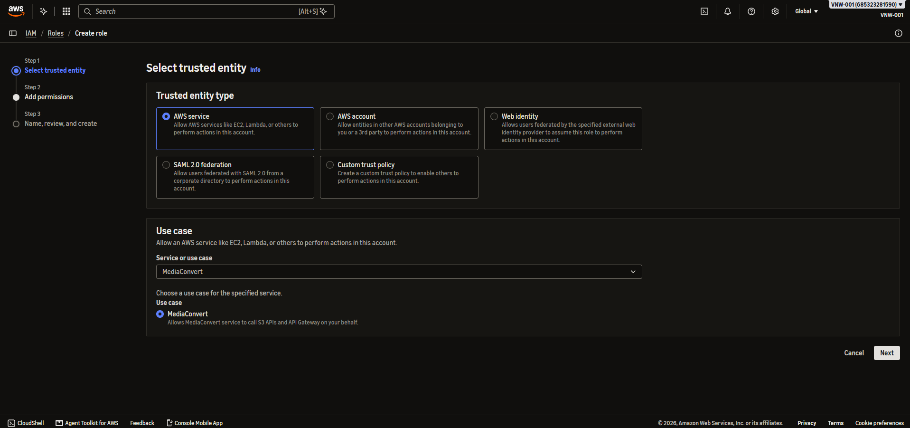
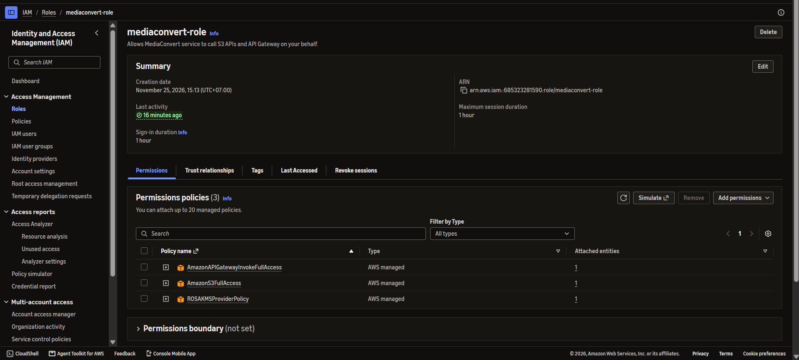
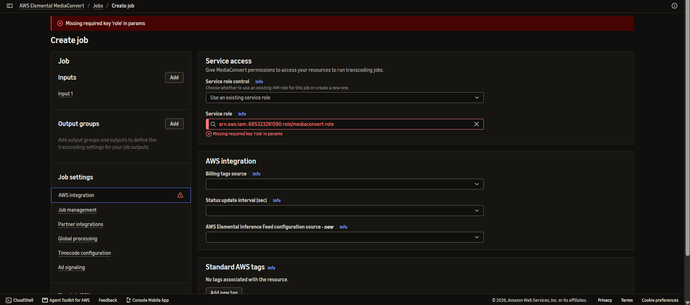
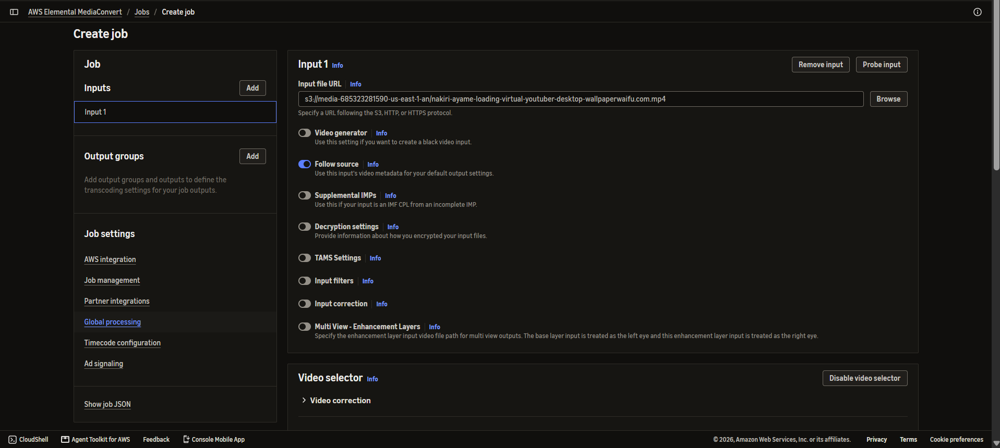
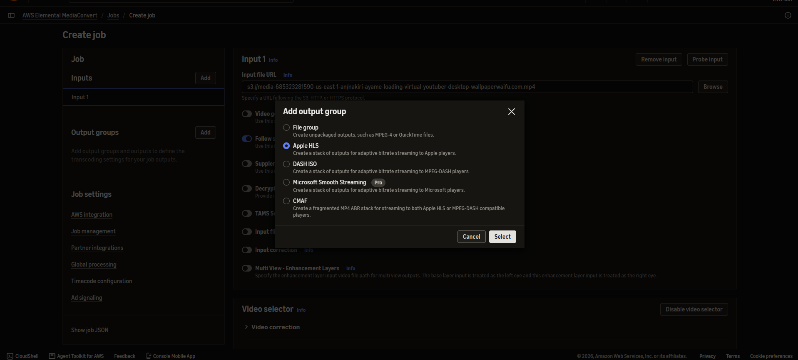
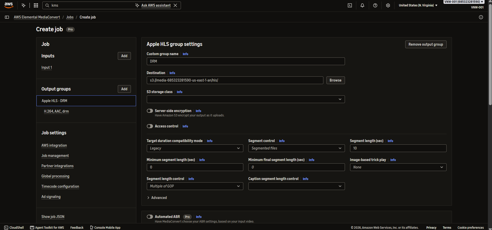
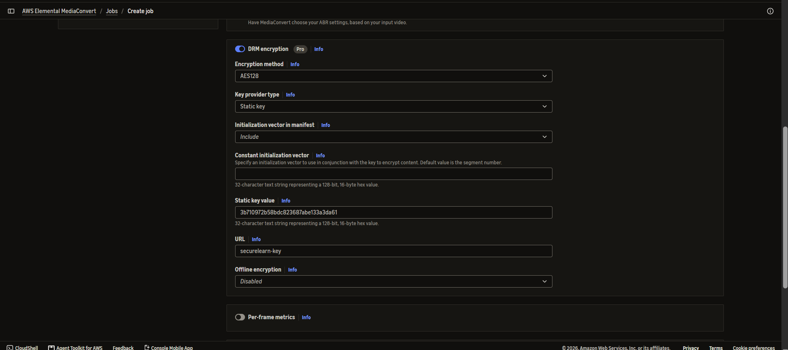
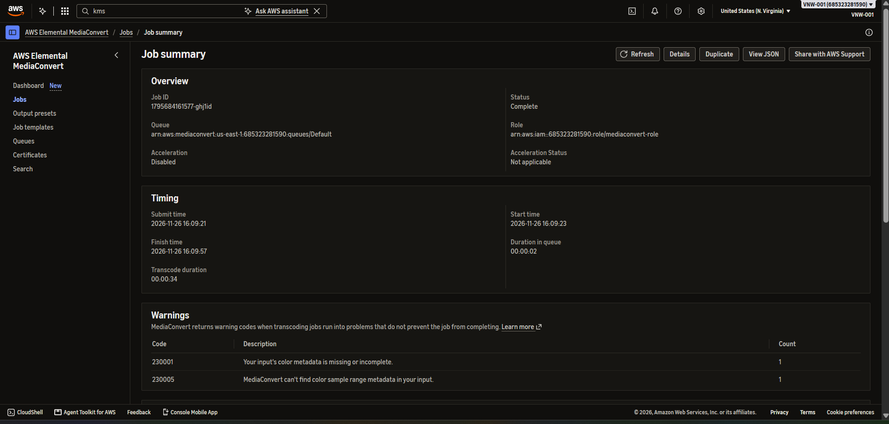
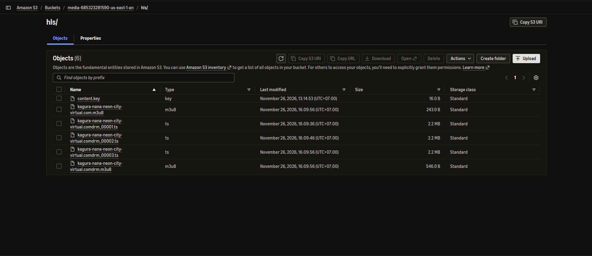

Phần thực hành tùy chọn này tạo đầu ra HLS mã hóa AES-128 bằng AWS Elemental MediaConvert. Hãy thay thế các giá trị placeholder bằng thông tin tài khoản AWS và bài học SecureLearn. Luồng upload và phát video hiện tại của SecureLearn cũng lưu bài học được tạo dưới `hls/`; key và URL phân phối key phải luôn nhất quán với trình phát.

> **Lưu ý:** Job dưới đây sử dụng cấu hình static key AES-128 của MediaConvert. Không công khai hoặc lưu static key trong source ứng dụng, metadata bài học hoặc các object S3 công khai.

### Điều kiện chuẩn bị

* Hoàn thành mục 5.4.1 và sử dụng bucket `securelearn-media-<account-id>`.
* Chạy MediaConvert trong cùng AWS Region với bucket.
* Chuẩn bị ARN của khóa KMS `SecureLearn-Key` ở mục 5.3.4.
* Chuẩn bị một video thử nghiệm ngắn trong prefix `videos/<courseId>/`.

> MediaConvert tính phí theo thời lượng chuyển mã. Hãy dùng video thử nghiệm ngắn và kiểm tra bảng giá AWS hiện hành trước khi gửi job.

### Bước 1: Tạo service role cho MediaConvert

1. Trong **IAM** > **Roles**, tạo role cho dịch vụ **AWS Elemental MediaConvert**, đặt tên `securelearn-mediaconvert-role`.

2. Trong tab **Permissions** của role, chọn **Add permissions** và gắn các policy quyền S3, KMS có sẵn trong tài khoản. Không tạo inline policy. Đảm bảo quyền S3 được gắn cho phép role truy vấn/liệt kê bucket, đọc object nguồn trong `videos/` và ghi object đầu ra trong `hls/`. Quyền KMS và key policy phải cho phép role sử dụng `SecureLearn-Key` với bucket SSE-KMS.
3. Trong key policy của `SecureLearn-Key`, cho phép `securelearn-mediaconvert-role` sử dụng khóa. Role cần giải mã nguồn SSE-KMS và sử dụng khóa khi ghi đầu ra SSE-KMS.
4. Nếu console MediaConvert tự tạo service role khi tạo job đầu tiên, hãy dùng role đó và gắn các policy quyền S3, KMS có sẵn thông qua **Add permissions**.

### Bước 2: Tạo MediaConvert job

1. Mở **AWS Elemental MediaConvert** tại Region đã tạo bucket S3.
2. Chọn **Jobs** > **Create job**.
3. Trong **Job settings**, chọn role `securelearn-mediaconvert-role`.

4. Cấu hình input:
  * **Input 1** > **Input file** thành `s3://<bucket>/videos/<courseId>/<timestamp>_<name>.mp4`.
  * Giữ video selector mặc định. Trong **Audio selectors**, dùng **Audio Selector 1** và đặt **Default selection** thành **Default**.
  * Đặt **Timecode source** thành **Start at 0** (zero-based).

5. Thêm output group **Apple HLS**. Đặt **Destination** thành `s3://<bucket>/hls/<courseId>/<timestamp>_<name>/master`. Dùng prefix `<timestamp>_<name>` duy nhất cho mỗi job.

6. Trong cài đặt HLS group, đặt **Segment length** là `6` giây và **Segment control** là **Segmented files**. Đặt **Minimum segment length** là `0` nếu giao diện có trường này.

7. Trong cài đặt mã hóa HLS, bật mã hóa và chọn **AES-128** với **Static key**. Nhập key ngẫu nhiên 16 byte dưới dạng 32 ký tự hex, đặt key URL là `securelearn-key` và chọn đưa initialization vector vào manifest. Không dùng lại key giữa các bài học hoặc để lộ key trong nơi lưu trữ công khai.

URL `securelearn-key` phải được SecureLearn triển khai hoặc cấu hình để trả về đúng static key; không được tiết lộ key trong manifest công khai. Tên các mục trên console có thể khác đôi chút tùy Region hoặc phiên bản giao diện, nhưng hãy nhập các giá trị trên vào phần input, HLS group, encryption, video và audio tương ứng.

### Bước 3: Chạy và theo dõi job

1. Chọn **Create** để gửi job.
2. Trong **Jobs**, đợi trạng thái chuyển thành **COMPLETE**. 

3. Mở prefix destination trong Amazon S3 và xác nhận playlist cùng các media segment đã được tạo.

