# Update the SecureLearn Anomaly Detection Pipeline

This step-by-step guide updates an existing SecureLearn AI monitoring deployment. It follows the supplied deployment guide: upload model v2, preserve the production `AccessLog` table, update the Lambda image and permissions, verify the stream and EventBridge triggers, then test alerts through the web application.

The pipeline uses:

* **Amazon S3** for the Isolation Forest model.
* **Amazon ECR** for the Lambda container image.
* **AWS Lambda** (`securelearn-anomaly-detection`) to score playback activity.
* **DynamoDB Streams** on `AccessLog` as the primary near-real-time trigger.
* **EventBridge** as a five-minute fallback trigger.
* **DynamoDB `AnomalyAlert`** and **Amazon SNS** for recorded alerts and email notifications.
* **Amazon CloudWatch Logs** for processing diagnostics.

Use Region `ap-southeast-1` (Singapore) for all resources.

## Before you begin

This is an **update and verification** procedure, not a clean deployment. It assumes the S3 model bucket, `AccessLog` and `AnomalyAlert` tables, Lambda function and execution role, ECR repository, and SNS topic already exist. The `AccessLog` index/stream mapping and EventBridge rule/target are verified or completed in the steps below. Do not recreate or delete the shared `AccessLog` table. If a foundational resource is missing, stop and complete the initial deployment procedure before continuing.

You need:

* AWS CLI v2 configured with a profile that can update these resources.
* Docker Desktop running.
* The `anomaly-lambda` project folder containing `handler.py`, `Dockerfile`, `requirements.txt`, `lambda-policy.json`, `lambda-env.json`, and `filter-criteria.json`.
* `isolation_forest_securelearn_v2.pkl` in the project folder. This is the single-file, 12-feature model; do not pair it with the older scaler/model files.
* An authorized test account and a staging or workshop web application for end-to-end testing.

Set `LOG_TIMEZONE` to `UTC` in `lambda-env.json`. The backend stores `accessedTime` in UTC without a timezone suffix.

## Step 0: Configure PowerShell and AWS CLI

Open PowerShell in the `anomaly-lambda` folder. Configure a named AWS CLI profile:
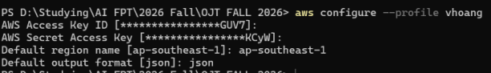

```powershell
aws configure --profile my-profile
$env:AWS_PROFILE = "my-profile"

$REGION  = "ap-southeast-1"
$ACCOUNT = aws sts get-caller-identity --query Account --output text
$REPO    = "securelearn-anomaly"
$IMAGE   = "$ACCOUNT.dkr.ecr.$REGION.amazonaws.com/${REPO}:v4"
$FUNC    = "securelearn-anomaly-detection"
$ROLE    = "securelearn-anomaly-lambda-role"
$BUCKET  = "securelearn-models-$ACCOUNT"

echo $ACCOUNT
```
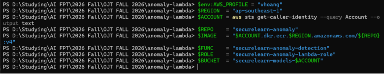

Confirm the output is your 12-digit AWS account ID. The profile and variables apply only to this PowerShell window; rerun this step if you open another one. Never put access keys in the guide or source files.

## Step 1: Upload model v2 to S3

Upload the model to the existing model bucket and keep the key under `models/`:

```powershell
aws s3 cp .\isolation_forest_securelearn_v2.pkl "s3://$BUCKET/models/isolation_forest_securelearn_v2.pkl"
aws s3 ls "s3://$BUCKET/models/"
```
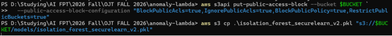

Confirm the v2 `.pkl` object is listed. Do not change the video/HLS bucket or make the model bucket public. The Lambda execution role should read the model using IAM; do not add access keys to the function.
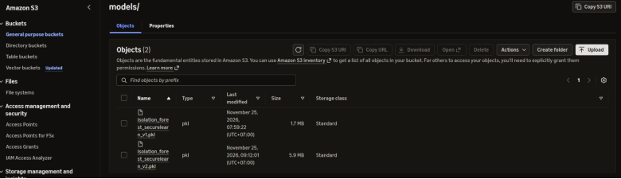

## Step 2: Verify the `AccessLog` index and stream

`AccessLog` contains backend logs. Preserve its records and key schema. Confirm its existing indexes:

```powershell
aws dynamodb describe-table --table-name AccessLog --region $REGION --query "Table.GlobalSecondaryIndexes[].{Name:IndexName,Status:IndexStatus}"
```
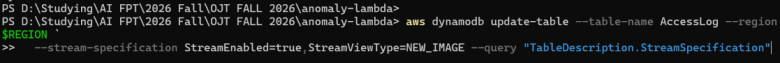

The Lambda expects `LogInADay` (`actionType` + `accessedTime`) and `byUserTime` (`userEmail` + `accessedTime`). If `byUserTime` is missing, add only that index:

```powershell
@'
[{"Create":{"IndexName":"byUserTime","KeySchema":[{"AttributeName":"userEmail","KeyType":"HASH"},{"AttributeName":"accessedTime","KeyType":"RANGE"}],"Projection":{"ProjectionType":"ALL"}}}]
'@ | Set-Content .\byusertime-gsi.json -Encoding ascii

aws dynamodb update-table --table-name AccessLog --region $REGION `
  --attribute-definitions AttributeName=userEmail,AttributeType=S AttributeName=accessedTime,AttributeType=S `
  --global-secondary-index-updates file://byusertime-gsi.json
```

Wait until `byUserTime` is `ACTIVE` before changing the stream. Check the current stream setting:

```powershell
aws dynamodb describe-table --table-name AccessLog --region $REGION --query "Table.StreamSpecification"
```

If streams are disabled, enable them with the `NEW_IMAGE` stream view type:

```powershell
aws dynamodb update-table --table-name AccessLog --region $REGION `
  --stream-specification StreamEnabled=true,StreamViewType=NEW_IMAGE
```

If the stream is already enabled with `NEW_IMAGE`, do not update it. If it is enabled with another view type, coordinate the change and set it to `NEW_IMAGE`; DynamoDB may issue a new stream ARN, which you must retrieve in Step 5. Continue only after the index is active and the stream is enabled.
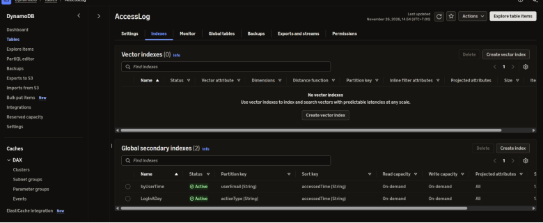

## Step 3: Update the Lambda role permissions

Replace the account placeholder in the local policy and environment files:

```powershell
foreach ($f in "lambda-policy.json", "lambda-env.json") {
  (Get-Content $f -Raw) -replace "ACCOUNT_ID", $ACCOUNT | Set-Content $f -NoNewline
}
```
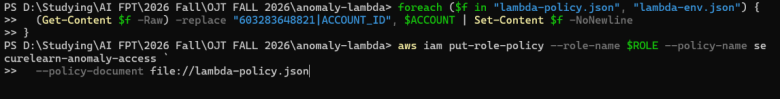

Check that `lambda-env.json` points to the existing model bucket, `models/isolation_forest_securelearn_v2.pkl`, `AccessLog`, `AnomalyAlert`, both GSI names, the correct SNS topic ARN, and `LOG_TIMEZONE` `UTC`. Keep `LOCK_ON_DETECT` set to `false` until the dedicated lockout test in Step 9.

If either file contains an account ID from another environment instead of the `ACCOUNT_ID` placeholder, update those account-specific ARN and bucket values to the current account before applying the policy.

Update the existing Lambda execution role policy:

```powershell
aws iam put-role-policy --role-name $ROLE --policy-name securelearn-anomaly-access `
  --policy-document file://lambda-policy.json

aws iam get-role --role-name $ROLE --query "Role.Arn" --output text
```
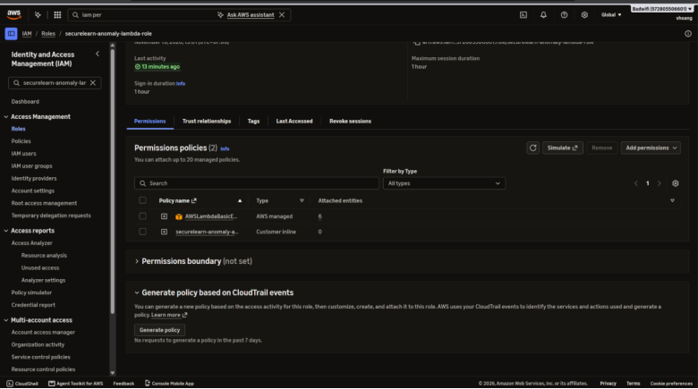

The policy must allow only the required operations: read the model object in S3; query `AccessLog` and its two GSIs; read its DynamoDB stream; query and write `AnomalyAlert`; publish to the alert SNS topic; and, for the optional lockout feature, use the required Cognito actions scoped to the intended user pool. Keep the existing Lambda trust relationship and basic CloudWatch logging permission.

## Step 4: Build and deploy the Lambda image

Log in to ECR and build the container for Lambda's x86_64 runtime:

```powershell
aws ecr get-login-password --region $REGION |
  docker login --username AWS --password-stdin "$ACCOUNT.dkr.ecr.$REGION.amazonaws.com"

docker buildx build --platform linux/amd64 --provenance=false --sbom=false -t $IMAGE --push .
```

The `--provenance=false` and `--sbom=false` options keep the pushed image manifest compatible with Lambda. Use a new image tag instead of `v4` if that tag is already being used for a different build.

Update the existing function code, wait for the update to finish, then update its complete environment from `lambda-env.json`:

```powershell
aws lambda update-function-code --function-name $FUNC --image-uri $IMAGE --region $REGION
aws lambda wait function-updated-v2 --function-name $FUNC --region $REGION

aws lambda update-function-configuration --function-name $FUNC `
  --environment file://lambda-env.json --region $REGION
aws lambda wait function-updated-v2 --function-name $FUNC --region $REGION
```
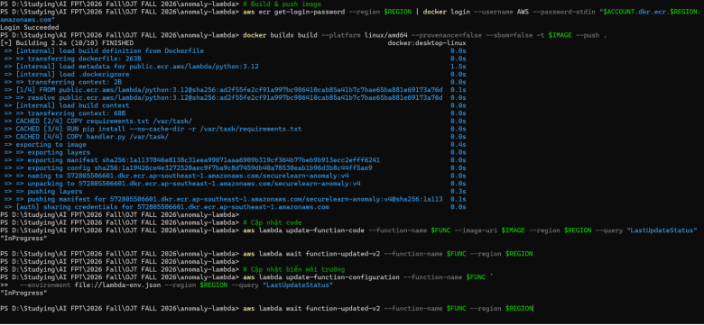

Do not use a partial environment update; it can remove variables the function still needs. Verify the image and model key:

```powershell
aws lambda get-function --function-name $FUNC --region $REGION `
  --query "{Image:Code.ImageUri,Status:Configuration.LastUpdateStatus,Environment:Configuration.Environment.Variables}"
```
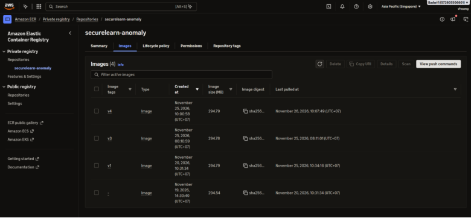

Confirm the update succeeded and the environment contains the v2 model key, correct table/index names, SNS topic ARN, and `LOCK_ON_DETECT` set to `false`.
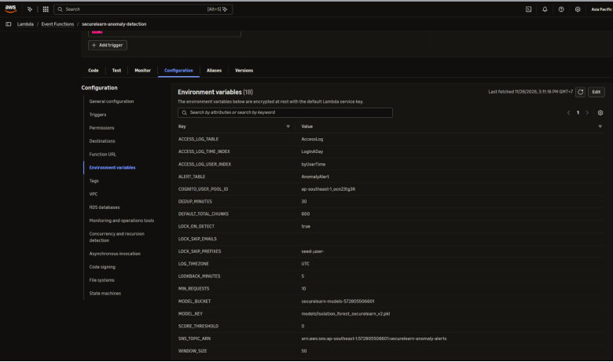

## Step 5: Connect or verify the DynamoDB Stream trigger

Get the current stream ARN:

```powershell
$STREAM_ARN = aws dynamodb describe-table --table-name AccessLog `
  --query "Table.LatestStreamArn" --output text --region $REGION
echo $STREAM_ARN
```

Check existing event source mappings before creating one:

```powershell
aws lambda list-event-source-mappings --function-name $FUNC --region $REGION `
  --query "EventSourceMappings[].{UUID:UUID,State:State,Source:EventSourceArn}"
```

If an enabled mapping already points to this stream, keep it and do not create a duplicate. Otherwise create the mapping:

```powershell
aws lambda create-event-source-mapping --function-name $FUNC `
  --event-source-arn $STREAM_ARN `
  --starting-position LATEST `
  --batch-size 100 `
  --maximum-batching-window-in-seconds 30 `
  --maximum-retry-attempts 2 `
  --maximum-record-age-in-seconds 3600 `
  --filter-criteria file://filter-criteria.json `
  --region $REGION
```
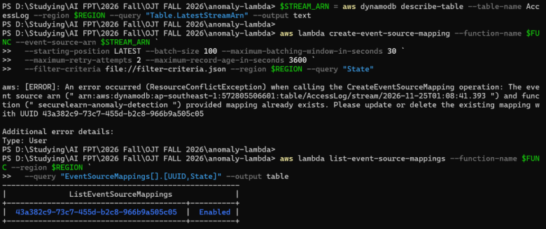

The filter file should pass only playback `INSERT` events with `PLAYBACK`, `MANIFEST_REQUEST`, `KEY_REQUEST`, or `SEGMENT_REQUEST` action types. Wait for the mapping state to become `Enabled`. Because the stream uses `LATEST`, new records trigger the function; old records are not replayed.
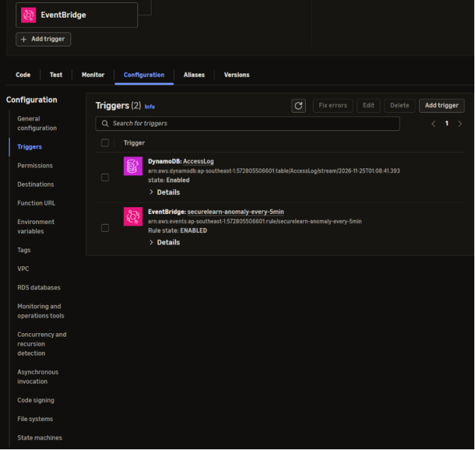

## Step 6: Confirm the SNS email subscription

The Lambda environment must reference the existing `securelearn-anomaly-alerts` topic in this Region. Check its subscriptions before adding another:

```powershell
$TOPIC = "arn:aws:sns:${REGION}:${ACCOUNT}:securelearn-anomaly-alerts"
aws sns list-subscriptions-by-topic --topic-arn $TOPIC --region $REGION
```
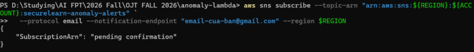

If the intended administrator email is not already subscribed, add it:

```powershell
aws sns subscribe --topic-arn $TOPIC --protocol email `
  --notification-endpoint "admin@example.com" --region $REGION
```

Replace the example with an authorized monitoring address. Open the confirmation email and confirm the subscription; SNS will not deliver alert emails until it is confirmed. If the topic does not exist, stop and create it using the initial deployment procedure. Then set its ARN in `lambda-env.json` and update the Lambda environment again using the full-file commands from Step 4.
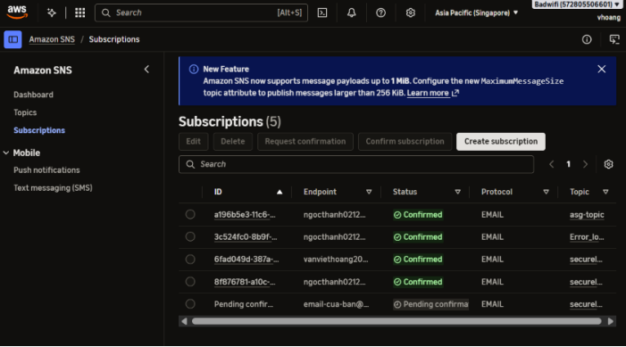

## Step 7: Verify the EventBridge fallback

The scheduled rule should invoke the same Lambda every five minutes. Check the existing rule and target. If the rule is missing, `list-targets-by-rule` can return `ResourceNotFoundException`; continue with the `put-rule` command below:

```powershell
aws events list-targets-by-rule --rule securelearn-anomaly-every-5min --region $REGION
```
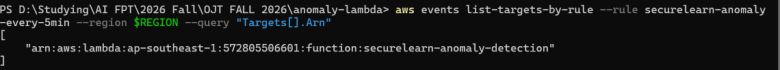

Create or update the named schedule and obtain its ARN. `put-rule` with this same name updates the existing schedule rather than creating a duplicate:

```powershell
$RULE_ARN = aws events put-rule --name securelearn-anomaly-every-5min `
  --schedule-expression "rate(5 minutes)" --region $REGION --query RuleArn --output text

$FUNC_ARN = aws lambda get-function --function-name $FUNC --region $REGION `
  --query Configuration.FunctionArn --output text

aws events put-targets --rule securelearn-anomaly-every-5min `
  --targets "Id=1,Arn=$FUNC_ARN" --region $REGION
```

The target ID is stable, so this command creates or updates the target. Ensure the Lambda resource policy allows EventBridge to invoke the function. Add the permission only if the `eventbridge-5min` statement does not already exist:

```powershell
aws lambda add-permission --function-name $FUNC --statement-id eventbridge-5min `
  --action lambda:InvokeFunction --principal events.amazonaws.com `
  --source-arn $RULE_ARN --region $REGION
```
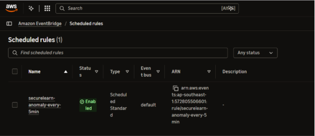

The five-minute fallback complements the stream; it does not replace it.

## Step 8: Test detection through the web application

Use the staging or workshop application and an authorized test account. Do not use real student accounts or run a crawler against a production service.

1. Watch a video normally for three to five minutes and confirm the backend writes playback records to `AccessLog`.
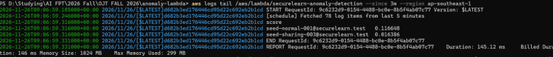
2. Review Lambda diagnostics:

   ```powershell
   aws logs tail /aws/lambda/$FUNC --since 10m --region $REGION
   ```

3. If the workshop provides an approved crawler test, run it only against the test environment with a dedicated test account.
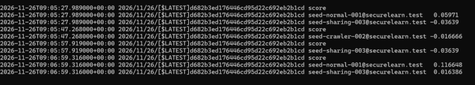
4. Confirm the test result in CloudWatch Logs, the `AnomalyAlert` table, and the confirmed SNS email subscription. A new alert should have `status = OPEN`; detection scores depend on the input data and model configuration.

Do not use `seed_test_logs.py` or insert synthetic data into the shared production `AccessLog` table as part of this procedure.
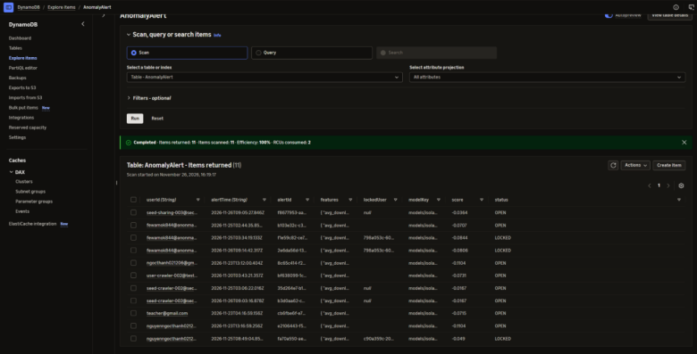
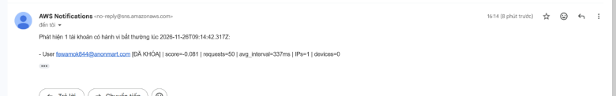

## Step 9: Test Cognito account lockout safely (optional)

Lockout is disabled by default. It can sign a user out and disable that Cognito account
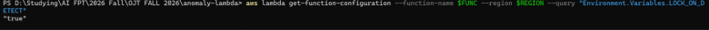
Generate the approved test pattern using only the disposable account. Verify the `AnomalyAlert` record and that Cognito shows the test user as disabled. Then immediately:
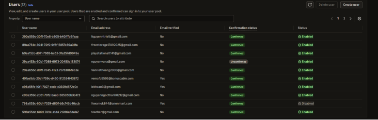

1. Set `LOCK_ON_DETECT` back to `"false"` in `lambda-env.json`.
2. Update the Lambda environment with the full file and wait for the update to complete.
Fewamok844@anomart.com using tool to download illegally so it was locked
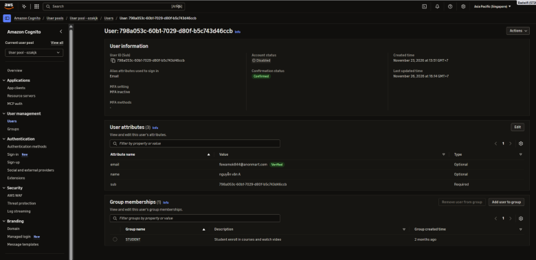
3. Re-enable the disposable user in **Amazon Cognito** > **User pools** > the user pool > **Users** > select the user > **Actions** > **Enable user access**.
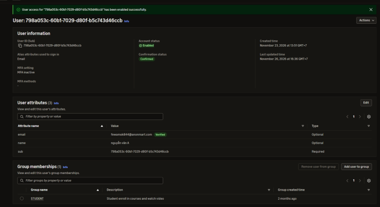
