# Cập nhật pipeline phát hiện bất thường SecureLearn

Hướng dẫn từng bước này cập nhật hệ thống giám sát AI SecureLearn đã được triển khai. Nội dung bám theo hướng dẫn step-by-step được cung cấp: tải model v2, giữ nguyên bảng `AccessLog` đang dùng, cập nhật image và quyền Lambda, kiểm tra trigger Stream và EventBridge, sau đó kiểm thử cảnh báo qua web application.

Pipeline gồm:

* **Amazon S3** lưu model Isolation Forest.
* **Amazon ECR** lưu container image của Lambda.
* **AWS Lambda** (`securelearn-anomaly-detection`) chấm điểm hoạt động phát video.
* **DynamoDB Streams** trên `AccessLog` làm trigger chính gần thời gian thực.
* **EventBridge** làm trigger dự phòng mỗi 5 phút.
* **DynamoDB `AnomalyAlert`** và **Amazon SNS** lưu cảnh báo, gửi email.
* **Amazon CloudWatch Logs** ghi thông tin xử lý và chẩn đoán.

Dùng Region `ap-southeast-1` (Singapore) cho tất cả tài nguyên.

## Trước khi bắt đầu

Đây là quy trình **cập nhật và kiểm tra**, không phải triển khai mới. Quy trình giả định bucket model S3, bảng `AccessLog` và `AnomalyAlert`, Lambda function và execution role, ECR repository cùng SNS topic đã tồn tại. Index/stream mapping của `AccessLog` và EventBridge rule/target sẽ được kiểm tra hoặc hoàn thiện trong các bước dưới đây. Không tạo lại hoặc xóa bảng `AccessLog` dùng chung. Nếu thiếu tài nguyên nền tảng, dừng lại và hoàn tất quy trình triển khai ban đầu trước khi tiếp tục.

Bạn cần:

* AWS CLI v2 đã cấu hình profile có quyền cập nhật các tài nguyên này.
* Docker Desktop đang chạy.
* Thư mục dự án `anomaly-lambda` gồm `handler.py`, `Dockerfile`, `requirements.txt`, `lambda-policy.json`, `lambda-env.json` và `filter-criteria.json`.
* File `isolation_forest_securelearn_v2.pkl` trong thư mục dự án. Đây là model một file, 12 đặc trưng; không dùng kèm các file model/scaler cũ.
* Tài khoản kiểm thử được cấp quyền và web application staging hoặc workshop để kiểm tra end-to-end.

Đặt `LOG_TIMEZONE` thành `UTC` trong `lambda-env.json`. Backend lưu `accessedTime` theo UTC, không có hậu tố múi giờ.

## Bước 0: Cấu hình PowerShell và AWS CLI

Mở PowerShell trong thư mục `anomaly-lambda`. Nếu cần, cấu hình profile AWS CLI:
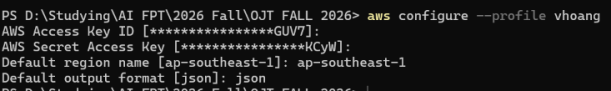

```powershell
aws configure --profile my-profile
$env:AWS_PROFILE = "my-profile"

$REGION  = "ap-southeast-1"
$ACCOUNT = aws sts get-caller-identity --query Account --output text
$REPO    = "securelearn-anomaly"
$IMAGE   = "$ACCOUNT.dkr.ecr.$REGION.amazonaws.com/${REPO}:v4"
$FUNC    = "securelearn-anomaly-detection"
$ROLE    = "securelearn-anomaly-lambda-role"
$BUCKET  = "securelearn-models-$ACCOUNT"

echo $ACCOUNT
```
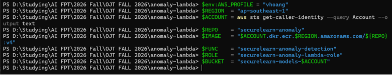
Xác nhận kết quả là AWS account ID gồm 12 chữ số. Profile và các biến chỉ tồn tại trong cửa sổ PowerShell hiện tại; chạy lại bước này nếu mở cửa sổ khác. Không đưa access key vào tài liệu hoặc source code.

## Bước 1: Tải model v2 lên S3

Tải model lên bucket model đã có và giữ object key bên dưới `models/`:

```powershell
aws s3 cp .\isolation_forest_securelearn_v2.pkl "s3://$BUCKET/models/isolation_forest_securelearn_v2.pkl"
aws s3 ls "s3://$BUCKET/models/"
```
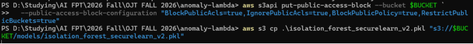
Xác nhận object `.pkl` phiên bản v2 xuất hiện trong danh sách. Không đổi bucket video/HLS hoặc đặt bucket model ở chế độ public. Lambda đọc model bằng IAM role; không thêm access key vào function.
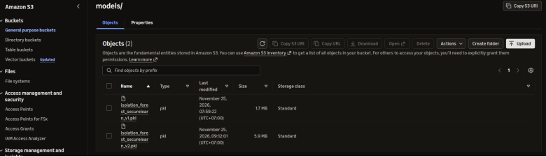
## Bước 2: Kiểm tra index và stream của `AccessLog`

`AccessLog` chứa log backend. Giữ nguyên dữ liệu và key schema của bảng. Kiểm tra các index hiện có:

```powershell
aws dynamodb describe-table --table-name AccessLog --region $REGION --query "Table.GlobalSecondaryIndexes[].{Name:IndexName,Status:IndexStatus}"
```
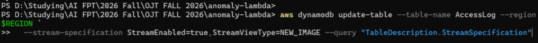
Lambda cần `LogInADay` (`actionType` + `accessedTime`) và `byUserTime` (`userEmail` + `accessedTime`). Nếu chưa có `byUserTime`, chỉ thêm index này:

```powershell
@'
[{"Create":{"IndexName":"byUserTime","KeySchema":[{"AttributeName":"userEmail","KeyType":"HASH"},{"AttributeName":"accessedTime","KeyType":"RANGE"}],"Projection":{"ProjectionType":"ALL"}}}]
'@ | Set-Content .\byusertime-gsi.json -Encoding ascii

aws dynamodb update-table --table-name AccessLog --region $REGION `
  --attribute-definitions AttributeName=userEmail,AttributeType=S AttributeName=accessedTime,AttributeType=S `
  --global-secondary-index-updates file://byusertime-gsi.json
```

Chờ `byUserTime` có trạng thái `ACTIVE` trước khi thay đổi stream. Kiểm tra cấu hình stream hiện tại:

```powershell
aws dynamodb describe-table --table-name AccessLog --region $REGION --query "Table.StreamSpecification"
```

Nếu stream đang tắt, bật stream với kiểu dữ liệu `NEW_IMAGE`:

```powershell
aws dynamodb update-table --table-name AccessLog --region $REGION `
  --stream-specification StreamEnabled=true,StreamViewType=NEW_IMAGE
```

Nếu stream đã bật với `NEW_IMAGE`, không cần cập nhật lại. Nếu stream đang bật với kiểu dữ liệu khác, hãy thống nhất trước khi đổi sang `NEW_IMAGE`; DynamoDB có thể cấp stream ARN mới, cần lấy lại ARN ở Bước 5. Chỉ tiếp tục khi index đã active và stream đã bật.
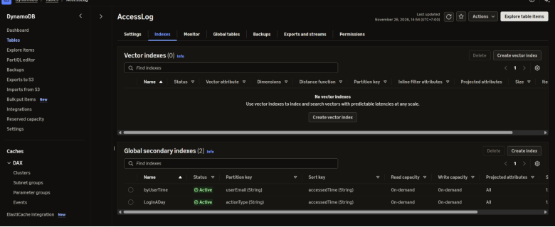
## Bước 3: Cập nhật quyền cho Lambda role

Thay account placeholder trong các file policy và environment tại máy:

```powershell
foreach ($f in "lambda-policy.json", "lambda-env.json") {
  (Get-Content $f -Raw) -replace "ACCOUNT_ID", $ACCOUNT | Set-Content $f -NoNewline
}
```
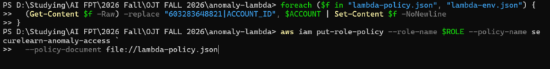
Kiểm tra `lambda-env.json` trỏ đến đúng model bucket hiện có, `models/isolation_forest_securelearn_v2.pkl`, `AccessLog`, `AnomalyAlert`, tên hai GSI, SNS topic ARN và `LOG_TIMEZONE` là `UTC`. Giữ `LOCK_ON_DETECT` là `false` cho đến bài kiểm tra khóa tài khoản riêng ở Bước 9.

Nếu một trong hai file có account ID của môi trường khác thay vì placeholder `ACCOUNT_ID`, hãy cập nhật các ARN và bucket theo account hiện tại trước khi áp dụng policy.

Cập nhật policy cho Lambda execution role hiện có:

```powershell
aws iam put-role-policy --role-name $ROLE --policy-name securelearn-anomaly-access `
  --policy-document file://lambda-policy.json

aws iam get-role --role-name $ROLE --query "Role.Arn" --output text
```
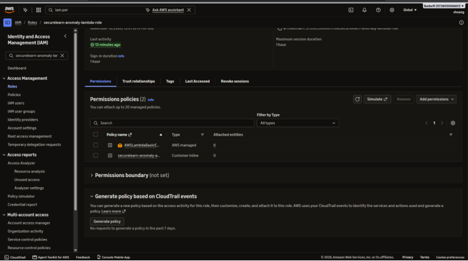
Policy chỉ nên cấp các quyền cần thiết: đọc model object trong S3; query `AccessLog` và hai GSI; đọc DynamoDB stream; query và ghi `AnomalyAlert`; publish vào SNS topic cảnh báo; và, nếu bật tính năng khóa tài khoản tùy chọn, dùng các Cognito action cần thiết giới hạn trong đúng user pool. Giữ nguyên trust relationship và quyền ghi CloudWatch Logs đang có của Lambda.

## Bước 4: Build và deploy Lambda image

Đăng nhập ECR và build container cho runtime Lambda x86_64:

```powershell
aws ecr get-login-password --region $REGION |
  docker login --username AWS --password-stdin "$ACCOUNT.dkr.ecr.$REGION.amazonaws.com"

docker buildx build --platform linux/amd64 --provenance=false --sbom=false -t $IMAGE --push .
```

Hai tùy chọn `--provenance=false` và `--sbom=false` giúp image manifest tương thích với Lambda. Dùng tag mới thay cho `v4` nếu tag đó đã được dùng cho một bản build khác.

Cập nhật code của function hiện có, chờ hoàn tất, rồi cập nhật toàn bộ environment từ `lambda-env.json`:

```powershell
aws lambda update-function-code --function-name $FUNC --image-uri $IMAGE --region $REGION
aws lambda wait function-updated-v2 --function-name $FUNC --region $REGION

aws lambda update-function-configuration --function-name $FUNC `
  --environment file://lambda-env.json --region $REGION
aws lambda wait function-updated-v2 --function-name $FUNC --region $REGION
```
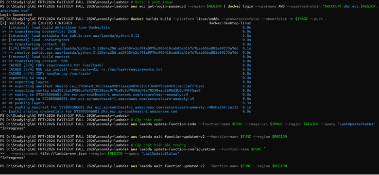
Không cập nhật một phần environment; thao tác đó có thể xóa các biến function còn cần. Xác minh image và model key:

```powershell
aws lambda get-function --function-name $FUNC --region $REGION `
  --query "{Image:Code.ImageUri,Status:Configuration.LastUpdateStatus,Environment:Configuration.Environment.Variables}"
```
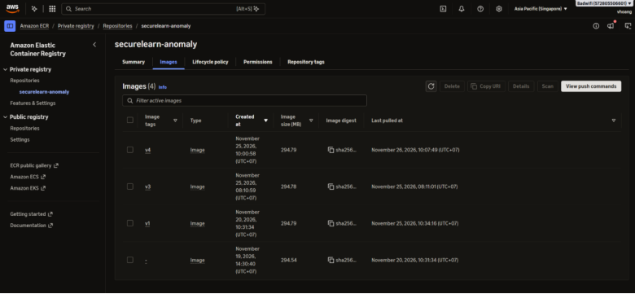
Xác nhận cập nhật thành công và environment có model key v2, đúng tên bảng/index, SNS topic ARN và `LOCK_ON_DETECT` đang là `true`.
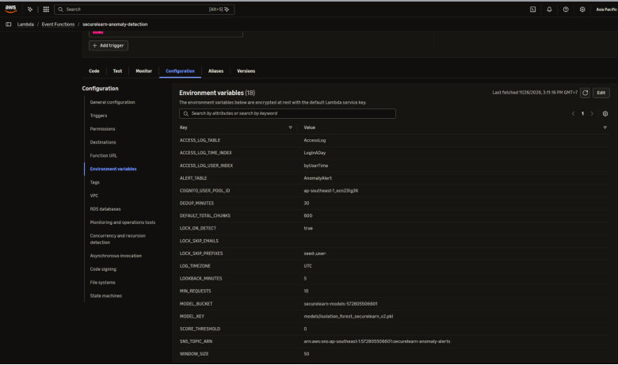
## Bước 5: Kết nối hoặc kiểm tra DynamoDB Stream trigger

Lấy stream ARN hiện tại:

```powershell
$STREAM_ARN = aws dynamodb describe-table --table-name AccessLog `
  --query "Table.LatestStreamArn" --output text --region $REGION
echo $STREAM_ARN
```

Kiểm tra event source mapping hiện có trước khi tạo mới:

```powershell
aws lambda list-event-source-mappings --function-name $FUNC --region $REGION `
  --query "EventSourceMappings[].{UUID:UUID,State:State,Source:EventSourceArn}"
```

Nếu đã có mapping bật và trỏ đến stream này, giữ nguyên, không tạo mapping trùng. Nếu chưa có, tạo mapping:

```powershell
aws lambda create-event-source-mapping --function-name $FUNC `
  --event-source-arn $STREAM_ARN `
  --starting-position LATEST `
  --batch-size 100 `
  --maximum-batching-window-in-seconds 30 `
  --maximum-retry-attempts 2 `
  --maximum-record-age-in-seconds 3600 `
  --filter-criteria file://filter-criteria.json `
  --region $REGION
```
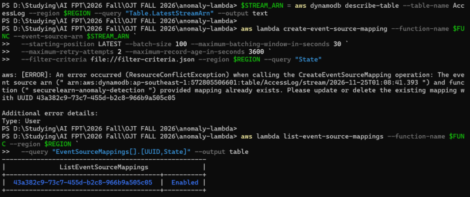
File filter chỉ nên cho qua các sự kiện playback `INSERT` có `actionType` là `PLAYBACK`, `MANIFEST_REQUEST`, `KEY_REQUEST` hoặc `SEGMENT_REQUEST`. Chờ mapping chuyển sang `Enabled`. Vì stream bắt đầu từ `LATEST`, function chỉ xử lý record mới, không chạy lại các record cũ.
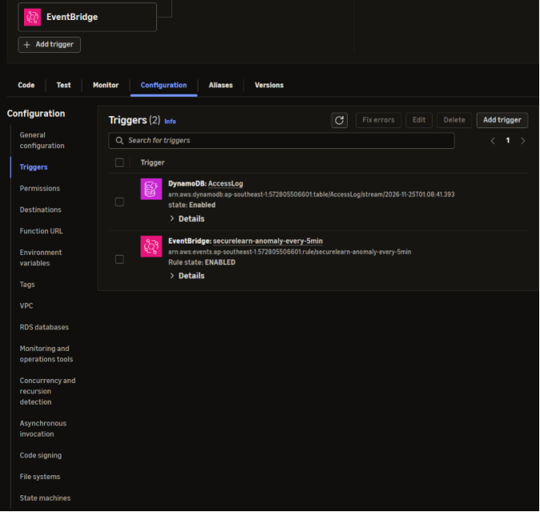

## Bước 6: Xác nhận SNS email subscription

Lambda environment phải trỏ đến topic `securelearn-anomaly-alerts` hiện có trong Region này. Kiểm tra subscription trước khi thêm mới:

```powershell
$TOPIC = "arn:aws:sns:${REGION}:${ACCOUNT}:securelearn-anomaly-alerts"
aws sns list-subscriptions-by-topic --topic-arn $TOPIC --region $REGION
```
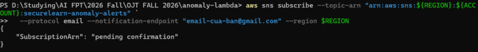

Nếu email quản trị nhận cảnh báo chưa được subscribe, thêm email đó:

```powershell
aws sns subscribe --topic-arn $TOPIC --protocol email `
  --notification-endpoint "admin@example.com" --region $REGION
```

Thay email ví dụ bằng địa chỉ giám sát được cấp quyền. Mở email xác nhận và xác nhận subscription; SNS chưa gửi cảnh báo cho đến khi subscription được xác nhận. Nếu topic chưa tồn tại, dừng lại và tạo topic theo quy trình triển khai ban đầu. Sau đó đặt ARN của topic vào `lambda-env.json` rồi cập nhật lại Lambda environment bằng các lệnh dùng toàn bộ file ở Bước 4.
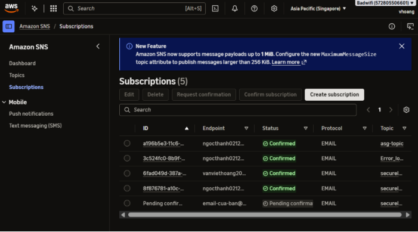
## Bước 7: Kiểm tra EventBridge dự phòng

Scheduled rule cần gọi cùng Lambda mỗi 5 phút. Kiểm tra rule và target đã có. Nếu chưa có rule, `list-targets-by-rule` có thể trả về `ResourceNotFoundException`; tiếp tục bằng lệnh `put-rule` bên dưới:

```powershell
aws events list-targets-by-rule --rule securelearn-anomaly-every-5min --region $REGION
```
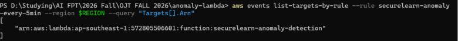
Tạo hoặc cập nhật lịch có tên này và lấy ARN của rule. `put-rule` với cùng tên sẽ cập nhật lịch hiện có thay vì tạo rule trùng:

```powershell
$RULE_ARN = aws events put-rule --name securelearn-anomaly-every-5min `
  --schedule-expression "rate(5 minutes)" --region $REGION --query RuleArn --output text

$FUNC_ARN = aws lambda get-function --function-name $FUNC --region $REGION `
  --query Configuration.FunctionArn --output text

aws events put-targets --rule securelearn-anomaly-every-5min `
  --targets "Id=1,Arn=$FUNC_ARN" --region $REGION
```

Target ID luôn ổn định nên lệnh trên tạo mới hoặc cập nhật target. Đảm bảo Lambda resource policy cho phép EventBridge gọi function. Chỉ thêm quyền nếu statement `eventbridge-5min` chưa tồn tại:

```powershell
aws lambda add-permission --function-name $FUNC --statement-id eventbridge-5min `
  --action lambda:InvokeFunction --principal events.amazonaws.com `
  --source-arn $RULE_ARN --region $REGION
```
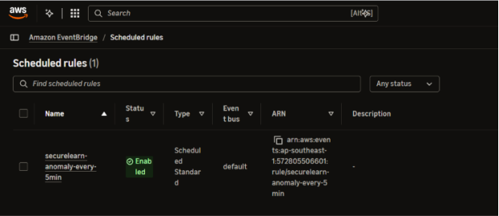
Lịch dự phòng 5 phút bổ sung cho stream, không thay thế stream.

## Bước 8: Kiểm tra phát hiện qua web application

Dùng staging/workshop application và tài khoản kiểm thử được cấp quyền. Không dùng tài khoản học viên thật hoặc chạy crawler vào dịch vụ production.

1. Xem video theo cách bình thường trong 3–5 phút và xác nhận backend ghi playback record vào `AccessLog`.
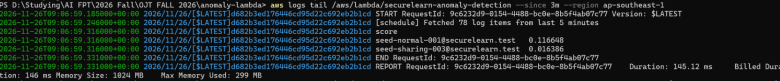
2. Xem log chẩn đoán của Lambda:

   ```powershell
   aws logs tail /aws/lambda/$FUNC --since 10m --region $REGION
   ```

3. Nếu workshop có công cụ crawler kiểm thử được phê duyệt, chỉ chạy trong môi trường test bằng tài khoản test riêng.
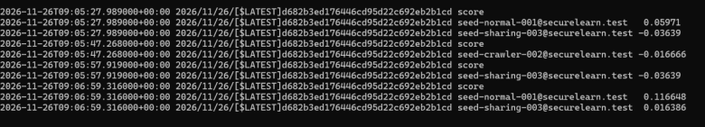
4. Xác nhận kết quả trong CloudWatch Logs, bảng `AnomalyAlert` và SNS email subscription đã xác nhận. Cảnh báo mới có `status = OPEN`; điểm phát hiện phụ thuộc dữ liệu đầu vào và cấu hình model.

Không dùng `seed_test_logs.py` hoặc chèn dữ liệu giả lập vào `AccessLog` production dùng chung trong quy trình này.
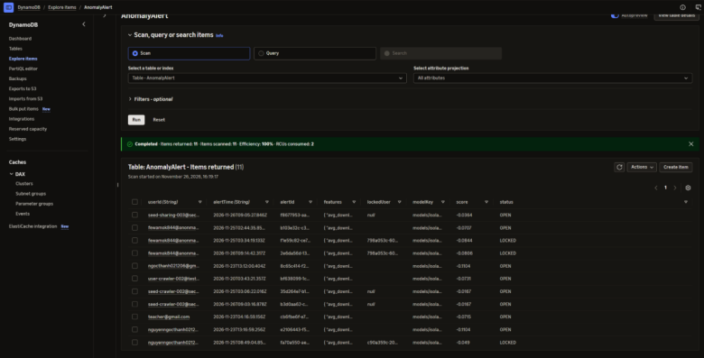
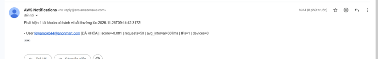

## Bước 9: Kiểm thử khóa tài khoản Cognito an toàn (tùy chọn)

Khóa tài khoản mặc định tắt. Tính năng có thể sign-out và vô hiệu hóa Cognito user.

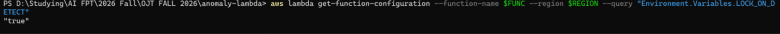
Tạo pattern kiểm thử đã được phê duyệt chỉ bằng tài khoản test dùng riêng. Xác nhận record trong `AnomalyAlert` và trạng thái Cognito user đã bị disabled. 
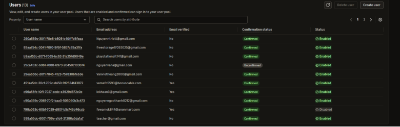
Sau đó lập tức:
1. Đặt lại `LOCK_ON_DETECT` thành `"false"` trong `lambda-env.json`.
2. Cập nhật Lambda environment bằng toàn bộ file và chờ cập nhật xong.
Fewamok844@anomart.com dùng tool cào nên bị khóa
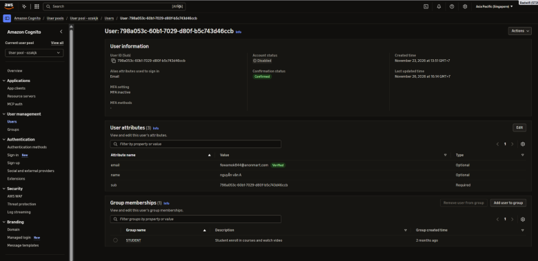
3. Bật lại tài khoản test trong **Amazon Cognito** > **User pools** > chọn user pool > **Users** > chọn user > **Actions** > **Enable user access**.
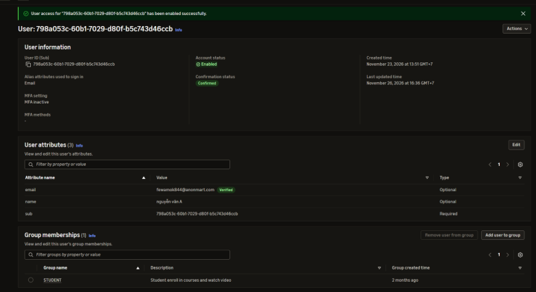


